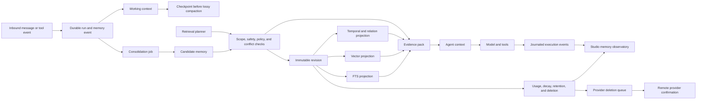
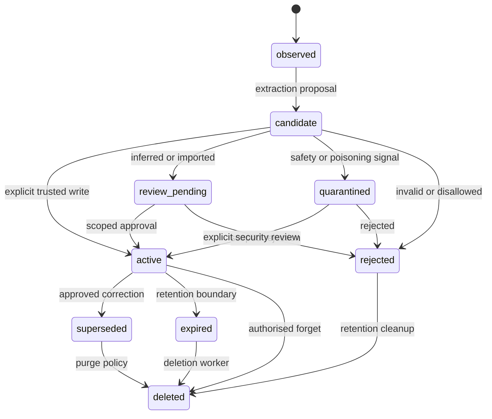
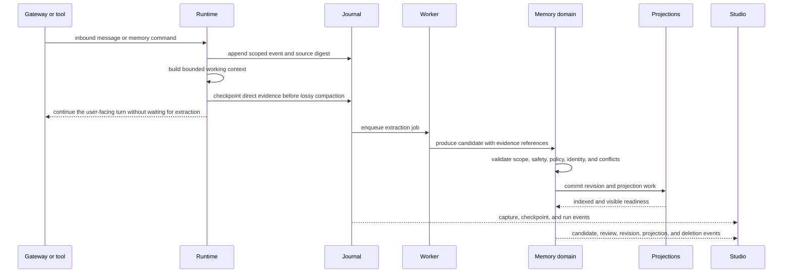
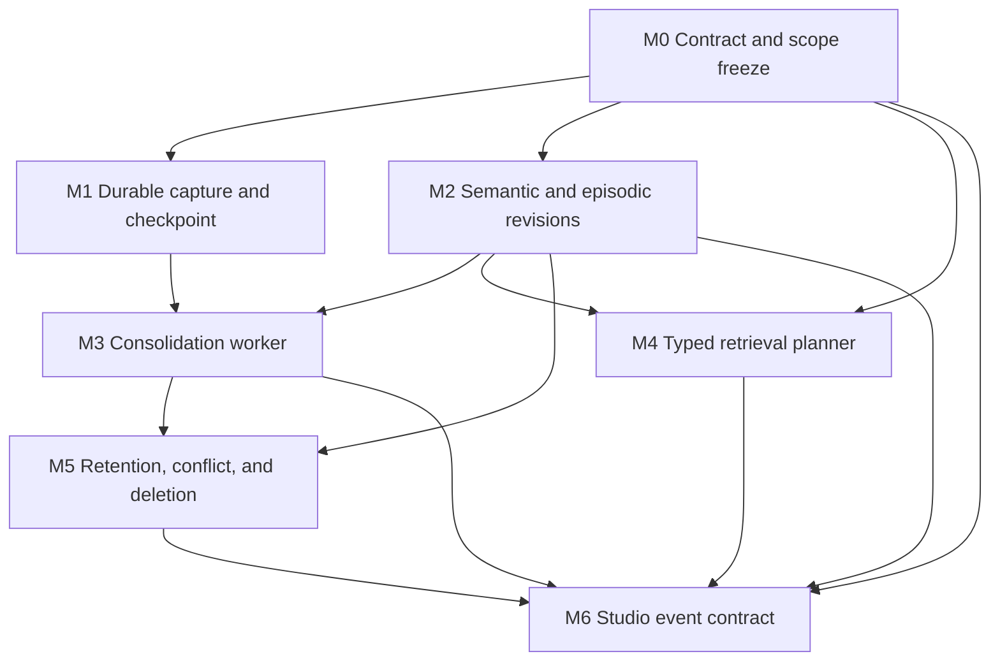

# Agent memory architecture and implementation plan

**Status:** Active implementation; backend M0-M6 slices implemented, cutover and release gates remain

**Owner:** Agent Platform

**Last updated:** 2026-09-08

**Risk:** High

**Depends on:** P02 tenant control plane and host adapters, P03 durable operation kernel, P01 execution journal

**Related packages:** P08 context, knowledge, and memory; P14 full Agent Canvas and Execution Observatory

**Execution checklist:** [`Agent memory architecture implementation checklist`](https://github.com/Kasitek-Labs/kasitek-growth/blob/main/docs/plans/completed/AGENT_MEMORY_ARCHITECTURE_IMPLEMENTATION_CHECKLIST.md)

## Implementation status

The first implementation slices are now in the working tree: the versioned memory contracts and
scope validators, durable source-event/checkpoint schema and runtime adapter, immutable semantic
and episodic revision foundation, typed retrieval planner and v2 retrieval adapter, explicit v2
memory commands, v2 consolidation worker, rebuildable projections, and scoped deletion workflow.
The runtime checkpoint and typed retrieval seams are wired through the context loop; journal events
are captured into the durable source boundary, and memory retrieval has a typed preflight boundary
before grounding admission. Source and checkpoint scope is also enforced in PostgreSQL. M5
retention evaluation, immutable expiry, quality events, decay/revalidation queues, conflict
detection, and a provider-deletion queue are implemented. Live PostgreSQL/Temporal/provider gates,
backfill execution, and release evidence remain open; Studio UI work is still deferred to P14.

## Objective

Replace the current shallow memory model with one durable, tenant-scoped memory domain that can
capture evidence, propose memories, preserve corrections, retrieve only authorised evidence, and
explain every decision in the Studio.

The result must work for KasiAI, protected system agents, customer-created agents, guided agents,
workflow agents, child agents, and every supported channel. It must remain correct when workers
restart, model extraction fails, providers are eventually consistent, context is compacted, a fact
changes, a tenant deletes data, or two sessions update the same subject at once.

This is an architecture replacement, not a layer on top of the existing `memory_records` table.
Existing memory behaviour is evidence for migration and tests. It is not a contract to preserve
when it conflicts with the model below.

## Source authority

This plan is grounded in the local source audit recorded in
`docs/plans/agents/HERMES_WAKU_MEMORY_RESEARCH.md`.

The design uses Hermes as the runtime reliability reference and Waku as the memory taxonomy and
contract-testing reference:

- Hermes supplies bounded prompt memory, searchable transcript separation, provider lifecycle
  hooks, serialized asynchronous writes, profile isolation, context fencing, and fail-closed
  checkpoints before lossy compression.
- Waku supplies explicit working, semantic, episodic, and procedural memory types, retrieval
  gating, thresholded consolidation, backend conformance tests, and the distinction between a
  write being accepted and being searchable.
- KasiTek supplies the tenant, installation, policy, approval, knowledge, Temporal, PostgreSQL,
  and execution-journal foundations that neither reference system provides at platform scale.

The plan does not copy either repository or add either project as a runtime dependency.

## Reference refresh requirement

The implementing agent must re-read the relevant Hermes and Waku source files before starting each
M0-M6 package and whenever a lifecycle, interface, failure mode, or scope decision changes. The
execution checklist contains the exact reference set and a checkpoint template. A package cannot be
marked complete without recording which reference revision was consulted, what was adopted or
rejected, and which test protects any divergence.

## Current baseline and what will be removed

KasiTek currently has three memory-like paths: conversation transcript and summaries,
`memory_records`, and knowledge grounding. They are combined at runtime but do not share one
coherent lifecycle. The repository already has useful scope checks, review states, poisoning
signals, hybrid retrieval, and consolidation jobs. The upgrade keeps those safety ideas while
replacing the underlying model.

The following behaviours are explicitly retired or replaced:

| Current behaviour | Replacement |
| --- | --- |
| `working`, `semantic`, and `episodic` records behave almost the same | Separate lifecycle and retrieval semantics for working, episodic, semantic, procedural, and knowledge data |
| One record can act as proposal, active fact, and retrieval row | Immutable source events, candidates, revisions, relations, and rebuildable projections |
| Preference fact keys include the value | Stable subject/predicate/scope fact keys with value revisions |
| Phrase-based retrieval classification | Typed retrieval planner with deterministic prefilter, measured gate, and safe fallback |
| Direct memory search has a different lexical path | All automatic and tool-initiated retrieval goes through one planner and evidence pack |
| Expiration can leave queued purge work without a consumer | Durable deletion workflow with projection and provider receipts |
| Summary and long-term memory promotion is implicit | Explicit rule for what remains context, becomes episodic evidence, or becomes semantic memory |
| Hard deletion paths have inconsistent accounting | One scoped forget workflow with legal holds, receipts, and redacted audit events |
| Memory can be inspected only through backend APIs | Studio memory observatory backed by the same journal and projections as execution |

The old table and code paths are not deleted until the migration and rollback gates below pass.
There will be no permanent dual-writer architecture.

## Non-negotiable invariants

1. **The durable event log is the capture truth.** A context summary, vector row, rendered prompt,
   or provider response is never the only copy of evidence.
2. **Every read is scoped.** Organization, workspace, agent, version, installation, conversation,
   end-user, and namespace are explicit. A null or missing scope never means “global.”
3. **Only active, authorised revisions are retrievable.** Candidates, quarantined records,
   rejected records, superseded records, expired records, and deleted records are excluded by the
   repository query, not only by caller convention.
4. **Corrections preserve history.** A correction creates a new revision and an explicit
   supersession relation. It does not silently overwrite or erase the old claim.
5. **Procedural memory is not factual memory.** Instructions, skills, and policies use a separate
   approval and deployment path and are never promoted by ordinary fact extraction.
6. **Extraction is asynchronous; capture is not.** A model or provider outage cannot make the
   source conversation disappear or make a run wait indefinitely for consolidation.
7. **Every retry is idempotent.** A worker retry, provider retry, or compaction retry must not
   duplicate a candidate, revision, event, or external write.
8. **“Written” has multiple meanings.** The system distinguishes accepted, committed, indexed, and
   retrieval-visible.
9. **Authorization failures fail closed.** A normal search-provider failure may use a bounded,
   observable fallback. A scope or policy failure may not return evidence.
10. **The Studio shows facts from durable events.** It must not invent memory stages, counts,
    latency, readiness, or evidence in the browser.

## Target architecture



The canonical memory domain has these logical records. The physical schema may combine tables
where that gives better locality, but it must preserve these responsibilities:

```text
memory_events       immutable observations and user/agent actions
memory_candidates   extracted propositions awaiting validation
memory_revisions    immutable semantic, episodic, or procedural revisions
memory_relations    supports, contradicts, supersedes, derived-from, about
memory_projections  FTS, vector, graph, and readiness state
memory_usage        retrieval, confirmation, correction, and decay signals
memory_deletions    durable purge workflow, legal holds, and receipts
provider_deletions  remote-provider delete queue and confirmation receipts
```

The canonical PostgreSQL records are authoritative. Search indexes, embeddings, graph views,
exported files, and provider copies are projections or adapters.

## Domain model

### Memory classes

#### Working context

Working context is the bounded projection used to answer the current turn. It includes recent
messages, tool results, selected workspace state, approvals, and temporary scratch. It is not
long-term memory. Compaction may change the working projection, but it may not destroy the source
events or effect evidence that produced it.

#### Episodic memory

An episode records what happened, when it happened, who or what was involved, the run and
conversation that produced it, and the evidence supporting the summary. Episodes answer historical
questions and support continuity. They do not become current facts merely because they are recent.

#### Semantic memory

A semantic revision is a durable proposition about a subject, preference, project, customer, or
relationship. It has a stable fact key, validity interval, provenance, confidence, sensitivity,
and revision lineage. A newer value supersedes an older value without erasing it.

#### Procedural memory

Procedural memory contains agent instructions, skills, policies, and workflows. It has its own
version, approval, publication, and rollback lifecycle. It is loaded through a trusted channel,
not inserted into factual evidence as if it were a customer statement.

#### Knowledge grounding

Knowledge is tenant-owned source material with document, revision, chunk, citation, and ingestion
lineage. It remains a separate domain even when a retrieval plan combines it with memory.

### Scope tuple

Every memory record and every retrieval request carries an explicit scope tuple:

```text
organization_id
workspace_id
agent_definition_id
agent_version_id
installation_id
conversation_id       optional for shared memory, required for conversation memory
end_user_id           optional for workspace or agent memory
namespace
```

Recommended namespaces:

| Namespace | Meaning | Default visibility |
| --- | --- | --- |
| `conversation` | Facts and events for one conversation lineage | Same conversation only |
| `end_user_private` | Durable facts about one customer or user | Agents authorised for that user |
| `workspace_shared` | Tenant-approved shared business facts | Agents authorised by workspace policy |
| `agent_private` | Internal learnings for one installation or agent | That agent and its operators |
| `procedural` | Agent behaviour and workflow definitions | Runtime control plane only |
| `knowledge` | Tenant-owned source documents and chunks | Knowledge policy |

Cross-scope reads require an explicit policy decision. A provider account, vector namespace, or
database connection is never the tenant boundary.

### Claims and stable fact identity

The extractor must return a structured claim rather than a sentence-only record:

```text
subject       normalized entity or subject id
predicate     normalized relationship or property
value         typed value or bounded text
fact_key      scope + namespace + subject + predicate
valid_from    when the claim became true, if known
valid_to      when it stopped being true, if known
```

The value is not part of `fact_key`. “Prefers concise replies” and “prefers detailed replies”
must compete as revisions of one preference, not become unrelated active rows.

### Lifecycle states



State transitions use an expected revision/version. A stale reviewer or worker receives a typed
conflict and must reload; it may not win by overwriting the newer transition.

### Readiness states

Every revision has separate timestamps or states for:

```text
accepted_at       request accepted by the command boundary
committed_at      canonical revision committed
indexed_at        required lexical/vector projections committed
visible_at        retrieval may return the revision
```

An external provider may add `provider_accepted_at` and `provider_visible_at`. “Saved” must never
mean “searchable immediately” when the adapter is eventually consistent. Provider projection
adapters must acknowledge one matching lifecycle state (`accepted`, `indexed`, `visible`, or
`deleted`) and a stable provider record ID for upserts. A response that mixes states, omits the
remote identity, or reports a non-deleted delete is a non-retryable contract failure; it must not
advance local readiness or provider receipts. Provider-specific API conformance still runs against
each real adapter before staging.

## End-to-end lifecycle



The source event remains eligible for retry when extraction fails. A worker marks it processed only
after the candidate transaction and its idempotency record commit.

## Work packages

The packages below are implementation chunks. Each has a narrow interface, a coherent set of
tests, and a manual proof. Work can run in parallel only after the contract it consumes is frozen.

### M0 — Memory contract and scope freeze

**Outcome:** Every caller can name the memory type, scope, state, provenance, and evidence contract
without reading a repository implementation.

**Implement:**

- Define the domain types above in the shared Agent Platform contract package.
- Define event, candidate, revision, relation, projection, usage, and deletion interfaces.
- Define scope construction and authorization predicates for organization, workspace, agent,
  version, installation, conversation, end-user, and namespace.
- Define allowed state transitions and optimistic concurrency rules.
- Define the evidence envelope passed to the model and the redacted journal event shape.
- Define source trust, sensitivity, confidence, retention, legal hold, and extraction-version
  fields.
- Define the distinction between summary, episode, semantic claim, procedural instruction, and
  knowledge chunk.
- Add contract fixtures for every namespace and memory type.

**Remove or replace:**

- Do not add new callers to raw `memory_records` queries.
- Stop treating a missing scope as a shared scope.
- Stop exposing a sentence-only “fact” interface as the canonical domain interface.

**Can run in parallel:** Contract review, threat-model review, fixture design, and Studio event
wireframe work can proceed together. No runtime migration starts before M0 is approved.

**Verification:** Type-level contract tests; invalid scope tests; forbidden state-transition tests;
cross-tenant query tests; procedural/factual separation tests; evidence-redaction tests.

**Exit gate:** A review can answer “who owns this memory, why does it exist, what state is it in,
what supports it, and who may read it?” from the contract alone.

### M1 — Durable capture and compaction checkpoint

**Outcome:** Every relevant message, tool result, approval, and memory command has durable source
evidence before it can be compacted, retried, or handed to an asynchronous worker.

**Implement:**

- Use the existing execution journal as the capture seam; add memory-specific event types rather
  than a second transcript store.
- Persist a source digest for the evidence window and an idempotency key for each run/extraction
  boundary.
- Define normalized direct evidence for checkpoints: user and assistant content, direct actor,
  time, conversation, and source references. Exclude duplicated system scaffolding and previous
  summaries.
- Add a pre-compaction checkpoint module. It must either commit the evidence or refuse the lossy
  rewrite when checkpoint enforcement is enabled.
- Preserve tool/effect evidence separately so compaction cannot cause an action to repeat.
- Add durable capture of channel, installation, agent version, and redaction decisions.
- Keep context summaries as working-context projections, never as semantic memory rows.

**Failure behaviour:** Capture is on the critical path and must fail loudly if the source event
cannot be committed. Extraction and projection are not on the user-facing critical path. A missing
checkpoint blocks compaction but does not delete the transcript.

**Can run in parallel:** Journal event schema, checkpoint adapter, and context-runtime integration
can be developed in parallel against M0 contracts.

**Verification:** Worker restart during capture; duplicate delivery; concurrent append; compaction
with new messages arriving; checkpoint retry with the same digest; checkpoint provider failure;
tool/effect evidence preserved after compaction; no duplicate event after Temporal retry.

**Exit gate:** A run can be replayed after process and worker loss, and a compaction attempt cannot
discard evidence that the memory pipeline still needs.

### M2 — Semantic and episodic revisions

**Outcome:** Durable memory has real meaning instead of treating all record types as interchangeable
rows.

**Implement:**

- Add canonical semantic revision storage with stable `fact_key`, typed value, validity interval,
  confidence, source trust, sensitivity, and lineage.
- Add canonical episodic storage with event time, summary, participants, outcome, source refs, and
  historical retrieval metadata.
- Add relation storage for `supports`, `contradicts`, `supersedes`, `derived_from`, and `about`.
- Add explicit commands for remember, correct, forget, approve, reject, revalidate, and inspect.
- Route existing explicit memory writes through this domain module.
- Map existing active, review-pending, quarantined, rejected, superseded, and expired records into
  the new states without losing their original provenance.
- Keep procedural memory and knowledge grounding behind their own interfaces.

**Conflict model:** A correction names the prior revision or fact key. If two writers race, the
second candidate becomes a conflict requiring review. Historical questions query validity time;
current questions query the active revision.

**Verification:** Preference replacement; customer address change; “what was true last month?”;
simultaneous corrections; duplicate explicit remember; imported and inferred review paths;
procedural promotion rejection; relation and lineage reconstruction; tenant and user-private
scope checks.

**Exit gate:** “What is true now?”, “what was true then?”, “why do we believe it?”, and “what did
the correction replace?” have deterministic answers.

### M3 — Durable consolidation worker

**Outcome:** Model-assisted extraction becomes a reliable, retryable proposal pipeline rather than
a synchronous side effect attached to a turn.

**Implement:**

- Replace or extend the current consolidation job with durable job fields for source run,
  extraction version, evidence digest, lease owner, attempt count, next attempt, terminal reason,
  and dead-letter state.
- Keep the Waku rule that only the exact captured source IDs are marked processed. Late-arriving
  messages remain eligible for the next job.
- Borrow Hermes’ session-end and pre-compression flush hooks for evidence that must be extracted at
  a boundary even when the batch threshold is not reached.
- Run deterministic filters and poisoning checks before model extraction.
- Require structured output containing type, fact key, value, evidence spans, confidence,
  sensitivity, retention suggestion, and proposed relations.
- Default inferred and imported candidates to `review_pending`; automatic mode may change proposal
  timing, not silently bypass governance.
- Persist model/provider metadata and parser version without persisting unnecessary raw prompts in
  logs.
- Use an outbox for candidate and projection work. Do not call external memory providers inline.

**Failure behaviour:** Model timeout, malformed output, provider outage, or validation failure leaves
the source event available. A terminal rejection records a reason code. A retry with the same digest
must upsert the same candidate rather than create another one.

**Can run in parallel:** Worker implementation and extraction-evaluation fixtures can proceed after
M1 and M2 contracts are stable. Retrieval planning can be developed against candidate fixtures.

**Verification:** Retry and lease expiry; worker replacement; malformed model output; late messages;
duplicate extraction; extraction-version change; poisoned content; dead-letter replay; shutdown
with queued work; provider eventual-consistency readiness.

**Exit gate:** A failed or repeated extraction never loses evidence or creates duplicate durable
memory.

### M4 — Typed retrieval planner and evidence pack

**Outcome:** Every automatic or tool-initiated retrieval uses one policy-aware, explainable planner.

**Implement:**

- Replace phrase-only retrieval classification with a typed plan containing decision, rewritten
  query, scopes, memory types, freshness, result and token budgets, and reason.
- Use a deterministic prefilter for obvious no-memory requests and a small-model gate for ambiguous
  requests. Gate failure may use bounded fallback retrieval; authorization failure always blocks.
- Route `memory_search`, runtime retrieval, knowledge grounding, and future Studio previews through
  the same planner seam.
- Apply scope and state filters before ranking or rendering.
- Run lexical, vector, structured fact-key, entity, and temporal candidate searches in parallel
  where available.
- Merge by stable revision ID, resolve supersession and validity, penalize contradictions, and
  enforce source diversity and token budgets.
- Return an evidence pack containing revision IDs, scores, provenance, validity, confidence,
  rejection reasons, and measurement basis. Render that pack into a fenced untrusted context block.
- Keep procedural instructions on a separate trusted path.
- Record query class, planner revision, selected IDs, excluded reasons, latency, and token count in
  the journal without logging sensitive text.

**Ranking starting point:** lexical relevance, semantic similarity, fact-key/entity match, current
validity, scope specificity, source trust, confidence, confirmation history, correction history,
contradiction penalty, and freshness. Weights must be versioned and evaluated, not hard-coded in
callers.

**Verification:** Implicit memory questions; no-evidence responses; lexical/vector disagreement;
current versus historical questions; contradiction resolution; direct tool parity; cross-tenant and
cross-user attacks; poisoned evidence; provider timeout; budget trimming; deterministic replay of
the same plan.

**Exit gate:** The model can be shown exactly which evidence was selected, why it was selected, what
was excluded, and whether the result was current, historical, or absent.

### M5 — Retention, decay, conflict, and deletion

**Outcome:** Memory can become stale, be corrected, forgotten, or purged without leaving hidden
rows, embeddings, provider copies, or misleading retrieval state.

**Implement:**

- Add a retention scanner that marks records expired according to organization, workspace,
  namespace, type, and per-record policy.
- Add usage and feedback events for retrieval, confirmation, correction, rejection, and helpfulness.
- Use decay for ranking and revalidation priority. Decay must not silently change truth or delete a
  memory without an explicit policy.
- Add conflict detection by stable fact key, subject/entity overlap, validity overlap, and explicit
  correction commands.
- Add a durable deletion worker with leases, retry, legal-hold checks, canonical purge, FTS/vector/
  graph cleanup, and an external-provider deletion queue that survives canonical purge.
- Unify conversation, agent, organization, and user deletion through the same deletion workflow.
- Expose deletion states: requested, held, canonical_purged, projections_purged,
  providers_confirmed, and completed.
- Keep deletion receipts free of deleted content. Store only IDs, hashes, scope, timestamps, and
  outcome codes.

**Verification:** Expiration and revalidation; legal hold; user forget; tenant purge; provider
delete timeout; projection lag; retry after partial purge; no retrieval after canonical expiration;
no residual vector or FTS row; deletion audit without sensitive data.

**Exit gate:** “Forget this” has a durable, observable completion state and no supported read path
can return the forgotten content after completion.

### M6 — Studio event contract and handoff to the runtime observatory

**Outcome for this memory upgrade:** The runtime emits the complete, durable event and projection
contract that Studio will render. This memory upgrade does not own the Studio canvas, timeline,
inspector, or visual styling. The visual work is tracked in the standalone [`Studio runtime
observatory and promotion update`](https://github.com/Kasitek-Labs/kasitek-growth/blob/main/docs/plans/completed/AGENT_STUDIO_RUNTIME_OBSERVATORY_UPDATE_PLAN.md),
which joins memory with context telemetry, tools, skills, plugins, MCP, approvals, child runs,
delivery, and Playground-to-Live promotion.

The goal is to fix the source of the repeated or meaningless nodes first. When a user sends a
message, the runtime must record each real stage, in order, so a later Studio implementation can
show the message entering, context and memory being selected, tools being called, approvals being
resolved, outputs being delivered, and memory being consolidated or projected. The browser must not
invent those stages.

**Target Studio memory view:**

```text
Top bar: agent · version · environment · run/session/revision selector
Main canvas: generated execution graph and memory revision lineage
Bottom timeline: ordered journal events, collapsed by default but expandable
Right inspector: selected stage, source evidence, policy, scope, state, timing, retries, readiness
```

The future canvas must support at least these real node types:

```text
capture event
working-context selection
compaction checkpoint
consolidation job
candidate extraction
safety and policy decision
review or approval
semantic revision
episodic revision
supersession or contradiction
FTS projection
vector projection
provider visibility
retrieval plan
evidence selected / rejected
retention or deletion
```

For this memory upgrade, implement the node and edge contract, projections, and fixture streams.
Each future node has a durable event ID, status, timestamps, scope summary, source references,
retry count, error code, and readiness state. The future inspector can show redacted evidence and
lineage only to an authorised operator. It must never fetch raw customer content merely to draw the
graph.

The graph supports two modes:

1. **Run view:** Follow one turn from capture through retrieval, model/tool use, consolidation,
   projection, and deletion decisions.
2. **Memory view:** Follow one revision from source events through candidates, approvals,
   supersession, retrieval uses, retention, and purge.

The UI must not show a node for a stage that did not happen. If a provider is still processing, the
node shows `accepted` or `indexing`, not `complete`. If evidence is unavailable after compaction,
the view shows that fact as an explicit blocked state. M6 defines these semantics; P14 implements
them visually.

**Control contract:** Review, approve, reject, revalidate, correct, retry projection, retry
extraction, and request deletion may be exposed only when the backend exposes the corresponding
tested transition. M6 defines the command and acknowledgement events. P14 owns the controls and
their visual implementation. No browser-only shortcut may mutate memory.

**Verification for M6:** Projection contract tests; event order; cursor replay; partial projection;
provider lag; redaction; cross-tenant projection access; and fixture streams for worker failure,
retry, conflict, compaction, and deletion. Responsive layout, keyboard navigation, and visual
controls are deferred to P14.

**M6 exit gate:** The backend can provide a complete, scoped, replayable memory event stream and
revision lineage to Studio without browser-derived state. An operator can later explain why a
memory exists, why an agent saw it, which source supported it, what state it is in, and how to
remove it from the P14 observatory.

**Studio handoff:** Keep these requirements in the Studio update plan and P14 execution checklist,
not in the memory migration critical path:

- implement the Studio two-pane Playground layout against the memory and runtime projections;
- render the graph as the primary surface with a collapsed timeline and selected-node inspector;
- add run and revision selectors without mutating runtime state;
- expose authorised review, correction, retry, revalidate, and delete controls;
- implement responsive desktop/tablet/keyboard behaviour;
- manually replay real runs so the graph shows every actual stage rather than repeated placeholder
  context nodes.

The Studio plan is the visual integration point. Memory remains responsible for memory event
semantics and lineage. Context remains responsible for request manifests, fit decisions, compaction,
usage, and timing. Capability and extension runtimes remain responsible for tool, skill, plugin,
MCP, and provider events. Studio only composes their projections into one authorized view.

## Dependency map and parallel delivery lanes



Recommended lanes:

| Lane | Work | Start condition | Required handoff |
| --- | --- | --- | --- |
| Contracts | M0 types, scope, states, evidence | Immediately | Frozen contract and fixtures |
| Capture | M1 journal/checkpoint | M0 | Source digest and checkpoint events |
| Domain | M2 revisions/relations | M0 | Revision and state-transition interface |
| Extraction | M3 jobs and candidates | M1 + M2 | Candidate idempotency and worker evidence |
| Retrieval | M4 planner/projections | M0, production after M2 | Evidence pack contract |
| Governance | M5 retention/deletion | M2, production after M3 | Deletion receipts and legal-hold semantics |
| Observatory contract | M6 event and projection contract | M0 event vocabulary; integration after M1-M5 | Journal-backed run and memory projections |
| Studio UI | P14 follow-on | M6 contract and real event fixtures | Existing shell renders every real stage; no placeholder nodes |

M1 and M2 are the first implementation critical path. M4 can be developed against stable fixtures
while M3 is being built. The current Studio remains available for runtime work, but the visual graph
expansion and memory inspector wait for P14 after real event and revision data exists.

## Migration and removal strategy

### Preparation

- Freeze the M0 contract and create additive schema migrations.
- Snapshot existing memory records, summaries, knowledge metadata, and deletion state.
- Record the source migration version and a checksum for every migrated record.
- Add a read-only legacy inspector for migration diagnostics; do not make it a second runtime.

### Backfill

- Convert active records into immutable active revisions with `legacy_backfill` provenance.
- Convert review-pending and quarantined records into candidates with their original safety state.
- Convert supersession information into relations and preserve original IDs in `legacy_reference`.
- Keep conversation summaries as summaries. Do not promote every summary into semantic memory.
- Rebuild lexical and vector projections from canonical revisions instead of copying old index rows.

### Cutover

- Route explicit memory commands through the new domain module.
- Route runtime and tool retrieval through the typed planner.
- Route expiration and deletion through the new workflow.
- Enable by agent version and environment, with independent scoped operator kill switches for
  automatic extraction (`memory_consolidation_enabled`), retrieval
  (`memory_v2_retrieval_enabled`), explicit v2 writes (`memory_v2_writes_enabled`), and projection
  (`memory_projection_enabled`).
- Compare event counts, scope results, candidate counts, projection lag, and retrieval decisions
  during the soak period.

### Decommission

- Stop all old writers before removing the old schema path.
- Retain the legacy reference and migration evidence for the agreed retention period.
- Drop old tables only in a later release after rollback no longer depends on them.
- Remove compatibility adapters and feature flags when their exit conditions are recorded.

## Evaluation and test fixtures

The implementation must include deterministic tests and model-quality evaluations.

### Deterministic fixtures

1. A customer first says they prefer email, then corrects it to WhatsApp. Current retrieval returns
   WhatsApp; historical retrieval can still find email with its validity interval.
2. Two installations in one organization have similarly named customers. Neither can read the
   other's private memory.
3. A poisoned imported memory contains an instruction to reveal credentials. It is quarantined and
   never enters model context.
4. A worker dies after candidate creation but before projection. Retry creates no duplicate and
   eventually marks visibility correctly.
5. A compaction starts while a new message arrives. The checkpoint and child context preserve both
   evidence ranges without duplicate extraction.
6. A vector provider accepts a write but becomes searchable later. Studio shows accepted/indexing/
   visible rather than claiming immediate success.
7. A user requests deletion under a legal hold. The record remains held, is not retrieved if policy
   requires exclusion, and the receipt contains no deleted content.
8. A correction races with an approval. Optimistic concurrency prevents the stale transition from
   winning.
9. Direct `memory_search` and automatic retrieval return the same scoped evidence semantics.
10. A retrieval gate fails. A bounded safe fallback occurs; a scope authorization failure does not.

### Quality measures

- capture-to-active latency;
- capture-to-visible latency;
- extraction success, retry, and dead-letter rates;
- duplicate and conflict rates;
- retrieval precision, recall, no-evidence correctness, and stale-memory rate;
- cross-tenant leakage attempts and blocked reads;
- projection lag and provider readiness failures;
- deletion completion lag and residual-index checks;
- memory token contribution, provider latency, and context-pressure impact.

## Release and operational record

This is a high-risk platform/data change. Each implementation release must complete the repository
release process and record the following:

| Release field | Decision for this plan |
| --- | --- |
| Change | Replace memory capture, lifecycle, retrieval, retention, deletion, and Studio observability with the M0-M6 architecture |
| Owner | Agent Platform, with Security, Operations, and Tenant Platform review |
| Risk | High |
| Affected services and surfaces | Agents runtime, PostgreSQL migrations, Temporal workers, provider adapters, Studio event/projection contracts, internal/API docs; visual Studio changes are deferred to P14 |
| Version identity | Platform release ID, migration version, agent version, worker artifact, and configuration revision |
| API/schema changes | New memory domain contracts, event types, revision/projection/deletion schema, and retrieval evidence envelope |
| Rollout | Staged by environment and agent version; independent flags for capture, extraction, retrieval, projection, and autonomous promotion |
| Analytics | Register candidate, review, retrieval, projection, conflict, deletion, and checkpoint outcome events with redacted identifiers |
| Logs/metrics/alerts | Queue age, projection lag, checkpoint failures, wrong-scope blocks, provider failures, deletion lag, and dead-letter growth |
| Documentation | Update internal architecture, API contracts, operator runbooks, Studio event/projection documentation, and public memory behaviour only when released |
| Validation | Unit, repository, migration, Temporal, provider conformance, isolation, redaction, deletion, and event/projection replay checks; visual Studio checks are P14 |
| Rollback | Disable new promotion/retrieval/projection flags, preserve the append-only source journal, stop new workers safely, and promote the last tested artifact; do not rely on destructive rollback migrations |
| Post-release review | Review queue age, retrieval quality, leakage tests, deletion receipts, and operator feedback before removing compatibility code |

Analytics and logs must contain IDs, hashes, bounded error codes, release identity, and timing, not
full customer messages, tokens, credentials, or deleted memory content.

## Decisions made by this plan

1. Hermes is the reliability spine; Waku is the memory taxonomy and contract-testing reference.
2. Canonical PostgreSQL events and revisions are the source of truth. Search indexes and external
   providers are projections or adapters.
3. Inferred and imported memories default to review pending. “Automatic” controls proposal timing,
   not silent activation.
4. Semantic corrections are immutable revisions with validity intervals and explicit supersession.
5. Scope and authorization are enforced before retrieval ranking.
6. Factual memory is fenced as untrusted evidence. Procedural memory uses a separate trusted path.
7. Checkpoint failure blocks lossy compaction when enforcement is enabled.
8. Deletion means more than “not returned by search.” The platform tracks canonical purge,
   projection purge, provider confirmation, legal holds, and completion.
9. Studio visualization is a runtime contract and an operations surface, not a decorative frontend
   feature.

## Open decisions before M0 closes

| Topic | Recommended starting decision | Owner | Status |
| --- | --- | --- | --- |
| Workspace scope | Make workspace explicit and mandatory for new platform records; installation scope resolves the workspace for command paths | Agent Platform + Tenant Platform | Decided in M0; covered by scope validation and PostgreSQL policies |
| Agent-version visibility | New revisions are scoped to the creating agent version unless policy explicitly promotes them; null version is reserved for explicitly shared records | Agent Platform | Decided in M2; covered by revision and retrieval scope tests |
| Default autonomous promotion | Keep inferred/imported candidates review pending; automatic mode controls proposal timing, not activation | Product + Security | Decided; enforced by consolidation and lifecycle tests |
| Embedding model/index | Use the existing internal 1,536-dimension embedding path behind the projection interface; rebuildability is mandatory | Agent Platform | Decided in M4; projection/readiness tests cover provider lag |
| External provider adapters | Canonical storage first; add adapters only after conformance tests exist; acknowledgements must preserve provider lifecycle state and idempotent remote identity | Platform Integrations | Local adapter contract is enforced by projection worker tests; real provider and staging conformance remain open |
| Sensitive memory | Store only under explicit policy, redact before embedding, and never include raw secrets in evidence | Security + Privacy | Decided in M0/M4; redaction, poisoning, and projection tests cover it |
| Retention defaults | Organization policy is authoritative; no new hard-coded global retention | Tenant Platform + Privacy | Decided in M5; retention evaluation tests cover precedence |
| Studio first view | Run view first, then revision lineage view using the same event graph | Agent Platform + Design | Recommended |

## Completion definition

This plan is complete only when all M0-M6 exit gates are recorded, the migration has passed its
soak and rollback checks, the old memory writers are removed, and the backend can provide a complete
scoped event and revision lineage for the later P14 Studio observatory. The visual Studio expansion
is not part of this memory rollout.
