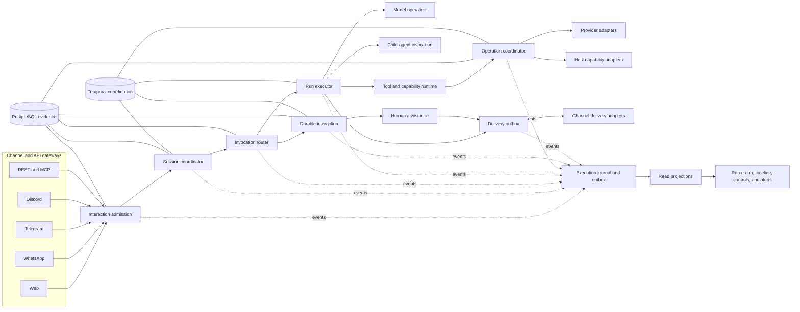
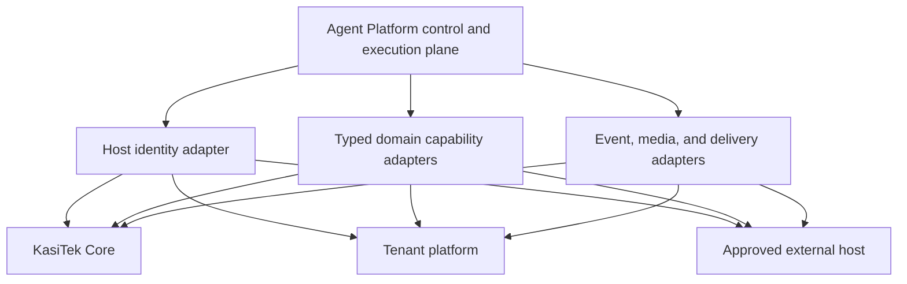
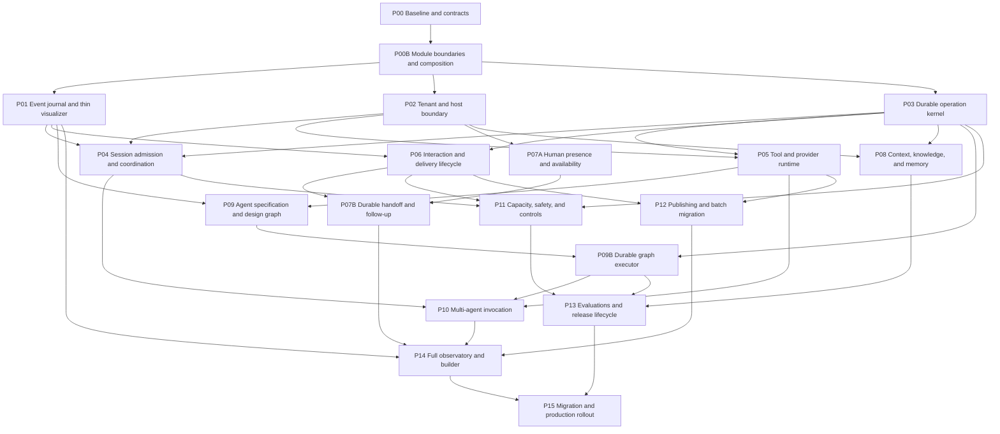
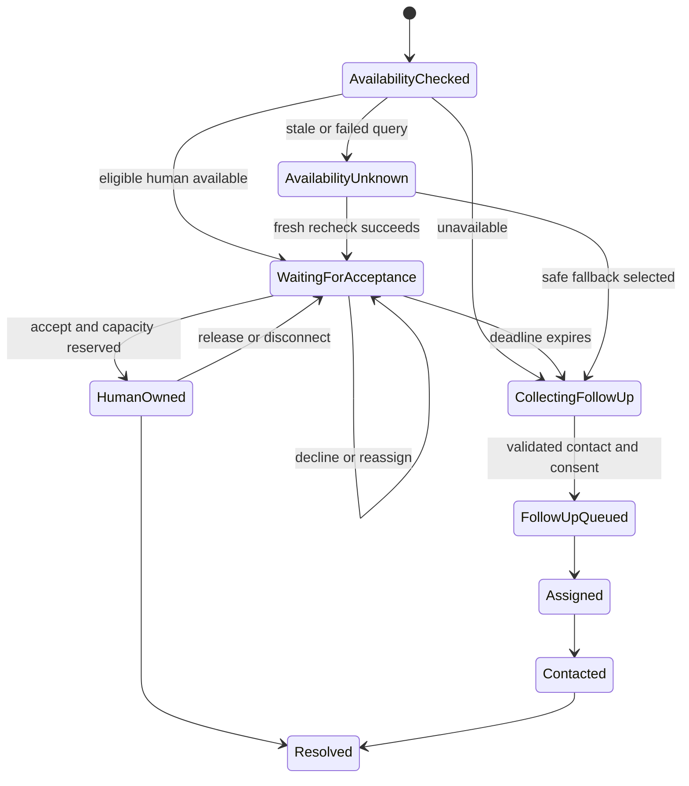

# Agent Platform implementation plan

**Status:** Active planning; first chunk complete locally, later chunks planned

**Owner:** Agent Platform

**Last updated:** 2026-09-06

**Risk:** High

## Purpose

This is the canonical implementation map for the next Agent Platform architecture. It turns the
architecture audit, execution and session research, provider work, current agent capabilities, and
human-assistance requirements into ordered work packages that can be implemented, reviewed, and
verified separately.

This plan replaces the earlier agent architecture plans as the source of future implementation
scope. Those documents remain evidence about the current system and prior decisions. They are not
parallel plans.

This is a deliberate Agent Platform rewrite. Existing code, behavior, routes, UI, error messages,
and runtime paths are reference material, not compatibility constraints. Batch publishing, tool
readiness, knowledge grounding, handoff, approvals, channel gateways, and durable runs may be
reimplemented or removed when the new runtime contracts require it. Existing tests may be replaced
with tests for the new behavior.

The rewrite preserves only invariants explicitly required by the new architecture: tenant and
credential isolation, authorization, durable evidence, effect safety, and the repository release
process. There is no requirement to maintain a legacy runtime, dual execution path, fallback
implementation, or current UI behavior.

## Rewrite strategy

- Build the new Agent Platform as the source of truth rather than wrapping the current runtime.
- Remove obsolete modules, direct Core dependencies, duplicate paths, and dead contracts once their
  replacements are established.
- Do not add compatibility flags, legacy fallbacks, dual writers, or mixed runtime paths merely to
  preserve existing implementation behavior.
- Treat the current UI as disposable. Rebuild it around the new runtime contracts and execution
  evidence; existing screens may survive only when they still serve the new model.
- Implement the runtime and data contracts first. The UI consumes those contracts and does not
  determine the architecture.
- Use the new system's manual proofs and conformance tests as the acceptance criteria, not parity
  with known-broken behavior.
- Deployment rollback remains an operational release control, but it is not a runtime compatibility
  strategy and does not require preserving the old architecture indefinitely.

## How to read this plan

This document has two levels:

1. **Stages** explain the work in a user-understandable sequence. Each stage has a practical
   outcome, a manual proof, and an exit gate.
2. **Work packages** contain the technical implementation detail, dependencies, contracts, and
   automated verification for that stage.

Read the stage map first. Use the package sections when a stage is ready to implement. A stage is
not complete because code merged or a unit test passed; it is complete only after the manual proof,
automated verification, operational evidence, and exit gate are recorded.

The stages are a verification sequence, not a requirement that every engineering task run in
strict isolation. Supporting work may proceed in parallel when it uses a stable contract and does
not bypass the exit gate for the capability it depends on.

## Planning and status rules

Each work package uses one of these states:

- `planned`: scoped here, with no implementation assumed.
- `active`: an implementation plan has moved to `docs/plans/active/` and code work has started.
- `verified`: its exit evidence has been recorded and the implementation plan has moved to
  `docs/plans/completed/agents/`.
- `blocked`: an explicit unresolved decision or dependency prevents implementation.

This document stays in `docs/plans/agents/`. When a package starts, create one short execution
checklist in `docs/plans/active/` that links back to the package. Do not fork the architecture into
another umbrella plan.

## Outcome

KasiTek agents should be able to accept work from multiple channels, keep the correct tenant and
conversation context, perform long-running work through durable operations, coordinate tools,
humans, providers, MCP servers, and other agents, and expose enough execution evidence to explain
and safely control every run.

The target has five runtime properties:

1. **Durable execution:** completed steps survive worker loss and external effects are not repeated.
2. **State and session coordination:** work is ordered within one conversation and concurrent across
   unrelated sessions.
3. **Communication and flow control:** agents, people, tools, and external systems use one invocation
   model with explicit deadlines, capacity, and ownership.
4. **Observability and control:** every run has a durable journal, an execution graph, and safe
   state-aware controls.
5. **Production safety:** approvals, retries, uncertain effects, escalation, compensation, release
   identity, rollout, and rollback are part of the runtime contract.

Temporal remains the durable workflow runtime unless measured failure tests show that it cannot
meet these contracts. PostgreSQL remains the source of truth for tenant data, product state,
idempotency, and queryable execution evidence. This plan adopts the useful execution properties
described by Restate without adding Restate as a second runtime.

## Scope authority

This plan supersedes future implementation direction in:

- `AGENT_PLATFORM_ARCHITECTURE_IMPROVEMENT_PLAN.md`;
- `AGENT_EXECUTION_SCALING_AND_SESSION_ARCHITECTURE_PLAN.md`;
- the architecture sections of the batch publishing, tool readiness, and knowledge grounding plans;
- the unfinished architecture recommendations in `AGENT_PLATFORM_ARCHITECTURE_AUDIT.md`.

The comparison and research documents remain references. Existing implementation plans and code are
inputs to understand the system, not commitments to preserve their behavior or structure.

## Conceptual stage map

The program follows this critical path:

```text
Understand the baseline
        ↓
See the system
        ↓
Make execution durable
        ↓
Make one agent runtime reliable
        ↓
Make conversations and delivery reliable
        ↓
Make human assistance reliable
        ↓
Make agents programmable
        ↓
Add bounded multi-agent execution
        ↓
Scale, release, cut over, and remove obsolete paths
```

### Stage 0 — Baseline, ownership, and composition

**Packages:** [P00](#p00-baseline-ownership-and-contract-freeze),
[P00B](#p00b-module-boundaries-and-composition-root)

**Purpose:** Establish what exists, who owns each lifecycle, and where the new contracts will live.

**Manual proof:** Pick one web conversation, one messaging conversation, one tool action, and one
handoff. A developer can identify the owning record, current state, provider boundary, and recovery
evidence for each without guessing from logs.

**Exit gate:** No lifecycle has two proposed owners, and the baseline fixtures and measurements are
recorded before runtime behavior is changed.

### Stage 1 — See the system before changing it

**Package:** [P01](#p01-execution-journal-and-thin-visualizer)

**Purpose:** Establish the event journal, projections, cursor replay, and a thin read-only run view
before migrating execution paths. The view should look like an execution graph or timeline, but it
must be generated from what the harness actually did; simple agents do not need to be authored as
visual blocks.

**Manual proof:** Trace one existing web run and one messaging run from inbound message through
agent execution, tool or human interaction, and outbound delivery. Reconnect the view and resume
from its cursor.

**Exit gate:** A developer can identify the failing module, current state, and next safe action from
the run view without reconstructing the path from unrelated service logs.

### Stage 2 — Durable execution and host boundaries

**Packages:** [P02](#p02-tenant-control-plane-and-host-adapters),
[P03](#p03-durable-operation-kernel)

**Purpose:** Keep the runtime host-independent and make model, tool, provider, delivery, and
compensation boundaries replay-safe.

**Manual proof:** Run a native or direct-provider action without Core, run a Core-owned action with
Core authorization, and inject worker loss or provider timeout at an operation boundary. Inspect the
resulting state and recovery work.

**Exit gate:** Confirmed external effects are not repeated, unknown effects become reconciliation
work, and host boundaries do not cross tenant or authority scope.

### Stage 3 — Reliable single-agent runtime

**Packages:** [P05](#p05-tool-capability-mcp-and-provider-runtime),
[P08](#p08-context-knowledge-and-memory)

**Purpose:** Make a single agent's context, knowledge, memory, tool selection, readiness decision,
and provider call predictable and inspectable.

**Manual proof:** Test a grounded question, a no-evidence question, an authorized tool, a blocked
tool, a provider timeout, and a large tool result. The agent must either produce a supported answer
or state the limitation, while the full execution evidence remains inspectable.

**Exit gate:** Tool readiness and context assembly use shared typed contracts, have tenant isolation
coverage, and do not depend on caller-specific retry or error handling.

### Stage 4 — Reliable conversations and delivery

**Packages:** [P04](#p04-session-admission-and-ordered-coordination),
[P06](#p06-unified-interaction-and-delivery-lifecycle)

**Purpose:** Make same-conversation work queue in order, unrelated sessions run concurrently, and
run completion remain distinct from customer-visible delivery.

**Manual proof:** Send two messages quickly in one conversation and confirm durable ordering. Send
messages in two conversations and confirm independent progress. Cause a delivery failure and verify
that the run is complete but the delivery remains visibly retryable or failed.

**Exit gate:** Ordinary messages no longer fail merely because a conversation is active, and every
supported channel follows the same interaction and delivery lifecycle.

### Stage 5 — Human assistance

**Packages:** [P07A](#p07a-presence-and-effective-availability),
[P07B](#p07b-durable-handoff-escalation-and-offline-follow-up)

**Purpose:** Make availability, handoff, assignment, acknowledgement, follow-up, and resolution
truthful and durable.

**Manual proof:** Request a human from web chat and a messaging channel. Confirm that the customer
receives an acknowledgement, an operator sees the request, a claim reserves capacity, the operator
can send a message, and an unavailable case becomes an owned follow-up item.

**Exit gate:** Every handoff has one current owner, one next action, and a customer- and
operator-visible history.

### Stage 6 — Agent definitions and durable workflows

**Packages:** [P09](#p09-typed-agent-specification-and-design-graph),
[P09B](#p09b-durable-workflow-graph-executor)

**Purpose:** Turn agent configuration and optional visual workflow design into one typed, versioned,
executable contract. A normal custom agent is configured with instructions, tools, knowledge,
memory, and safety policy. An explicit graph is an advanced option for deterministic workflows,
approvals, branching, fan-out, or multi-agent coordination.

**Manual proof:** Create or edit a draft agent, validate it, run a test version, inspect its graph,
pause at a wait or approval, resume it, and confirm that an active run keeps the original version.

**Exit gate:** The design graph and executed graph describe the same pinned plan, including branch,
budget, recovery, and terminal result.

### Stage 7 — Bounded multi-agent execution

**Package:** [P10](#p10-multi-agent-invocation-and-long-running-work)

**Purpose:** Add specialist agents as durable child invocations without introducing an unrestricted
swarm or a second lifecycle.

**Manual proof:** Run a coordinator that delegates two bounded tasks, inspect parent and child
timelines, fail or cancel one child, and confirm the parent receives a typed partial or terminal
result without inheriting the child's full transcript.

**Exit gate:** Child authority, context, budget, deadline, cancellation, and result ownership are
explicit and durable.

### Stage 8 — Scale, production safety, and release

**Packages:** [P11](#p11-capacity-production-safety-and-execution-controls),
[P13](#p13-evaluation-publication-deployment-and-release-lifecycle)

**Purpose:** Make concurrency, fairness, approvals, retries, stuck-work handling, release gates,
canaries, and rollback explicit production controls.

**Manual proof:** Run mixed interactive and batch load, inspect queueing and fairness, pause and
cancel a run, trigger an escalation, publish a candidate agent through its gates, and halt or roll
back a staged release.

**Exit gate:** Scale and incident controls are policy-driven, inspectable, tenant-safe, and covered
by failure-injection and rollback evidence.

### Stage 9 — Rewrite cutover and platform completion

**Packages:** [P12](#p12-publishing-and-batch-execution-migration),
[P14](#p14-full-agent-canvas-and-execution-observatory),
[P15](#p15-migration-cutover-and-decommission)

**Purpose:** Rebuild required product behavior on the shared runtime, expand the visual platform,
and remove obsolete paths after the new behavior has evidence.

**Manual proof:** Execute a multi-target publishing batch, inspect each target as a child operation,
use the full Agent Canvas to investigate a failure, roll out by cohort, and rehearse rollback with
in-flight work.

**Exit gate:** The new runtime owns the declared scope, obsolete paths are removed, deployment and
rollback evidence passes, and no active work depends on the old lifecycle.

### Stage-level status

Use these states for the stage map:

```text
planned → implementing → ready_for_manual_test → manual_test_passed
        → hardening → automated_verification_passed → deployed_to_test
        → verified
```

Use `blocked` only when a named decision or external dependency prevents progress. A failed manual
test returns the stage to `implementing` or `hardening`; it does not become `verified` because the
underlying code exists.

### Custom-agent design principle

The default custom-agent experience is harness-first, not block-first:

```text
Agent profile + selected tools + knowledge + memory + safety policy
                              |
                              v
                         Agent harness
               context → model → tool → result → next step
                              |
                              v
                 Generated execution graph and timeline
```

The execution visualisation is required for every agent. It shows model calls, selected tools,
tool results, approvals, waits, retries, handoffs, child runs, and delivery states as they happen.
It is an observability and debugging surface, not evidence that the agent was authored as a chain
of blocks.

Explicit graph authoring remains available for advanced workflows where the author needs to define
the sequence, branch, parallelism, fan-in, approval, compensation, or delegation behavior in
advance. The plan must keep these two concepts separate:

- **Configured agent:** the harness chooses the next tool or response within the agent's granted
  capabilities and policies.
- **Explicit workflow:** the author defines typed nodes and edges, and the durable graph executor
  enforces them.

The visual interface should therefore have two related modes: an execution view available to every
agent, and an optional workflow designer for agents that need deterministic orchestration. It must
not require customers to assemble ordinary customer-service or research agents from n8n-style
blocks.

## Immediate implementation chunks

The first implementation work is intentionally split into two dependent chunks. The first creates
the host and composition seam. The second uses that seam to make the runtime reliable before we add
more integrations, graph features, or customer-configured multi-agent behavior.

### First chunk — Host boundary and runtime restructure

[`Agent Platform Runtime Foundation and Host Composition Rewrite`](../active/AGENT_PLATFORM_HOST_BOUNDARY_RESTRUCTURE_PLAN.md)

Establishes Core as a first-party host adapter, adds a tenant-host conformance path, moves
construction into composition roots, and proves one Core-backed, one hostless, and one test-host
slice through the same runtime boundary.

### Second chunk — Hermes-aligned runtime reliability

[`Agent Platform Hermes-Aligned Runtime Reliability`](../active/AGENT_PLATFORM_HERMES_ALIGNED_RUNTIME_RELIABILITY_PLAN.md)

Adopts the useful Hermes runtime patterns across context management, model/tool loops, configured
graphs, capability execution, durable recovery, delivery, observability, custom-agent profiles,
and the future child-agent seam. It adapts those patterns to Temporal, PostgreSQL, tenant policy,
approvals, provider reconciliation, and KasiTek's execution journal. It does not add Hermes as a
dependency or enable unrestricted multi-agent execution.

The second chunk is a cross-cutting implementation slice over P01, P03, P05, P08, P09, P09B, P10,
and P14. The local implementation is complete. The remaining Hermes gap work is tracked in the
active [`Agent Platform Hermes Gap Closure and Runtime Rework`](../active/AGENT_PLATFORM_HERMES_GAP_CLOSURE_PLAN.md)
plan, beginning with the context and token execution kernel.

### Third chunk — Agent Playground and execution observatory

[`Agent Platform Execution Observatory and Visual Control Plane`](../active/AGENT_PLATFORM_EXECUTION_OBSERVATORY_AND_CONTROL_PLANE_PLAN.md)

Consumes the second chunk's durable journal, projections, and cursor contracts to build the Agent
Playground as a real execution environment: draft configuration, immutable candidates, separately
bound Playground resources, production-equivalent execution, generated timeline and graph, live
subscription, operation inspector, safe controls, evidence-backed promotion, atomic activation,
and rollback. Promotion activates the exact tested candidate and extension digests against
validated live bindings; it does not rebuild configuration or copy Playground secrets, data,
conversations, memories, or effects. It also provides the manual end-to-end test surface for web,
messaging, REST/MCP,
Core-hosted, native, and tenant-hosted runs. It is a profile-and-tools experience with generated
execution visuals, not an n8n-style requirement that ordinary agents be authored from blocks; the
full workflow designer and multi-agent canvas remain later scope.

## Current baseline

The implementation starts from a substantial working base:

- durable agent runs and Temporal workflows;
- durable conversations, messages, approvals, checkpoints, tool invocations, effect receipts, and
  reconciliation evidence;
- a typed tool registry, capability grants, installation grants, and kill switches;
- website, WhatsApp, Telegram, Discord, REST, and MCP ingress paths;
- customer handoff offers, requests, claims, releases, continuations, and resolution;
- scoped memory and knowledge ingestion and retrieval;
- versioned agent definitions, installations, workflow graphs, evaluations, and operator controls;
- structured runtime events, an analytics outbox, and OpenTelemetry foundations;
- batch publishing with per-target results, one approval, and explicit unknown outcomes.

The current baseline is an inventory of existing capability and evidence. The rewrite may replace
these implementations, routes, UI surfaces, and behavior where the new contracts require it. It
must still address these confirmed gaps:

- the current event envelope cannot represent the full invocation graph, state revisions, release
  identity, redaction class, or projection cursor;
- human presence, effective availability, capacity, and callback ownership are not first-class
  platform capabilities;
- conversation admission rejects overlapping work instead of durably queueing ordinary messages;
- run completion, outbound delivery, and human ownership are still separate paths in places;
- generic runtime entry points directly assemble a Core client and a large `kasitek.core.*` tool
  surface;
- provider readiness, tool execution, delivery, and reconciliation do not yet share one operation
  contract across all adapters;
- operator evidence exists across several records but is not projected as one canonical journal and
  graph;
- workload capacity, organization fairness, provider rate controls, and worker queues are separate
  mechanisms;
- agent specifications, publication gates, canary rollout, and evaluation evidence are incomplete;
- large orchestration files still own unrelated policy, adapters, and execution details.

## Non-negotiable invariants

1. Every record and request is scoped to an organization, installation, and authenticated actor.
   Conversation, connection, capability, and resource scope are added where relevant.
2. A model may propose work. It cannot authorize itself, select unscoped credentials, or decide
   that an external effect succeeded.
3. A child invocation may receive less authority, context, budget, and time than its parent. It may
   never gain authority through delegation.
4. A completed external effect is never blindly repeated. An uncertain effect is reconciled before
   retry or compensation.
5. Run completion, delivery completion, handoff acceptance, and customer receipt are distinct facts.
6. Same-session mutations are ordered. Independent sessions can run concurrently.
7. A queued or waiting invocation does not occupy a worker or provider capacity lease.
8. Every admitted invocation pins agent, graph, tool catalog, host adapter, safety policy, and release
   versions.
9. PostgreSQL records and Temporal history remain authoritative. UI projections and telemetry do not
   become hidden sources of truth.
10. Events, logs, traces, and visual projections do not expose credentials, raw provider payloads,
    private reasoning, or unnecessary customer data.
11. New agent versions use the new harness and scope model; no legacy runtime or fallback path is
    required. Durable evidence, tenant isolation, and confirmed external effects remain safe during
    cutover.
12. No work package creates a permanent pass-through layer. A module owns policy and invariants or
    it is not a useful seam.

## Domain model

| Term | Meaning and owner |
| --- | --- |
| Agent definition | Editable agent specification. Agent Platform owns it. |
| Agent version | Immutable published definition, graph, policies, and declared capabilities. |
| Installation | Tenant-scoped deployment of an agent version with grants, credentials, and channel bindings. |
| Session | Ordered coordination boundary keyed by organization, installation, and conversation. |
| Invocation | One unit of requested work. It can represent an agent, tool, human, provider, MCP, or compensation call. |
| Run | Execution of an agent invocation against a pinned agent version. |
| Operation | Bounded durable execution of a model, tool, delivery, or external effect. |
| Interaction | Durable wait for an approval, clarification, handoff, human task, escalation, or external result. |
| Delivery | Outbound intent, attempts, provider receipt, and terminal customer-facing outcome. |
| Execution journal | Ordered, redacted projection of durable state transitions across a root invocation. |
| Safety plan | Pinned rules for approval, deadlines, retries, escalation, cancellation, and compensation. |
| Host adapter | Narrow bridge to host-owned identity, business capabilities, media, events, or delivery. |

## Target architecture



The core modules expose small interfaces:

```text
SessionAdmission.accept(request) -> accepted | already_queued | queue_full
SessionCoordinator.signal(sessionKey, command) -> acknowledgement
InvocationRouter.submit | signal | cancel | inspect | attach
OperationCoordinator.admit | execute | observe | reconcile | cancel
DurableInteraction.open | resolve | cancel | inspect
DeliveryCoordinator.enqueue | observe | reconcile | cancel
ExecutionJournal.append | read | subscribe
```

Channel adapters translate protocols. Host adapters enforce host-owned business rules. Provider
adapters handle provider-specific authentication and response semantics. None owns the agent loop,
conversation state machine, handoff policy, or retry vocabulary.

## Tenant and host boundary



Agent Platform owns agent versions, installations, sessions, invocations, runs, workflow state,
interactions, approvals, operation evidence, and execution projections. A host owns tenant identity,
actors, entitlements, domain records, domain rules, billing, and its delivery or media resources.
The runtime loads only the adapters required by the admitted capability. A native or direct-provider
agent must not fail because Core is unavailable.

## Implementation dependency map



### Parallel delivery lanes

| Stage | Required sequence | Work that can run in parallel |
| --- | --- | --- |
| Foundation | P00, P00B, then the P01 vertical slice | P02 and P03 can start once the ownership and composition boundaries are fixed |
| Runtime core | P04 after P01, P02, and P03 | P05 and P06 can proceed in parallel against the same invocation and event contracts |
| Product capabilities | P07B after P07A and P06 | P07A, P08, and P09 can proceed in parallel; P12 follows P05 and P06 |
| Graph and coordination | P09B after P03 and P09; P10 after P04, P05, and P09B | P11 can start once session, operation, and interaction contracts are stable |
| Product proof | P14 consumes events from all migrated paths | P13 can mature alongside the later capability packages |
| Cutover | P15 after release and observability gates pass | Adapter-by-adapter and tenant-by-tenant rollout can use separate cohorts |

P01 is deliberately early. It does not attempt the finished visual builder. It establishes the
event contract, projection, and a thin read-only run view so every later package can be verified in
the same place.

### Recommended execution sequence

1. Complete P00 and approve the ownership and contract record.
2. Establish P00B through the first host-boundary implementation chunk, then deliver the smallest
   P01 journal and run-view slice. Perform the first manual trace before changing runtime behavior.
3. Apply the Hermes-aligned runtime reliability chunk across the harness, context, loop, tool,
   operation, event, delivery, graph, and child-invocation seams. Prove token pressure, worker loss,
   tool replay, delivery uncertainty, and visual replay before adding more feature surface.
4. Run P02 and P03 in parallel, feeding their state transitions into P01 as they land. Verify one
   host boundary and one recoverable operation.
5. Deliver the Stage 3 single-agent slice through P05 and P08. Prove grounded answers, blocked
   tools, provider failure, and bounded context before changing conversation admission.
6. Deliver P04 and P06. Prove same-session ordering, cross-session concurrency, customer delivery,
   and one messaging path before broad gateway migration.
7. Deliver P07A, then P07B. Prove acknowledgement, operator ownership, customer messaging, and
   offline follow-up.
8. Deliver P09 and P09B. Prove a versioned agent design, a durable wait, and recovery from a graph
   node failure.
9. Deliver P10. Prove bounded parent-child execution before allowing customer-configured
   multi-agent workflows.
10. Mature P11 and P13 using measured queue, operation, evaluation, and release data. Do not treat
   the full canvas as a substitute for these controls.
11. Migrate existing publishing through P12, expand the observatory through P14, and execute P15
   cohort cutover only after rollback and recovery evidence passes.

## Work package format

Every package implementation checklist must record:

- exact interface and owning module;
- schema and migration impact;
- callers removed or migrated;
- unit, contract, integration, failure-injection, and tenant-isolation tests;
- events, metrics, logs, alerts, and redaction rules;
- cutover and deployment rollback plan;
- documentation changed;
- release ID and validation evidence.

No package is verified by a UI screenshot or a happy-path request alone.

Every stage implementation record must also make the manual verification path explicit:

```text
Stage:
User-visible outcome:
Current failure being addressed:
Preconditions and test tenant:
Manual test steps:
Expected UI, channel, and agent behavior:
Expected durable state and execution events:
Failure and recovery scenarios:
Evidence captured:
Exit gate:
Rollback or safe stop:
```

The manual test must use a known agent version, installation, channel, and test data. Record the
run ID, correlation ID, release identity, screenshots or screen recording where useful, and the
execution-journal cursor needed to reproduce the result. A manual pass is evidence of behavior,
not a substitute for automated and failure-injection verification.

## P00: Baseline, ownership, and contract freeze

**State:** `planned`

**Goal:** Turn current behavior and architecture hypotheses into versioned contracts before moving
state or code.

**Deliverables:**

- Inventory every ingress path, tool class, Core dependency, provider adapter, workflow/activity,
  handoff transition, delivery path, execution record, policy source, and operator control.
- Assign one authoritative owner to conversations, messages, runs, handoffs, deliveries, approvals,
  operations, provider receipts, and projections.
- Define versioned schemas for invocation envelopes, graph edges, operation results, interactions,
  deliveries, execution events, reason codes, safety plans, and release identity.
- Define authority attenuation, context references, deadline propagation, cancellation propagation,
  and hierarchical budget rules.
- Record current baseline behavior for batch publishing, grounding, handoff, Telegram, WhatsApp,
  web, Discord, approvals, and MCP as reference fixtures for redesign decisions.
- Measure current completion rate, queue rejection, activity duration, worker memory, tool failure,
  delivery failure, handoff failure, retry, and unknown-effect rates.
- Decide the authoritative interaction ownership boundary between Agent Platform and Core before a
  migration is written.

**Verification:** Schema validation tests cover every envelope and reject unknown revisions. The
inventory maps every current caller to an owner. Baseline fixtures run unchanged and measured
operational baselines are recorded.

**Exit:** No lifecycle has two proposed owners, no external effect lacks an idempotency and unknown
outcome rule, and P01 through P06 can implement against stable version-one contracts.

## P00B: Module boundaries and composition root

**State:** `planned`

**Depends on:** P00

**First implementation chunk:** [`Agent Platform Runtime Foundation and Host Composition Rewrite`](../active/AGENT_PLATFORM_HOST_BOUNDARY_RESTRUCTURE_PLAN.md)

**Next implementation chunk:** [`Agent Platform Hermes-Aligned Runtime Reliability`](../active/AGENT_PLATFORM_HERMES_ALIGNED_RUNTIME_RELIABILITY_PLAN.md)

**Goal:** Restructure the code incrementally so the new contracts live in deep modules rather than
adding more policy to current entry points or wrapping them in permanent forwarding layers.

**Deliverables:**

- Map dependencies, callers, invariants, transactions, and tests for the oversized HTTP,
  Temporal-activity, tool-registration, runtime-loop, Core-client, and handoff files.
- Establish API and worker composition roots that construct adapters and inject them into owning
  modules. Domain modules must not construct database, provider, Core, or telemetry clients.
- Define import-direction rules between domain contracts, application modules, adapters, protocol
  handlers, and composition roots. Add automated cycle and forbidden-import checks.
- Move contract tests to module interfaces before moving implementation. Extract one vertical slice
  at a time and replace callers directly.
- Keep authorization, transaction ownership, idempotency, error translation, and event emission
  inside the module that owns the invariant.
- Remove duplicate validation, dead routes, temporary adapters, and obsolete helpers after each
  caller migrates.
- Track interface size, dependency count, test setup, module ownership, and remaining old callers in
  every package review.

**Verification:** New contract fixtures pass through the extracted interface. The old and new
implementations are not both selectable after the rewrite slice is complete. Dependency checks
prevent protocol and provider details from entering domain modules.

**Exit:** P01 through P06 have clear composition points and can be extracted without another broad
service facade or a second runtime path.

## P01: Execution journal and thin visualizer

**State:** `planned`

**Depends on:** P00

**Goal:** Establish the observability backbone first, then use it to verify every later change. The
visualizer is a generated execution graph and timeline for every agent, not a requirement that
every agent be built from authoring blocks.

**Module:** `ExecutionJournal`

**Deliverables:**

- Extend the current event envelope with tenant scope, root/parent invocation IDs, run, session,
  operation, interaction, delivery, graph node, state revision, attempt, deadline, release identity,
  safe reason code, data classification, and detail reference.
- Create a transactional event outbox and append-only journal with deduplication, monotonic ordering
  within an aggregate, cursor replay, projection lag, and gap detection.
- Build run-summary, ordered timeline, and invocation-edge projections over existing run, tool,
  approval, handoff, effect, delivery, and Temporal evidence.
- Add one read API and one authorized live subscription with replay from a cursor.
- Build a thin, read-only run page showing current state, last progress, pinned versions, parent and
  child work, retries, waits, tool outcomes, handoff state, and delivery outcome.
- Render the harness path for ordinary configured agents automatically, including model calls, tool
  selection, tool results, approvals, waits, retries, handoffs, child runs, and delivery states.
- Keep the execution graph distinct from an authored workflow graph. A simple agent must produce a
  useful visual execution trace without exposing or requiring a node-building interface.
- Link durable records to traces without treating sampled telemetry as authoritative.

**Verification:** Replayed, duplicated, delayed, and out-of-order events converge to the same
projection. Browser reconnect resumes from the last cursor. Cross-tenant reads and subscriptions
fail. Redaction tests prove that secrets and raw private content do not enter the journal.

**Exit:** One existing web conversation and one messaging-channel conversation can be traced from
inbound message through run completion and delivery using one correlation chain.

## P02: Tenant control plane and host adapters

**State:** `planned`

**Depends on:** P00

**First implementation chunk:** [`Agent Platform Runtime Foundation and Host Composition Rewrite`](../active/AGENT_PLATFORM_HOST_BOUNDARY_RESTRUCTURE_PLAN.md)

**Can run with:** P01 and P03

**Goal:** Make the generic Agent Platform host-independent while retaining host-owned authority and
business rules without retaining Core-specific runtime structure.

**Modules:** `HostIdentity`, typed `DomainCapability` adapters, and `HostDelivery` or `HostMedia`
adapters. Do not create one broad host client.

**Deliverables:**

- Add mandatory organization and installation scope to definitions, versions, sessions,
  invocations, tools, credentials, knowledge, memory, channels, policies, events, quotas, and
  projections.
- Put Core developer-key resolution and `kasitek.core.*` behavior behind first-party adapters.
- Remove unconditional Core client construction from generic API and worker startup.
- Add Agent Platform-native installation credentials for hostless native and provider capabilities.
- Add a tenant-platform adapter only for concrete capabilities that differ from Core.
- Pin host identity source, adapter revision, capability owner, resource selector, and authorization
  evidence to each invocation and effect.
- Complete restricted-role, background-worker, credential, RLS, tenant-deletion, and restore tests.

**Verification:** A hostless installation executes native and direct-provider tools with Core down.
A Core-owned action still uses Core authorization. A tenant adapter cannot read or mutate another
tenant's resources. Worker and background paths pass the same negative isolation suite as API paths.

**Exit:** Core is a first-party host, not a hidden requirement of every run.

## P03: Durable operation kernel

**State:** `planned`

**Depends on:** P00

**Can run with:** P01 and P02

**Goal:** Make every model, tool, provider, delivery, and compensation boundary replay-safe.

**Module:** `OperationCoordinator`

**Lifecycle:**

```text
ADMITTED -> EXECUTING -> CONFIRMED
                    |-> FAILED
                    |-> UNKNOWN -> RECONCILIATION_REQUIRED -> CONFIRMED | FAILED
                    `-> CANCELED
```

**Deliverables:**

- Create durable operation, attempt, receipt, observation, reconciliation, and compensation records.
- Split model calls, tool calls, external effects, receipts, and completion into bounded retry-safe
  activities. Do not retry an entire reasoning loop around a completed effect.
- Require stable idempotency keys and declare provider-side idempotency support per adapter.
- Classify retryable transport failure, permanent failure, authorization failure, blocked readiness,
  timeout, cancellation, and unknown outcome.
- Persist checkpoints before and after every external or human-controlled boundary.
- Add bounded polling, webhook observation, reconciliation, and effect-aware cancellation.
- Pin deadlines and consume the parent's remaining time rather than resetting it on retry.
- Keep reserved, consumed, captured, released, and provider-reported usage as separate evidence and
  reconcile them during staged rollout.

**Verification:** Kill a worker before and after request submission, receipt persistence, result
observation, and journal publication. A confirmed effect occurs once. An uncertain effect becomes
reconciliation work. Compensation never runs against an unreconciled forward effect.

**Exit:** Two representative real adapters and the deterministic fake adapter pass the operation
conformance suite.

## P04: Session admission and ordered coordination

**State:** `planned`

**Depends on:** P01, P02, and P03

**Goal:** Queue ordinary same-conversation work durably while allowing unrelated sessions to run in
parallel.

**Modules:** `SessionAdmission`, `SessionCoordinator`, and session queue projection.

**Deliverables:**

- Key a session by organization, installation, and conversation.
- Add durable request sequence, admission idempotency, pinned agent version, queue deadline,
  priority, workload class, and terminal overflow outcome.
- Implement a keyed Temporal session coordinator using race-safe signal-with-start behavior and
  continue-as-new for bounded history.
- Keep the current run executor focused on one run. It must not discover or order unrelated
  messages.
- Route ordinary messages through the queue and approvals, controls, human decisions, and external
  signals directly to their waiting invocation.
- Define message behavior while approval or handoff is active, including whether later messages
  wait, update context, or cancel pending work.
- Associate outbound messages with the admitted sequence and preserve session delivery order.

**Verification:** Concurrent duplicate ingress creates one queued request. Same-session requests run
in sequence. Different sessions run in parallel. Worker loss between queue claim and run start does
not lose or duplicate work. Queue expiry and overflow return explicit outcomes.

**Exit:** The normal `conversation_run_active` rejection is replaced by durable queueing behind a
cohort flag while the active-run database guard remains a safety invariant.

## P05: Tool, capability, MCP, and provider runtime

**State:** `planned`

**Depends on:** P02 and P03

**Goal:** Give every tool source one proposal, authorization, readiness, execution, and observation
contract.

**Modules:** `CapabilityCatalog`, `CapabilityAdmission`, `ToolProvider`, and provider adapters.

**Deliverables:**

- Normalize manifests for built-in, Core, tenant, provider, remote MCP, test, and future sandbox
  tools.
- Separate the model proposal, tenant/resource authorization, capability readiness, approval,
  operation execution, and final observation into durable records.
- Preserve readiness outcomes including `READY`, `NOT_CONFIGURED`, `NOT_GRANTED`, `UNSUPPORTED`,
  `REQUIRES_PROVIDER_APPROVAL`, `REQUIRES_USER_ACTION`, `UNHEALTHY`, and `UNKNOWN`.
- Treat proven blocked outcomes as terminal for the request and make zero provider calls.
- Define the smallest provider adapter interface for capability discovery, execute, observe, health,
  reconcile, and cancel.
- Pin provider installation, credentials, adapter revision, output limits, egress policy, and
  declared unsupported guarantees.
- Add review and allowlist gates for organization-installed remote MCP providers.
- Keep arbitrary custom code out of shared workers. Treat sandboxing as a separately approved
  security program after its threat model and isolated proof of concept.

**Verification:** Every provider type passes the same manifest, authorization, timeout, duplicate,
rate-limit, cancellation, unknown-outcome, and redaction suite. Normal loops, configured graphs,
REST, and MCP return the same typed terminal outcomes.

**Exit:** Tool readiness and execution no longer depend on caller-specific retry or error handling.

## P06: Unified interaction and delivery lifecycle

**State:** `planned`

**Depends on:** P01 and P03

**Goal:** Make customer messages, agent results, human ownership changes, and outbound delivery part
of one traceable interaction path.

**Modules:** `InteractionAdmission`, `DurableInteraction`, and `DeliveryCoordinator`.

**Deliverables:**

- Adopt one `DurableInteraction.open | resolve | cancel | inspect` interface for approvals,
  clarification, handoff, human tasks, escalation, and external results.
- Add a delivery outbox with queued, sending, delivered, retrying, failed, unknown, and reconciled
  states.
- Separate run completion from delivery completion in APIs, events, projections, and UI.
- Make website, WhatsApp, Telegram, Discord, and future adapters translate only protocol payloads and
  receipts. Remove channel-specific conversation, retry, and handoff semantics.
- Normalize connection lifecycle, webhook verification, bot start or pairing requirements, inbound
  deduplication, outbound receipt handling, and reconnection evidence.
- Make realtime events with cursor replay the primary read path and keep a bounded projection read as
  fallback.
- Classify missing sessions, stale projections, admission failure, execution failure, handoff wait,
  and delivery failure separately.

**Verification:** For web and at least one messaging gateway, trace inbound acceptance, run result,
delivery enqueue, provider receipt, and customer-visible outcome. Duplicate webhooks and reconnects
do not duplicate messages. A completed run with failed delivery remains visibly undelivered.

**Exit:** New channel adapters cannot create their own lifecycle or claim delivery from an HTTP
acceptance alone.

## P07: Human assistance

Human assistance is its own implementation area. It is not an error fallback, tool-specific message,
or prompt convention.

### P07A: Presence and effective availability

**State:** `planned`

**Depends on:** P02

**Goal:** Let support staff show availability and let agents query a fresh, scoped availability
decision.

**Host-owned input:** Human identity, roles, schedules, queues, skills, supported channels, manual
status, and staffing policy.

**Agent Platform-owned evidence:** Availability query, revision used for a handoff, invocation link,
deadline, and result shown to the agent.

**Effective availability:**

```text
manual status = AVAILABLE
+ recent authenticated heartbeat
+ active shift and queue eligibility
+ required skill and channel support
+ remaining assignment capacity
= eligible for a new handoff
```

**Deliverables:**

- Add `AVAILABLE`, `BUSY`, `AWAY`, and `OFFLINE` manual states to the support interface.
- Add authenticated heartbeat, last seen, expiry, status reason, revision, queue/skill/channel scope,
  maximum assignments, and active assignment count.
- Derive effective availability server-side. A stale heartbeat or full capacity cannot be reported
  as available even when the manual switch remains on.
- Return an aggregate query with availability, eligible count, estimated wait, queue reference,
  checked time, freshness, and revision. Do not expose individual staff by default.
- Reserve capacity atomically when a handoff is accepted and release it on every terminal path.
- Show staff their effective state and the reason they are not eligible.

**Verification:** Heartbeat expiry, simultaneous claims, schedule changes, skill mismatch, channel
mismatch, capacity exhaustion, logout, cross-tenant reads, and stale revisions have deterministic
outcomes.

**Exit:** An agent can truthfully distinguish available, unavailable, and unknown human assistance.

### P07B: Durable handoff, escalation, and offline follow-up

**State:** `planned`

**Depends on:** P06 and P07A

**Goal:** Replace the fragile handoff path with one durable ownership lifecycle and a real follow-up
path when no person can accept now.



**Deliverables:**

- Map every existing handoff offer, request, claim, release, continuation, resolution, expiry,
  customer acknowledgement, and human message to the shared interaction lifecycle.
- Make availability check, offer, acceptance, capacity reservation, ownership transition, customer
  acknowledgement, and delivery explicit durable transitions.
- Support accept, decline, claim, release, reassign, expire, cancel, resolve, operator override, and
  first-human-message-delivered evidence.
- If no one is available, let the agent request only the contact details, preferred channel, reason,
  and consent needed for follow-up. Validate and persist them as a real assignable work item.
- Support callback queueing, assignment, notification attempts, acknowledgement deadlines,
  reassignment, contact outcome, expiry, and resolution.
- Keep generated wording separate from state. The agent receives typed facts and may explain them;
  it cannot invent availability or promise contact without a durable follow-up record.
- Preserve bounded conversation context and customer consent without copying unrestricted host data.

**Verification:** Test availability-to-acceptance races, duplicate claims, late accepts, capacity
exhaustion, operator disconnect, duplicate customer messages, failed acknowledgements, channel
delivery loss, callback validation, missing consent, reassignment, notification failure, worker loss,
and every cross-tenant path.

**Exit:** Every handoff or follow-up has one owner, one current state, one next action, and a complete
customer and operator-visible history.

## P08: Context, knowledge, and memory

**State:** `planned`

**Depends on:** P02 and P03

**Goal:** Assemble useful context without leaking tenants, inventing evidence, or requiring Core.

**Module:** `ContextAssembler`

**Deliverables:**

- Add context references and evidence provenance to the invocation contract.
- Keep working lexical and semantic retrieval behavior, deterministic no-evidence behavior, source
  scope, installation scope, and poisoning controls as migration fixtures.
- Move host-specific customer, workspace, or business context behind typed read capabilities.
- Compile agent memory policy into the versioned agent specification.
- Complete conversation extraction, consolidation, retention, correction, deletion, and review
  paths under declared policy.
- Replace remaining heuristic retrieval gates with measured hybrid retrieval where evaluation shows
  improvement.
- Record retrieval query class, selected evidence references, ranking revision, latency, and bounded
  decision summary in the journal.

**Verification:** Cross-tenant and cross-installation retrieval return no evidence. No-evidence
requests do not fabricate grounding. Poisoned or revoked evidence is excluded. Hostless, Core, and
tenant-hosted runs obey the same context contract.

**Exit:** Context assembly is host-independent, policy-driven, inspectable, and covered by retrieval
quality and isolation evaluations.

## P09: Typed agent specification and design graph

**State:** `planned`

**Depends on:** P01 and P05

**Goal:** Give every published agent one typed, versioned definition. The definition should generate
an execution visualisation for ordinary harness-driven agents and an exact authored executable plan
only when the author opts into an explicit workflow.

**Deliverables:**

- Inventory every configuration and template field, then define one normalized specification for
  instructions, model policy, tools, knowledge, memory, workflow, channels, handoff, budgets,
  safety, visibility, and evaluation requirements.
- Reject unknown fields and make runtime code consume only the compiled specification.
- Define stable node IDs and node types for input, context, knowledge, memory, reasoning, router,
  tool, approval, handoff, wait, parallel branch, validator, operation, child agent, delivery, and
  result.
- Add procedural skills as versioned specification inputs with declared triggers, resources,
  capabilities, limits, and evaluation requirements.
- Define sequence, conditional, parallel, fan-in, retry, compensation, handoff, and delegation
  edges.
- Generate a compact runtime graph for simple agents from harness events. Do not require authors to
  place a node for every model call or tool call.
- Allow advanced authors to opt into typed workflow nodes and edges without learning Temporal
  internals. Keep authored workflow structure separate from the generated execution trace.
- Separate draft, validate, evaluate, publish, deploy, pause rollout, and rollback states.
- Pin the compiled specification and graph revision to every admitted invocation.

**Verification:** Every editor field round-trips through the schema. Unknown fields fail. A draft
cannot affect production installations. Active runs retain their original graph after an edit. The
same node IDs connect design and execution views.

**Exit:** Prompt-only and explicit-graph agents share one compiled contract.

## P09B: Durable workflow graph executor

**State:** `planned`

**Depends on:** P03 and P09

**Goal:** Execute the verified graph as durable node work instead of treating the graph as only a
visual description or retrying a whole loop around completed steps.

**Module:** `WorkflowExecutor`

**Deliverables:**

- Persist node admission, input reference, attempt, checkpoint, output reference, branch decision,
  usage delta, and terminal state.
- Run the bounded agent loop as an explicit graph node rather than a separate execution mode.
- Implement conditions, waits, signals, parallel branches, one-time fan-in, attached child nodes,
  and compensation edges with stable semantics.
- Apply model, tool, token, credit, wall-time, branch, and parallelism budgets as deltas against the
  root allocation. Retries and child nodes must not reset usage.
- Pin graph and node contract revisions and define compatible resume behavior across worker releases.
- Emit node events through P01 and run every effect-producing node through P03 and P05.
- Constrain publication to the node and edge subset that the executor and recovery suite support.

**Verification:** Kill a worker before and after every non-terminal node transition. Branch output is
merged once, completed nodes are not repeated, unsupported graph shapes cannot publish, and usage
totals match operation and provider evidence.

**Exit:** The design graph and executed graph describe the same pinned plan, including recovery,
budgets, branch choice, and terminal result.

## P10: Multi-agent invocation and long-running work

**State:** `planned`

**Depends on:** P04, P05, and P09B

**Goal:** Add controlled delegation without introducing a separate lifecycle or unrestricted swarm.

**Module:** `AgentOrchestrator` behind `InvocationRouter`

**Deliverables:**

- Represent current runs as root invocations before enabling child-agent destinations.
- Add typed `delegate`, `wait`, `signal`, `cancel`, and `inspect` operations.
- Require an installed, version-pinned child agent, typed input/result contract, explicit relationship,
  selected context references, attenuated authority, child budget, deadline, and safety plan.
- Support attached children, detached owned work, fan-out, fan-in, partial results, and bounded result
  aggregation.
- Propagate cancellation only across declared attached edges. Detached work retains an explicit
  owner and completion destination.
- Use durable waits and checkpoints for work that lasts minutes, hours, or days without retaining a
  worker.
- Keep `agent_loop` as reasoning inside one run and `agent_invocation` as a call to another installed
  agent.

**Verification:** Parent and child failure, timeout, cancellation, budget exhaustion, version
changes, worker loss, late results, partial fan-out, and unauthorized delegation are deterministic.
The journal reconstructs the nested graph without flattening child internals by default.

**Exit:** A coordinator can delegate to two bounded specialist agents and resume after their typed
results without exceeding root authority, budget, or deadline.

## P11: Capacity, production safety, and execution controls

**State:** `planned`

**Depends on:** P03, P04, and P06

**Goal:** Turn concurrency, retries, human waits, and operator actions into one explicit production
safety model.

**Modules:** `CapacityScheduler`, `SafetyPlanCompiler`, and `ExecutionControl`.

**Deliverables:**

- Define workload classes for interactive, batch, model, media, integration, and maintenance work.
- Add organization, installation, agent, provider, credential, workload, and operation capacity
  scopes with weighted fairness, reserved interactive capacity, queue depth, and expiry.
- Split Temporal task queues and worker deployment controls by measured workload.
- Add distributed rate and circuit state while retaining process-local short-circuiting.
- Pin a compiled safety plan covering approval, deadline, retry, escalation, cancellation,
  compensation, and unknown effects.
- Implement state-aware pause, resume, cooperative cancel, force terminate, retry, reconcile, and
  compensate commands with authorization and audit evidence.
- Add progress-based stuck-work classification and durable escalation with owner, acknowledgement
  deadline, fallback routing, reassignment, expiry, and resolution.
- Protect PostgreSQL with explicit pool budgets, measured indexes, retention, archive, restore, and
  point-in-time recovery evidence.

**Verification:** Mixed-load tests demonstrate tenant fairness and protected interactive capacity.
Controls behave correctly during active effects, human waits, worker loss, and unknown outcomes.
Multi-replica circuit and rate-limit tests converge. Stuck work creates one owned escalation.

**Exit:** Scale and incident controls are policy-driven, inspectable, and safe across replicas.

## P12: Publishing and batch execution migration

**State:** `planned`

**Depends on:** P05 and P06

**Goal:** Rebuild the existing publishing behavior on the shared runtime without losing its proven
batch semantics.

**Deliverables:**

- Keep one content item, explicit destinations, one fixed approval snapshot, per-target operations,
  and aggregate status.
- Route batch preflight through shared readiness and host capability interfaces.
- Execute each target through `OperationCoordinator`; the agent must not loop over provider calls.
- Preserve independent blocked, confirmed, failed, processing, and unknown target outcomes.
- Reconcile unknown targets before retry and require fresh authorization for approved retries where
  policy demands it.
- Pin content revision, target selection, connection revision, provider adapter, approval, safety
  plan, and release identity.
- Project every target as a child operation in the execution graph.

**Verification:** Mixed-result batches, duplicate submission, worker loss at every boundary, provider
timeout, media failure, revoked connection, stale approval, partial reconciliation, tenant-host
execution, and Core execution pass the same suite.

**Exit:** The old batch-specific orchestration path can be disabled without changing visible user
semantics or losing recovery evidence.

## P13: Evaluation, publication, deployment, and release lifecycle

**State:** `planned`

**Depends on:** P08, P09B, and P11

**Goal:** Prevent an unverified agent or platform artifact from silently becoming production
behavior.

**Deliverables:**

- Define evaluation suites by agent type, channel, capability risk, memory policy, attack class, and
  change class.
- Version fixtures for conversations, tools, knowledge, memory, budgets, handoff, delivery, and
  gateway behavior.
- Run deterministic checks first. Use model-judged checks only where deterministic assertions are
  insufficient, and store evaluator version, rubric, inputs, outputs, score, and uncertainty.
- Compare candidate agent versions with the currently deployed version and block material
  regressions.
- Enforce one lifecycle for draft, validation, evaluation, approval, publication, deployment,
  canary, pause, abort, rollback, and terminal retirement.
- Make Playground a real environment on the same runtime and adapters as live. Isolate authority
  through separately managed credentials, provider resources, data namespaces, channel identities,
  destinations, quotas, budgets, concurrency, and approvers.
- Define portable immutable candidates, required resource declarations, environment binding
  snapshots, promotion manifests, atomic activation, active-run pinning, and rollback records.
- Require real Playground execution and per-channel evidence for promotion; a mock or dry-run result
  cannot certify a release.
- Promote the exact candidate and extension digests proven in Playground, resolve compatible live
  bindings separately, and never copy test secrets, conversations, memories, data, or effects.
- Classify risk from the specification diff rather than a user-selected label.
- Capture an immutable deployment manifest for agent, graph, tool catalog, host adapters, workers,
  migrations, configuration, flags, and safety policy.
- Add progressive rollout by test conversation, installation, organization, and percentage with
  declared halt and rollback thresholds.

**Verification:** Stale writes, duplicate transitions, failed suites, missing evidence, artifact or
binding drift, cross-environment access, rollout races, worker restart, metric outage, partial
rollout, active-run pinning, and rollback are covered. Playground runs perform real effects but
cannot use live authority or escape their destination and resource constraints.

**Exit:** Publication and deployment are distinct, gated, auditable operations.

## P14: Full Agent Canvas and Execution Observatory

**State:** `planned`

**Depends on:** P01 and the event-producing capability packages

**Goal:** Turn the thin P01 visualizer into the shared execution observatory and, where needed, an
optional workflow builder. The observatory is available to every agent; the builder is only needed
for explicit deterministic workflows.

**Deliverables:**

- Provide candidate configuration, environment binding health, version/promotion diff, validation
  state, and real Playground-run inspection for builders.
- Provide synchronized execution graph and timeline views with active path, nested invocations,
  waits, retries, handoffs, approvals, deliveries, compensation, and per-target batch lanes.
- Make the generated execution graph the default view for ordinary custom agents. Show the harness
  decisions and tool calls directly without presenting them as an authored n8n-style workflow.
- Keep workflow authoring as an optional mode for typed nodes, branches, parallelism, approvals,
  compensation, and child-agent orchestration. An authored graph must be visibly distinguished from
  the execution trace produced by a configured agent.
- Provide operation details with readiness, provider, connection, attempts, deadline, receipt,
  reconciliation state, redacted error, trace link, and safe next actions.
- Provide queue, capacity, human availability, handoff, callback, escalation, connection health,
  projection lag, and release views for operators.
- Add authorized controls only when the underlying P11 transition is implemented and tested.
- Apply role-based visibility for agent builders, tenant administrators, support staff, KasiTek
  operators, developers, and customers.
- Support cursor replay, historical reconstruction, collapsed groups, zoom, pan, minimap, keyboard
  use, screen-reader state, and intentional desktop, tablet, and mobile layouts.

**Verification:** Every view is rebuilt from durable projections after deletion and replay. Controls
cannot be invoked from stale or unauthorized state. Redaction and tenant boundaries hold across
every role. Responsive and accessibility checks cover the supported breakpoints.

**Exit:** A developer can identify the failing module and an operator can choose the next safe action
without reading unrelated service logs.

## P15: Migration, cutover, and decommission

**State:** `planned`

**Depends on:** P13 and P14

**Goal:** Cut over to the new architecture, remove obsolete runtime paths, and keep durable data and
external-effect evidence safe during the rewrite.

**Deliverables:**

- Define explicit target schemas and data migrations for the new runtime.
- Recreate installation, queued work, handoff, approval, provider-effect, and channel-session state
  in the new model where required; do not create a permanent compatibility adapter.
- Use a controlled deployment cutover where operationally necessary, without maintaining two runtime
  implementations.
- Measure completion, latency, cost, duplicate-effect, unknown-effect, delivery, handoff, queue age,
  projection lag, and tenant-isolation metrics against the new runtime's declared contracts.
- Stop new admissions before rollback. Let confirmed work finish, reconcile uncertain effects, and
  preserve all evidence.
- Remove old paths as soon as the replacement contract owns the declared scope and the deletion gate
  passes. Deployment rollback remains separate from retaining the old runtime in production.
- Move superseded active capability plans to `completed/agents/` with their verification evidence
  after the rewrite package is verified.

**Verification:** Rehearse forward migration, mixed-version operation, rollback, restore, worker
replacement, configuration rollback, and an in-flight unknown effect in an isolated environment.

**Exit:** The new runtime owns the declared scope, obsolete paths are removed, deletion criteria are
met, and the post-release review records no unresolved ownership or recovery gap.

## Capability coverage matrix

This table is the check against burying or dropping earlier requirements.

| Requirement | Owning package | Proof |
| --- | --- | --- |
| Deep-module code restructure | P00B and each owning package | Composition, dependency, contract, and old-caller removal checks |
| Durable execution and replay | P03 | Worker-loss matrix with no duplicate confirmed effects |
| Persistent sessions and ordered messages | P04 | Same-session ordering and cross-session concurrency tests |
| Communication and flow control | P04, P10, P11 | Queue, invocation, budget, and fairness evidence |
| Execution journal and visual graph | P01, P14 | Cursor replay and reconstructed run graph |
| Pause, resume, cancel, kill, retry, reconcile | P11, P14 | State-specific control tests and audit records |
| Approval, deadline, escalation, compensation | P06, P11 | Pinned safety-plan and failure-injection evidence |
| Human availability | P07A | Fresh scoped aggregate availability with capacity tests |
| Handoff architecture replacement | P07B | Offer-to-human-message and offline-follow-up scenarios |
| Tenant-platform support | P02 | Hostless, Core, and tenant adapter conformance tests |
| Tool calling and readiness | P05 | Shared terminal outcomes across all caller and provider types |
| Provider and MCP adapters | P05 | Adapter conformance, allowlist, and revision evidence |
| Knowledge grounding | P08 | Isolation, relevance, no-evidence, and poisoning evaluations |
| Agent definition and versioning | P09 | Compiled typed specification and graph compatibility tests |
| Durable workflow graph execution | P09B | Node crash recovery, branch fan-in, and budget accounting tests |
| Agent visualization priority | P01 | Thin visualizer lands before runtime migrations |
| Full builder and operator visuals | P14 | Design/run graph, timeline, roles, and responsive checks |
| Multi-agent delegation | P10 | Bounded child invocations with authority attenuation |
| Long-running work | P03, P04, P10 | Durable waits, checkpoints, and continue-as-new tests |
| Multi-channel gateways | P06 | Web and messaging proof, then adapter-by-adapter conformance |
| Batch publishing | P12 | Per-target durable operations and reconciliation tests |
| Workload classes and worker isolation | P11 | Mixed-load and task-queue evidence |
| Tenant fairness, quotas, and budgets | P11 | Noisy-neighbour and atomic lease tests |
| Database protection and recovery | P11 | Pool, load, backup, restore, and retention evidence |
| Evals and release gates | P13 | Candidate comparison and blocked-regression tests |
| Canary and rollback | P13, P15 | Immutable manifest, staged metrics, and rollback drill |
| Custom code isolation | Separate security program after P05 | Threat model and disposable sandbox proof required before scope approval |

## Cross-package verification matrix

Every affected package must select the relevant rows and record evidence.

| Failure or boundary | Required proof |
| --- | --- |
| Duplicate inbound event | One admitted request and one resulting effect |
| Worker loss | Resume from durable evidence without repeating completed work |
| Provider timeout | Explicit unknown or failed state, never invented success |
| Late or duplicate human response | Audit it without changing a terminal interaction |
| Credential revoked mid-run | Safe authorization failure and remediation state |
| Tenant mismatch | Deny before data, credentials, tools, or events are exposed |
| Deadline exhausted | Declared safety-plan outcome with no unexplained processing state |
| Cancellation during an effect | Cooperative cancel or unknown plus reconciliation |
| Projection outage | Authoritative execution continues and projection catches up from cursor |
| Metrics outage | Rollout halts or falls back according to the declared gate |
| Mixed platform versions | Pinned contracts remain readable or admission is rejected safely |
| Rollback with in-flight work | New admission stops; durable work drains or reconciles without deletion |

## Release record

The repository release process applies to every package. The following decisions are fixed for this
program; each active package must fill in its concrete values.

| Field | Program decision |
| --- | --- |
| Change | Agent Platform architecture, execution, interaction, tenancy, safety, and visualization program. |
| Owner | Agent Platform. Platform Integrations owns provider adapters. Operations owns deployment gates, dashboards, alerts, and recovery exercises. |
| Risk | High. Packages touching only read projections may be medium after contract review. |
| Affected services and surfaces | Agents API and worker, Temporal, PostgreSQL, Core and tenant adapters, gateways, MCP, provider integrations, operator and agent-builder UI. |
| Platform release version or ID | Required per deployed package; not applicable to this planning-only change. |
| API, schema, and migration | New contracts may replace obsolete contracts. Dual-read or additive compatibility layers are not required unless a specific data-safety migration proves they are necessary. Exact revisions belong to each active package. |
| Rollout | Controlled deployment cutover where needed; no runtime compatibility flag is required. |
| Analytics | Registry-backed lifecycle and outcome events required. Private prompt and message content is excluded. |
| Logs, metrics, dashboards, alerts | Structured, redacted, release-identified telemetry required before rollout. A durable telemetry destination and ownership must be recorded. |
| Documentation | Update affected files in `docs/internal/`, runbooks, API contracts, and public behavior docs in the same package. |
| Validation | Unit, contract, integration, tenant isolation, failure injection, migration, staged runtime, and rollback evidence as applicable. |
| Rollback | Disable new admission, preserve durable evidence, drain safe work, reconcile unknown effects, and promote the last tested artifact. Never delete execution evidence to roll back. |
| Post-release review | Required after each high-risk package and after obsolete paths are removed. |

## Decisions fixed by this plan

| Topic | Decision |
| --- | --- |
| Durable runtime | Keep Temporal and prove its guarantees through failure tests. |
| Product evidence | Keep PostgreSQL authoritative for tenant and durable query state. |
| Visualization order | Ship the event contract and thin read-only visualizer before runtime migration. |
| Core relationship | Core becomes the first-party host adapter, not a universal runtime dependency. |
| Handoff | Build presence, availability, handoff, and offline follow-up as a dedicated durable capability. |
| Delivery | Treat delivery independently from run completion and use one outbox lifecycle. |
| Provider effects | Use stable operation IDs, receipts, unknown states, and reconciliation. |
| Multi-agent | Build on the common invocation graph; do not introduce an unrestricted swarm runtime. |
| Existing feature plans | Use their behavior and tests as reference evidence, but re-derive implementation through the new contracts. |
| Visual controls | Begin read-only. Add controls only after their state transitions and authorization are proven. |

## Decisions required before affected packages start

| Decision | Needed by | Owner |
| --- | --- | --- |
| Authoritative owner for generic conversations and messages | P00/P06 | Agent Platform and Core |
| Website session ownership during migration | P06 | Agent Platform and Core |
| Queue overflow and maximum age by workload | P04/P11 | Product and Operations |
| Later-message behavior during approval and handoff | P04/P07B | Agent Platform and Product |
| Human schedule, queue, skill, and wait-estimate source | P07A | Tenant Platform and Product |
| Follow-up consent fields and retention | P07B | Product, Privacy, and Support |
| Safety-plan precedence and emergency override | P11 | Security and Operations |
| Durable telemetry destination and retention | P01/P11 | Operations and Security |
| First tenant-platform domain capability | P02 | Tenant Platform |
| First two provider conformance adapters | P03/P05 | Platform Integrations |
| Canary thresholds and automatic halt conditions | P13 | Operations and Product |
| Custom-code product scope | Separate approval | Product and Security |

An open decision blocks only the package named in the table. It does not block independent packages.

## Program completion criteria

The architecture program is complete only when:

- the replacement path meets every non-negotiable invariant;
- all capability rows above have recorded automated and staged evidence;
- a real interaction can be traced from web or messaging ingress through session admission, agent
  reasoning, tools or humans, delivery, and customer receipt;
- human availability, acceptance, ownership, and offline follow-up are truthful and durable;
- hostless, Core-hosted, and tenant-hosted installations use the same execution contracts without
  crossing data or authority boundaries;
- a worker or provider can fail at every durable boundary without losing progress or duplicating a
  confirmed effect;
- a builder can understand the versioned agent design and an operator can understand and safely
  control a live run;
- publication, deployment, canary, rollback, and post-release review use immutable release evidence;
- obsolete paths and superseded checklists are removed or archived after their explicit deletion
  gates pass; no legacy runtime is retained as a product requirement.

## Reference inputs

- `AGENT_PLATFORM_ARCHITECTURE_AUDIT.md`
- `docs/plans/agents/AGENT_PLATFORM_ARCHITECTURE_IMPROVEMENT_PLAN.md`
- `docs/plans/agents/AGENT_EXECUTION_SCALING_AND_SESSION_ARCHITECTURE_PLAN.md`
- `docs/plans/agents/AGENT_MULTI_AGENT_ORCHESTRATION_RESEARCH.md`
- `docs/plans/agents/AGENT_PLATFORM_COMPARISON_RESEARCH.md`
- `docs/plans/agents/AGENT_HERMES_ARCHITECTURE_RESEARCH.md`
- `docs/plans/active/AGENT_TOOL_ACTION_READINESS_PLAN.md`
- `docs/plans/active/AGENT_BATCH_PUBLISHING_PLAN.md`
- `docs/plans/active/AGENT_KNOWLEDGE_GROUNDING_FIX_PLAN.md`
- [Release process](/operations/release-process)
