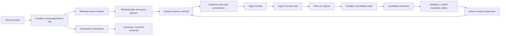
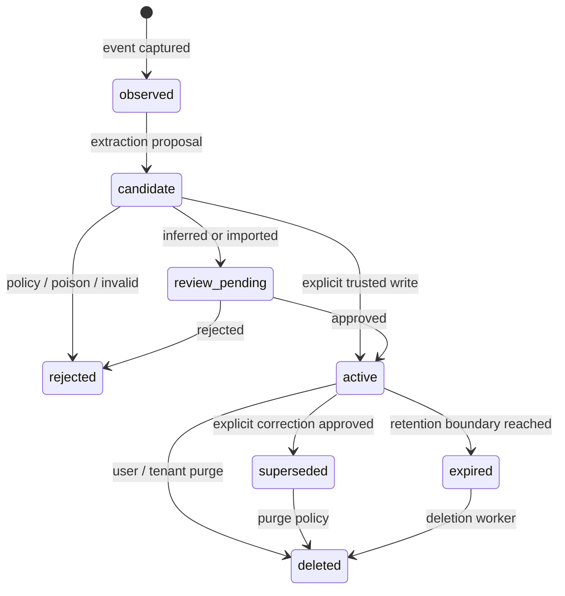

# Hermes and Waku memory-system research

Status: research complete  
Scope: local source audit of Hermes Agent and Waku Agent, focused on memory architecture and lifecycle  
Repository snapshots: Hermes `9a84bee265` (2026-09-06), Waku `21486b3` (2026-08-29)  
Prepared: 2026-09-07

This is a primary-source code study. Claims below point to the implementation or first-party documentation in the two local repositories. It distinguishes what the projects actually implement from what their documentation describes as a product capability.

## Executive finding

Hermes and Waku solve different parts of the problem.

Hermes treats memory as a host-managed lifecycle around a durable conversation system. It has explicit hooks for initialization, prefetch, post-turn synchronization, session boundaries, compression checkpoints, tool routing, shutdown, profile isolation, failure containment, and provider-specific extensions. Its built-in memory is intentionally small and curated; its full conversation archive is separate and searchable through FTS5. Its external-provider contract is the more valuable architectural reference for Kasitek.

Waku presents a clearer conceptual taxonomy: procedural memory (skills), semantic memory (facts), and episodic memory (events), plus bounded working memory. It separates retrieval gating from retrieval, batches consolidation after N exchanges, supports multiple semantic/episodic backends behind contracts, and tests backend behavior with conformance suites. Its Zep adapter demonstrates why temporal validity and asynchronous ingestion need to be first-class concepts. Its implementation is intentionally small and does not yet provide tenant isolation, durable job orchestration, rich provenance, or robust conflict/retention semantics.

The architecture Kasitek should build is a combination:



The central design rule is: **capture everything needed for audit, promote only validated durable knowledge, retrieve only scoped evidence, and never confuse a context summary with a memory fact.**

## 1. Hermes: what the system actually does

### 1.1 Two built-in stores plus an archive

Hermes ships two bounded files:

- `MEMORY.md`: agent notes, environment facts, conventions, and lessons; default limit 2,200 characters.
- `USER.md`: user profile and preferences; default limit 1,375 characters.

They live below the active profile's `HERMES_HOME/memories/` directory and are loaded into the system prompt as a frozen snapshot at session start. Writes hit disk immediately but do not mutate the current prompt, preserving prompt-prefix caching. See [Hermes memory documentation](../../../agents/hermes-agent/website/docs/user-guide/features/memory.md:11-57) and [`MemoryStore`](../../../agents/hermes-agent/tools/memory_tool_store.py:66-84).

Hermes' durable conversation archive is separate. `state.db` stores `sessions` and `messages`, including session lineage, source/platform identifiers, parent session, active/compacted markers, token counts, API-projected content, tool metadata, and timestamps ([schema](../../../agents/hermes-agent/hermes_state_common.py:279-367)). The archive is indexed by FTS5 with guarded triggers, deferred rebuild high-water marks, a trigram index for CJK/substrings, and filtering of tool/cron/subagent noise ([FTS design](../../../agents/hermes-agent/hermes_state_common.py:540-731)).

This gives Hermes three useful retention tiers:

```text
Always-loaded profile memory  → tiny, curated, prompt-costly
On-demand session search      → large, exact, FTS indexed
Current session context       → bounded, mutable, compaction-aware
```

The separation is more important than the file format. A fact that must be present on every turn belongs in the first tier; an old conversation that should be found only when relevant belongs in the second; active reasoning belongs in the third.

### 1.2 Memory provider lifecycle

External memory is an extension point, not a second ad hoc path. `MemoryProvider` defines:

- availability check without network calls;
- initialization with profile, platform, agent identity, workspace, user, and parent-session context;
- static system-prompt block;
- prefetch for recall;
- background prefetch queueing;
- completed-turn synchronization;
- provider tools and tool dispatch;
- session end and session switch hooks;
- pre-compression hook/checkpoint;
- mirroring of built-in writes;
- shutdown and configuration hooks.

See the interface at [`memory_provider.py`](../../../agents/hermes-agent/agent/memory_provider.py:58-165) and the provider contract documentation at [`memory-provider-plugin.md`](../../../agents/hermes-agent/website/docs/developer-guide/memory-provider-plugin.md:73-131).

Hermes initializes the built-in store from profile-scoped config, then optionally activates one external provider alongside it. Provider availability is checked before initialization; provider tools are injected only after activation ([agent init](../../../agents/hermes-agent/agent/agent_init.py:1230-1292)). The manager deliberately allows provider failures to be non-fatal and isolates external prefetch with a timeout ([manager](../../../agents/hermes-agent/agent/memory_manager.py:288-437)).

The manager has an important operational rule: completed-turn writes never run inline. A single daemon worker serializes background writes and prefetch operations, so turn N is written before turn N+1 and a slow provider does not keep the user-facing request open ([manager](../../../agents/hermes-agent/agent/memory_manager.py:452-523)).

### 1.3 Hermes turn lifecycle

The effective lifecycle is:

1. Agent startup loads profile-scoped built-in memory and initializes the configured provider.
2. At turn start, the provider receives a turn tick.
3. External memory is prefetched before the tool loop. Trivial prompts skip recall. The result is bounded by a provider-specific timeout.
4. Returned memory is fenced and sanitized before entering the model-facing context.
5. A deterministic recall indicator is emitted when memory was injected.
6. The agent runs and the successful turn is persisted.
7. The completed turn is synchronized to providers on a serialized background worker.
8. The next turn can use a background prefetch that has already been warmed.
9. A real session boundary performs end-of-session extraction before rebinding provider state.
10. Compression invokes a pre-compression memory hook; providers can optionally make that hook fail-closed.
11. Shutdown drains or bounds pending writes and closes provider resources.

The turn-start path is visible at [`turn_context.py`](../../../agents/hermes-agent/agent/turn_context.py:671-691), and the post-turn path at [`codex_runtime.py`](../../../agents/hermes-agent/agent/codex_runtime.py:422-444).

### 1.4 Retrieval integration and prompt safety

Hermes does not put dynamic external recall into the static provider system-prompt block. The static block describes the provider; dynamic recall comes from `prefetch`. Returned content is sanitized and wrapped in a `<memory-context>` fence with an explicit “not new user input” note ([context fencing](../../../agents/hermes-agent/agent/memory_manager.py:166-285)). Streaming output is scrubbed as well, including tags split across deltas.

Hermes also emits a status line such as “recalled N memories” so that memory use is observable to a human even if the model does not mention it ([recall indicator](../../../agents/hermes-agent/agent/memory_manager.py:439-450)).

The built-in store scans writes and loads for prompt-injection and exfiltration patterns. Threatened entries are blocked from the prompt snapshot but kept visible in the live file for removal, avoiding silent loss ([store loading](../../../agents/hermes-agent/tools/memory_tool_store.py:111-134)). Writes are protected by file locks, atomic temp-file replacement, strict decoding, external-drift detection, and refusal to treat an unreadable file as empty ([store mutation](../../../agents/hermes-agent/tools/memory_tool_store.py:135-212)).

### 1.5 Capture and consolidation

Hermes has two capture paths:

1. Foreground `memory` tool writes. The agent explicitly adds, replaces, removes, or atomically batches compact entries. Capacity overflow returns the current entries and asks the agent to consolidate; after three consecutive failures the operation becomes terminal so a memory failure cannot suppress the user reply ([tool/store path](../../../agents/hermes-agent/tools/memory_tool.py:129-158), [failure cap](../../../agents/hermes-agent/tools/memory_tool_store.py:66-109)).
2. Background review. After a successful turn, Hermes can fork a review agent that replays a snapshot and decides whether memory or skills should be saved. The fork has an explicit tool whitelist, bounded iterations/input budget, cancellation handshake, foreground priority, and separate usage accounting ([background review](../../../agents/hermes-agent/agent/background_review.py:1-6), [budget/cancellation](../../../agents/hermes-agent/agent/background_review.py:119-184), [usage attribution](../../../agents/hermes-agent/agent/background_review.py:667-717)).

When `write_approval` is enabled, foreground and background writes are staged for review instead of affecting live memory ([documentation](../../../agents/hermes-agent/website/docs/user-guide/features/memory.md:258-283)).

Hermes' external providers may also extract at session end, but the host deliberately sequences that before session rebinding. `commit_session_boundary_async` places extraction and provider switch in one FIFO worker task, preventing a late extractor from attributing an old transcript to the new session ([manager](../../../agents/hermes-agent/agent/memory_manager.py:589-638)).

### 1.6 Compression and durable checkpoints

Hermes treats context compression as a lossy boundary. A provider can advertise checkpoint API v2. When checkpoint enforcement is enabled, the host refuses compression unless a provider successfully durably archives normalized direct evidence. The host passes user/assistant evidence, excludes tool results/system messages/old compaction summaries, and requires idempotent provider writes keyed by a content digest ([checkpoint contract](../../../agents/hermes-agent/website/docs/developer-guide/memory-provider-plugin.md:133-199), [host gate](../../../agents/hermes-agent/agent/conversation_compression.py:2590-2627)).

This is a valuable distinction for Kasitek: memory capture should happen before a lossy context rewrite, with an explicit durable boundary and a retry-safe key.

### 1.7 Hermes profile and provider isolation

Hermes requires providers to use the `hermes_home` supplied during initialization, not a global path. Profiles therefore isolate built-in memory and provider state. The plugin system allows bundled, user, project, and package providers but only one external provider is active at a time; the built-in provider remains active alongside it ([plugin discovery](../../../agents/hermes-agent/website/docs/developer-guide/memory-provider-plugin.md:15-36), [profile isolation](../../../agents/hermes-agent/website/docs/developer-guide/memory-provider-plugin.md:316-327)).

The external-provider catalog demonstrates several scopes and strategies: Honcho models user and AI peers in a shared workspace; OpenViking uses hierarchical user/agent paths and tiered retrieval; Hindsight supports bank IDs, tags, session metadata, async retain, recall/reflect, and observation types ([provider overview](../../../agents/hermes-agent/website/docs/user-guide/features/memory-providers.md:28-39), [Honcho scopes](../../../agents/hermes-agent/website/docs/user-guide/features/memory-providers.md:150-205), [OpenViking scopes](../../../agents/hermes-agent/website/docs/user-guide/features/memory-providers.md:325-344)).

### 1.8 Hindsight: the strongest Hermes provider pattern

Hindsight is the most operationally mature provider in this checkout:

- one serial writer queue prevents concurrent retain races;
- every turn is snapshotted before the writer runs;
- a stable session-scoped document supports append mode;
- async server operations are tracked by operation ID;
- next-turn prefetch can wait for both local queue drain and server-side completion;
- waits are bounded and unresolved operations are dropped with a warning to preserve liveness;
- session switch flushes old buffered turns, drains and discards old prefetch, then mints a new document ID;
- shutdown stops accepting jobs, drains with a deadline, and closes resources.

See [`hindsight/__init__.py`](../../../agents/hermes-agent/plugins/memory/hindsight/__init__.py:305-345), [async retain visibility](../../../agents/hermes-agent/plugins/memory/hindsight/__init__.py:550-629), [prefetch](../../../agents/hermes-agent/plugins/memory/hindsight/__init__.py:859-933), [retain batching](../../../agents/hermes-agent/plugins/memory/hindsight/__init__.py:971-1050), and [session rotation](../../../agents/hermes-agent/plugins/memory/hindsight/__init__.py:1102-1155).

The architectural lesson is not “use Hindsight.” It is that memory durability has two separate acknowledgements: **accepted by the local writer** and **visible to retrieval**. A scalable system must model both.

## 2. Waku: what the system actually does

### 2.1 Explicit memory taxonomy

Waku's memory facade names three durable types:

```text
Procedural  → SKILL.md files: how to act
Semantic    → facts: what is durably true
Episodic    → dated summaries: what happened and when
```

It also has bounded working memory: the current session keeps only the last configured number of turns, while older turns remain in `state.db` and can return through retrieval or consolidation ([facade](../../../agents/waku-agent/waku/memory/__init__.py:1-11), [working-memory window](../../../agents/waku-agent/waku/app.py:114-136), [session runtime](../../../agents/waku-agent/waku/runtime/session.py:1-10)).

This taxonomy is a good product-level vocabulary for Kasitek, but Waku stores semantic facts and episodes as simple rows. It does not implement a general memory state machine, temporal conflict model, or tenant-aware authorization.

### 2.2 Storage model and backend abstraction

The default Waku database is one SQLite file. It stores:

- `facts(subject, content, source, created_at)` plus FTS5 triggers;
- `episodes(happened_at, summary, created_at)` plus FTS5 triggers;
- `chat_log(role, content, consolidated, session_id, source, meta)`.

See [`waku/db.py`](../../../agents/waku-agent/waku/db.py:1-107).

The semantic `FactStore` protocol requires `add`, `search`, `list`, `search_with_ids`, `update`, `delete`, and `settle`; the contract explicitly says misses must return empty/false and backends must not take down the turn ([protocol](../../../agents/waku-agent/waku/memory/semantic/base.py:62-137)). A conformance suite runs the same behavior against SQLite, Supabase, Mem0, Zep, and LangMem where configured ([tests](../../../agents/waku-agent/evals/deterministic/test_fact_store_conformance.py:92-185)).

The backend seam is a strong idea, but the semantic contract is too small for Kasitek: it has no scope, policy, provenance lineage, version, conflict, sensitivity, lifecycle state, retention, or idempotency fields.

### 2.3 Capture and consolidation

Every completed Waku turn is appended to `chat_log`. Consolidation runs synchronously after the response and only when at least N new exchanges exist; the default is six exchanges ([config](../../../agents/waku-agent/waku/config.py:74-88), [turn wiring](../../../agents/waku-agent/waku/app.py:102-110)).

The consolidator:

1. reads rows with `consolidated = 0`;
2. checks the exchange threshold without calling the model below it;
3. sends the complete unconsolidated log to a small model;
4. expects JSON containing facts and one episode;
5. writes valid facts and the episode;
6. marks exactly the IDs it read as consolidated.

If the model fails or output is unparseable, rows remain unconsolidated for a later attempt. New messages arriving during summarization are not swallowed because only the captured IDs are marked done ([consolidation](../../../agents/waku-agent/waku/memory/consolidation.py:37-82), [failure and concurrency tests](../../../agents/waku-agent/evals/deterministic/test_consolidation.py:147-225)).

This is a sound minimum viable queue boundary, but it is still process-coupled and synchronous. There is no durable consolidation-job table, lease, retry count, dead-letter state, extraction version, candidate review state, or source-run idempotency key.

### 2.4 Retrieval gate and ranking

Before searching, Waku makes a small-model call asking whether the user message needs personal memory and, if yes, what query to search. The gate skips general knowledge and self-contained prompts; it fails open on malformed output or API errors so a retrieval outage is not silently interpreted as “no memory” ([gate](../../../agents/waku-agent/waku/memory/retrieval_gate.py:1-55), [tests](../../../agents/waku-agent/evals/deterministic/test_retrieval_gate.py:79-105)).

The runtime then searches semantic facts and episodes, appending both to the system prompt as “Relevant memory” ([runtime](../../../agents/waku-agent/waku/memory/__init__.py:90-101), [prompt assembly](../../../agents/waku-agent/waku/runtime/session.py:63-88)).

SQLite uses FTS5 BM25 ranking. Semantic search returns up to `retrieval_top_k` facts; episodic search returns three, ranking by lexical rank then date. Waku intentionally does not default to embeddings; Supabase is an optional pgvector backend. The SQLite query builder has explicit Unicode/CJK handling to avoid empty queries falling through to “recent episodes,” which previously could inject an unrelated memory ([semantic store](../../../agents/waku-agent/waku/memory/semantic/store.py:31-107), [episode store](../../../agents/waku-agent/waku/memory/episodic/store.py:16-45), [regression tests](../../../agents/waku-agent/evals/deterministic/test_memory_search.py:77-105)).

The gate is a useful cost and relevance control, but Waku's gate is only a boolean/query rewrite. It does not produce a typed retrieval plan, required scope, evidence budget, confidence threshold, or reason for excluding a candidate.

### 2.5 Backend-specific lifecycle lessons

#### SQLite

SQLite writes and FTS updates are in one transaction, so `settle()` returns immediately. It is transparent, local, and easy to inspect, but lexical recall is weaker when wording changes ([SQLite store](../../../agents/waku-agent/waku/memory/semantic/store.py:67-129)).

#### Supabase / pgvector

Supabase computes the embedding before upserting the fact and recomputes it on update, avoiding stale vectors. Its SQL creates a 1,536-dimensional vector column, IVFFlat index, cosine RPC, and RLS policies; however the checked-in development policy includes anonymous read access, which is not suitable as a production tenant default ([adapter](../../../agents/waku-agent/waku/memory/semantic/supabase_store.py:27-59), [schema](../../../agents/waku-agent/sql/init_supabase.sql:18-123)).

#### Mem0

The adapter deliberately calls `infer=False`, because Waku's `add()` contract promises that a written fact is stored and retrievable. This means Waku's benchmark measures Mem0 retrieval, not Mem0 extraction ([adapter](../../../agents/waku-agent/waku/memory/semantic/mem0_store.py:12-25), [write](../../../agents/waku-agent/waku/memory/semantic/mem0_store.py:64-78)). Mem0 has no readiness signal, so `settle()` polls until the count stops changing; the adapter documents observed eventual-consistency delays ([settle](../../../agents/waku-agent/waku/memory/semantic/mem0_store.py:100-127)).

#### Zep

Zep ingests text into a temporal knowledge graph. A correction is appended rather than overwriting the old edge; temporal validity marks the older fact superseded. Its adapter waits for episode processing and then separately waits for graph node count stability because `processed=True` does not guarantee derived nodes are queryable ([adapter design](../../../agents/waku-agent/waku/memory/semantic/zep_store.py:1-39), [ingest and settle](../../../agents/waku-agent/waku/memory/semantic/zep_store.py:88-152), [correction semantics](../../../agents/waku-agent/waku/memory/semantic/zep_store.py:167-205)).

This is the strongest evidence in either repository that “memory write succeeded” and “memory is retrievable” must be distinct lifecycle states.

#### LangMem

LangMem exposes a store abstraction with semantic, episodic, and procedural concepts. Waku configures either an in-process `InMemoryStore` or a Postgres-backed store with a 1,536-dimensional index. The in-process default disappears on restart, which the adapter documents clearly ([adapter](../../../agents/waku-agent/waku/memory/semantic/langmem_store.py:1-64)).

### 2.6 Human and agent correction surfaces

Waku exposes `manage_memory` for search/update/delete of facts and episodes. It requires searching for an ID before updating/deleting, and it routes the same store shown in the dashboard ([tool](../../../agents/waku-agent/waku/tools/memory_admin.py:25-82)). `update_soul` writes procedural behavior rules to `SOUL.md`, while `create_skill` creates a reusable `SKILL.md` only after the user agrees ([tools](../../../agents/waku-agent/waku/tools/memory_admin.py:85-151)).

Waku also exports a generated `MEMORY.md`, but `state.db` remains the source of truth; the file is a human-readable view refreshed after every turn ([export](../../../agents/waku-agent/waku/memory/__init__.py:166-190)). This is a good model for a read-only human inspection surface, provided Kasitek never lets the exported view become an unversioned write path.

## 3. Direct comparison

| Concern | Hermes | Waku | Kasitek implication |
|---|---|---|---|
| Working memory | Live transcript with compaction and session lineage | Last N turns | Keep bounded working context separate from durable memory. |
| Durable semantic memory | Tiny curated files or provider-defined | Facts table/backends | Use typed records plus provider-independent lifecycle. |
| Episodic memory | Full searchable session archive | Dated episode rows | Store episodes as first-class evidence, not only summaries. |
| Procedural memory | Skills system | `SKILL.md` and `SOUL.md` | Keep instructions separate from factual memory and protect them more strongly. |
| Retrieval | Provider prefetch, optional background warm-up, fenced context | Small-model gate then fact/episode search | Use a typed retrieval planner and evidence pack. |
| Extraction | Explicit tool, background review, provider session-end hooks | Batch after N exchanges | Durable asynchronous jobs with source-run idempotency. |
| Conflict handling | Built-in replace; provider-specific | Update/delete; Zep appends temporal correction | Make immutable revisions and explicit supersession universal. |
| Scope | Profile, user, agent, peer/workspace provider scopes | Mostly one local user; hosted user ID | Tenant, workspace, agent, installation, conversation, and end-user scopes must be mandatory. |
| Eventual consistency | Hindsight tracks local queue and server op IDs | `settle()` per backend | Model accepted, committed, indexed, and retrieval-visible states. |
| Compaction safety | Optional fail-closed durable checkpoint | No equivalent | Checkpoint transcript evidence before lossy context compaction. |
| Privacy | Profile isolation, threat scanning, prompt fencing | Local-first; hosted adapters with user ID, Supabase dev RLS caveat | Make tenant authorization and redaction part of the storage contract. |
| Observability | Provider status, recall indicators, usage attribution, logs | Gate/tracing/meta and dashboard | Record lifecycle decisions and evidence IDs as durable run events. |
| Scaling | Serialized provider worker, bounded timeouts, profile-local state | Single process and synchronous consolidation | Move workers to durable queues and leases; preserve per-scope ordering. |
| Testing | Lifecycle/provider/checkpoint tests | Backend conformance and deterministic retrieval/consolidation tests | Contract-test every memory backend and every lifecycle transition. |

## 4. Target architecture for Kasitek

### 4.1 Memory should be an evidence system, not a vector table

Kasitek should have one canonical memory domain with multiple projections:

```text
memory_events       immutable observations and user/agent actions
memory_candidates   extracted propositions awaiting validation
memory_revisions    immutable fact/episode/procedure revisions
memory_relations    supersedes, supports, contradicts, derived-from
memory_embeddings   asynchronous retrieval projection
memory_fts          lexical retrieval projection
memory_usage        retrieval, confirmation, correction, and decay signals
memory_deletions    durable purge workflow and legal-hold state
```

The canonical source is the event/revision layer. FTS, vectors, graph edges, summaries, and exported views are rebuildable projections. No vector store or rendered prompt block should be authoritative.

### 4.2 Three memory classes, with explicit boundaries

Use Waku's taxonomy but add lifecycle semantics:

1. **Working context**
   - Current run messages, tool results, selected workspace state, and temporary scratch.
   - Not durable memory.
   - Bounded by provider-aware context planning.
   - May be compacted into a summary, but the pre-compaction transcript is preserved in the event log.

2. **Episodic memory**
   - A bounded, time-anchored record of what happened in a conversation or operation.
   - Stores event time, run/conversation IDs, participants, outcome, source evidence, and confidence.
   - Retrieved for “what happened,” continuity, and audit.

3. **Semantic memory**
   - A proposition about a person, organization, customer, project, preference, or durable state.
   - Has a stable `fact_key`, validity interval, confidence, sensitivity, provenance, and revision lineage.
   - Corrections create a new revision; they do not overwrite history.

4. **Procedural memory**
   - Agent instructions, skills, policies, and workflows.
   - Must not be created by ordinary factual extraction.
   - Requires a separate approval and version/deployment path because retrieved procedural text can alter behavior.

5. **Knowledge grounding**
   - Tenant-owned source documents and externally imported knowledge.
   - Separate ownership, provenance, ingestion, and citation rules from personal/conversational memory.

### 4.3 Scope model

Every memory record and every retrieval request should carry an immutable scope tuple:

```text
organization_id
workspace_id
agent_id
agent_installation_id
conversation_id (optional)
end_user_id (optional)
namespace
```

Retrieval should be an intersection of the requested scope and policy-allowed scope. Recommended namespaces:

- `conversation`: only this conversation/run lineage;
- `end_user_private`: facts about the current customer/user;
- `workspace_shared`: tenant-approved shared facts;
- `agent_private`: internal agent learnings, not customer-visible;
- `knowledge`: tenant source material, governed separately;
- `procedural`: agent behavior definitions, never mixed into factual retrieval.

Do not infer tenancy from a vector namespace or a provider account. The authorization predicate must run before candidate retrieval, and every backend adapter must receive the scope explicitly. Hosted providers may use an opaque partition key derived from the tuple, but the canonical database remains the authority.

### 4.4 State machine



Required invariants:

- only `active` revisions are retrievable;
- `review_pending`, `rejected`, `quarantined`, `superseded`, and `expired` are excluded by the storage query, not only by application code;
- an active revision is never silently overwritten;
- a correction names the revision it supersedes or is stored as a conflict candidate;
- every candidate links to source event IDs, source run ID, extractor version, and policy decision;
- deletion purges canonical and derived projections, with a durable deletion receipt that contains no deleted content.

### 4.5 Capture and ingestion pipeline

Capture should be synchronous and cheap; extraction should be asynchronous and retryable:

```text
gateway / web / tool event
  → append immutable run event
  → record redacted + encrypted payload references
  → enqueue consolidation job with (run_id, extraction_version)
  → worker leases job
  → construct bounded evidence window
  → deterministic filters / threat scan
  → extractor proposes facts, episodes, and relations
  → validate schema, scope, sensitivity, fact key, and provenance
  → dedupe by source digest and proposition fingerprint
  → state transition / conflict check
  → commit candidate + outbox event transactionally
  → async FTS/vector/graph projections
  → mark candidate searchable only after required projections are ready
```

Borrow from Waku's “only after N exchanges” threshold, but make it per installation and durable. Borrow Hermes' session-end and pre-compression hooks for forced flushes. A consolidation job must be idempotent by `(source_run_id, extraction_version, evidence_digest)`; a retry must upsert rather than duplicate.

Never mark source events “consolidated” until the candidate transaction succeeds. If the model fails, the evidence remains available for retry. If validation fails, mark a terminal rejection with a reason code rather than silently dropping it.

### 4.6 Extraction policy

Use a tiered extractor:

1. **Deterministic explicit path**
   - `remember`, `forget`, direct correction, direct preference/decision.
   - Highest authorship trust; can become active if it passes safety and policy.

2. **Bounded model proposal path**
   - Runs on batches or pre-compaction/session boundaries.
   - Produces typed propositions plus evidence spans, confidence, sensitivity, expiration suggestion, and fact key.
   - Defaults to `review_pending`.

3. **Human or policy approval path**
   - Approves, rejects, merges, or supersedes candidates.
   - Every decision is auditable and scoped.

4. **Procedural promotion path**
   - Separate from factual extraction and requires explicit approval/deployment.

This preserves Hermes' compact-memory discipline while adding Waku's useful semantic/episodic split and Zep-like temporal relations.

### 4.7 Retrieval planner and ranking

The gate should be cheaper and more expressive than a boolean:

```json
{
  "decision": "skip | retrieve | retrieve_and_ground | retrieve_history",
  "query": "...",
  "scopes": ["end_user_private", "workspace_shared"],
  "types": ["semantic", "episodic"],
  "max_results": 8,
  "max_tokens": 1600,
  "freshness": "any | recent | current",
  "reason": "..."
}
```

The planner should fail open only where that is safe. A retrieval-gate outage can allow a bounded lexical fallback; an authorization/scope failure must fail closed. A customer factual question with no trusted evidence should produce a limitation state, not an unrelated result.

Ranking should combine:

```text
semantic similarity
lexical relevance
entity / fact-key match
validity and recency
source trust / authorship
scope specificity
confirmation and correction history
contradiction penalty
usage / reinforcement signal
```

Retrieval should run lexical and vector search in parallel, merge by stable revision ID, exclude non-active states before ranking, and return an evidence pack containing IDs and scores. Prompt rendering should be a projection of that pack. The run event should record selected IDs, rejected IDs/reasons, ranking components, and token budget without storing unnecessary sensitive text.

### 4.8 Prompt and context integration

Memory injection must follow Hermes' fence/snapshot pattern, but with Kasitek's “untrusted evidence” semantics:

```text
<memory-evidence>
  source: memory_revision_id
  type: semantic|episodic|knowledge
  validity: current / historical
  confidence: ...
  provenance: user / operator / inferred / imported
  text: ...
</memory-evidence>
```

Dynamic memory should not be part of the static system-prompt prefix. It should be a separately measured context segment with a hard token budget. Procedural memory is loaded through a separate trusted channel and is never rendered as factual evidence.

Before compaction, persist the exact direct evidence needed to rebuild durable memory. If a deployment requires this guarantee, make the checkpoint fail closed like Hermes API v2; otherwise preserve the transcript and emit a visible warning when the checkpoint cannot complete.

### 4.9 Conflict, validity, and forgetting

Use append-only revisions for semantic facts:

```text
fact_key = normalized subject + predicate + scope + namespace
revision 1: valid_from = t0, valid_to = t1, status = superseded
revision 2: valid_from = t1, valid_to = null, status = active
```

A correction should not delete the old evidence. Retrieval defaults to the currently valid active revision but can answer historical questions by validity interval. This is the Zep insight made provider-independent.

Memory should have separate controls for:

- expiration (`expires_at`);
- retention policy (organization/namespace/type);
- decay score (ranking only, never silent deletion);
- legal hold;
- user-requested forget;
- tenant purge;
- supersession.

Expiration must enqueue a durable deletion job. A record being excluded from retrieval is not the same as being deleted. Kasitek should expose purge completion and derived-index deletion receipts.

### 4.10 Provider abstraction and consistency

If Kasitek supports pluggable backends, the contract must be richer than Waku's `FactStore`:

```text
append_event(event, idempotency_key)
propose(candidate, source_refs)
transition(memory_id, expected_version, next_state)
search(scope, query_plan) -> evidence
get(memory_id, scope)
list(scope, lifecycle_filter)
supersede(old_id, new_revision, expected_version)
forget(scope, selector)
projection_status(revision_id)
checkpoint(source_run_id, digest)
```

Every backend must satisfy the same semantics for:

- authorization scope;
- no cross-tenant reads;
- no stale vector after update;
- no retrieval of pending/rejected/expired records;
- idempotent retries;
- explicit readiness (`committed` versus `searchable`);
- correction/supersession behavior;
- delete propagation.

Waku's conformance approach should be retained, but the contract tests must run against the lifecycle rather than only CRUD shape.

### 4.11 Scaling and concurrency

The scalable design should use:

- append-only event log partitioned by organization/workspace;
- consolidation queue with row leases, visibility timeout, retry count, and dead-letter state;
- per-scope ordering key where fact conflicts are possible;
- outbox events for projection work;
- independent lexical/vector/graph index workers;
- bounded per-run and per-tenant budgets;
- one active projection writer per memory/revision key, not one global worker;
- idempotency keys for every external provider call;
- explicit `accepted_at`, `committed_at`, `indexed_at`, `visible_at` timestamps;
- backpressure and queue-age metrics.

Hermes' single serialized worker is correct for a local profile; it should not become Kasitek's global worker model. Preserve the ordering guarantee by partitioning the queue by installation or memory key.

### 4.12 Privacy and security

Required controls:

- authorization predicates in every repository query;
- database-level row-level security where supported;
- no provider account or vector namespace used as the only tenant boundary;
- secret/PII classification before persistence and before embedding;
- redaction or encryption of sensitive evidence;
- memory prompt-injection scanning on write and on load;
- untrusted fencing for factual memory;
- trusted procedural-memory review and versioning;
- scoped user/operator review actions;
- deletion of all projections and provider copies where contractually possible;
- no deleted content in logs, metrics, queue errors, or deletion receipts.

Waku's Supabase SQL is useful as a pgvector example but its anonymous read policy is development-only ([policy](../../../agents/waku-agent/sql/init_supabase.sql:106-123)). Hermes' file threat scan, profile isolation, and write-approval flow are useful baseline controls ([scan](../../../agents/hermes-agent/tools/memory_tool_store.py:25-29), [approval docs](../../../agents/hermes-agent/website/docs/user-guide/features/memory.md:258-283)).

### 4.13 Observability and evaluation

Every memory lifecycle operation should emit structured events:

```text
memory.capture.accepted
memory.consolidation.queued
memory.consolidation.started
memory.candidate.created
memory.candidate.rejected
memory.review.approved / rejected
memory.revision.superseded
memory.projection.committed / failed
memory.retrieval.planned
memory.retrieval.completed
memory.retrieval.evidence_selected
memory.retrieval.blocked
memory.expiration.marked
memory.deletion.completed / blocked
memory.checkpoint.completed / failed
```

Record IDs and hashes, not raw sensitive text. Track:

- capture-to-active latency;
- capture-to-searchable latency;
- consolidation success/retry/dead-letter rates;
- duplicate and contradiction rates;
- retrieval precision/recall and no-evidence rate;
- stale-memory and wrong-scope incidents;
- token contribution and provider latency;
- projection lag;
- deletion completion lag;
- per-tenant memory size and queue age.

Evaluation must include deterministic and judgment-based suites. Waku's tests show the right split: deterministic tests pin thresholds, failure posture, Unicode correctness, IDs, and backend contracts; model quality belongs in separate evaluation suites ([consolidation tests](../../../agents/waku-agent/evals/deterministic/test_consolidation.py:1-17), [retrieval gate tests](../../../agents/waku-agent/evals/deterministic/test_retrieval_gate.py:1-15), [conformance tests](../../../agents/waku-agent/evals/deterministic/test_fact_store_conformance.py:1-25)). Add Kasitek-specific suites for tenant isolation, scope escalation, conflict chronology, stale projection, retry idempotency, compaction checkpoints, and deletion propagation.

## 5. Recommended Kasitek implementation sequence

### Phase M0 — Contract freeze and evidence model

- Define the canonical memory vocabulary and scope tuple.
- Define event, candidate, revision, relation, projection, and deletion contracts.
- Freeze lifecycle states and allowed transitions.
- Define the exact prompt/evidence envelope and redaction policy.
- Add repository authorization predicates and test fixtures.

Exit evidence: schema/contract tests pass; no memory API can return a record without an explicit scope.

### Phase M1 — Durable capture and working-context separation

- Treat the existing message/run/event journal as the source of capture truth.
- Add per-run source digests and idempotency keys.
- Keep current context assembly separate from long-term memory retrieval.
- Add a compaction checkpoint hook before any lossy summary rewrite.

Exit evidence: a run can be replayed after restart, and no compaction loses the captured evidence boundary.

### Phase M2 — Semantic/episodic canonical memory

- Add immutable semantic revisions and episodic records.
- Add candidate states, fact keys, validity intervals, provenance, confidence, and sensitivity.
- Implement explicit remember/forget/correct flows.
- Make conflict approval create superseding revisions.

Exit evidence: correction, historical query, rejection, expiration, and deletion tests pass.

### Phase M3 — Consolidation worker

- Add durable jobs with lease, retry, extraction version, evidence digest, and dead-letter state.
- Port Waku's threshold and exact-ID marking behavior.
- Port Hermes' session-end and pre-compression flush boundaries.
- Default model-inferred candidates to review pending.

Exit evidence: retries do not duplicate candidates or facts; late-arriving messages remain available for the next job.

### Phase M4 — Retrieval planner and projections

- Implement the typed retrieval plan and fail-open/fail-closed rules.
- Run lexical and vector search in parallel.
- Add projection readiness and visibility states.
- Add stable evidence IDs, scores, provenance, and token budgets.

Exit evidence: retrieval returns only authorized active evidence and never claims a write is searchable before readiness.

### Phase M5 — Temporal conflicts, decay, retention, and purge

- Add validity intervals and supersession relations.
- Add usage/confirmation/correction signals for ranking.
- Add expiration scanner and deletion worker.
- Add legal-hold and provider-delete workflows.

Exit evidence: “what is true now,” “what was true then,” and “forget this” are separately testable.

### Phase M6 — Studio and operations

- Show the memory lifecycle on the existing execution graph: capture, candidate, approval, projection, retrieval, and deletion events.
- Let operators inspect evidence lineage without exposing secrets.
- Add tenant-scoped review, quarantine, purge, and reprocessing controls.
- Add dashboards for queue age, projection lag, retrieval quality, and wrong-scope alarms.

Exit evidence: a human can explain why a memory was created, why it was retrieved, what source supported it, and how to remove it.

## 6. Decisions Kasitek should not defer

1. **What is the tenant boundary?** Organization, workspace, installation, agent, end user, and conversation must have explicit meanings.
2. **Which memories can become active automatically?** Recommendation: explicit trusted user writes only; inferred/imported facts remain review pending until quality evidence supports a safer policy.
3. **Are corrections destructive?** Recommendation: never; use immutable revisions and validity intervals.
4. **What does “written” mean?** Distinguish accepted, committed, indexed, and visible.
5. **What is procedural memory?** Keep it outside factual memory and require a separate approval/deployment path.
6. **What happens when extraction fails?** Preserve source evidence, retry through a durable job, and never mark it complete merely because the model returned no parseable output.
7. **What happens when retrieval fails?** Scope/authorization failures fail closed; ordinary ranking/backend failures degrade to a bounded safe fallback and remain observable.
8. **What is the deletion promise?** Define whether deletion means “not retrieved,” “canonical row removed,” or “all derived/provider copies purged,” and expose completion state.
9. **How is memory quality measured?** Establish retrieval, precision, conflict, stale-memory, and cross-tenant leakage tests before enabling autonomous extraction broadly.

## Bottom line

Hermes contributes the lifecycle discipline required for a long-running agent: durable session boundaries, asynchronous but serialized writes, bounded timeouts, provider isolation, profile scope, context fencing, and fail-closed checkpoints before lossy compaction.

Waku contributes the clearest memory vocabulary and a set of practical correctness tests: working versus durable memory, semantic versus episodic versus procedural knowledge, gated retrieval, thresholded consolidation, exact source-row bookkeeping, backend conformance, Unicode-safe search, and explicit eventual-consistency settling.

Kasitek should not copy either implementation. It should build a canonical, tenant-scoped memory domain with immutable evidence and revisions, durable consolidation jobs, typed retrieval plans, temporal conflict handling, projection readiness, and Studio-level observability. That is the smallest architecture that can become reliable across all agents, channels, and future memory providers without turning memory into an opaque vector search sidecar.
