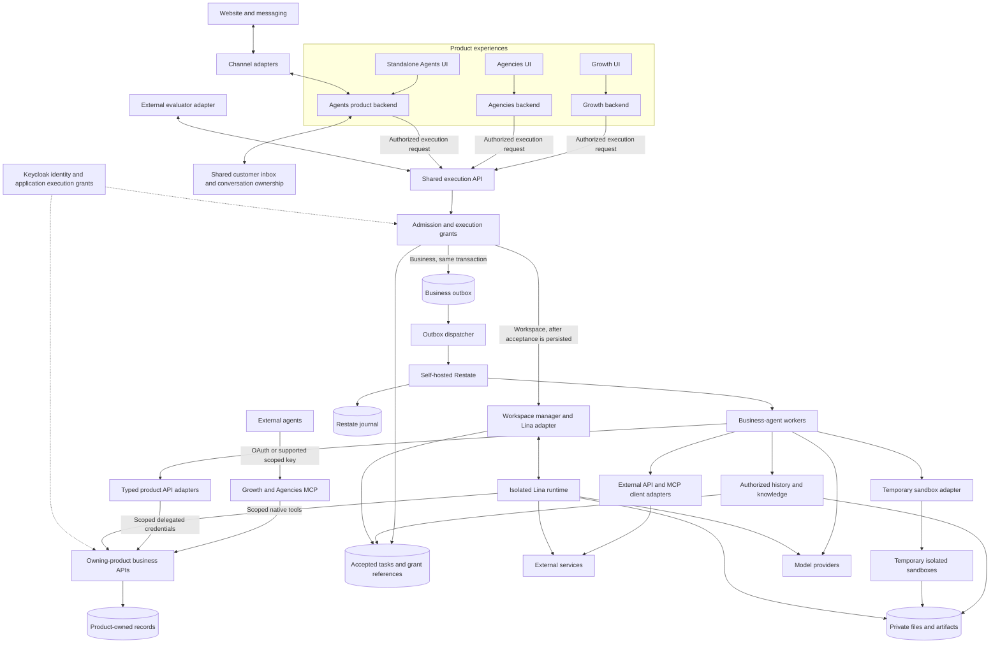
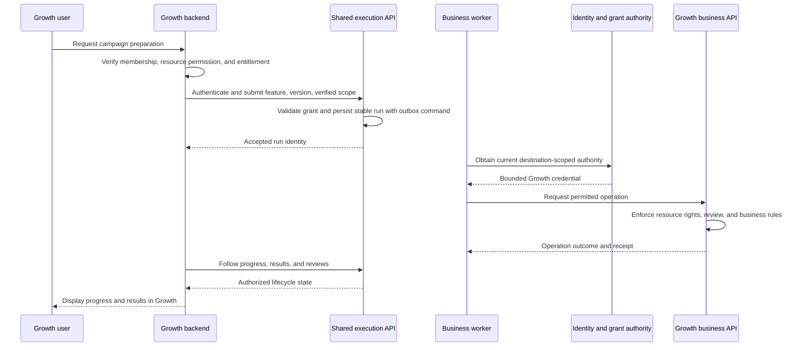

# Agents platform architecture

Owner: Agents engineering. Last reviewed: 2026-11-02.

This is the target architecture agreed with the owner. It defines the shared execution service
and the standalone Agents product separately. Design against these boundaries first. Existing
code is reusable only where it fits. This is a new product built with fresh schemas. Existing
data, histories, credentials, endpoints, and clients impose no migration, preservation, or backward-compatibility
requirements. Legacy data retention is not a prerequisite. The [implementation status](../source-boundary.md) describes
current implementation; it does not constrain the target design.

## Product experience and ownership

| Surface | Customer experience | Authority |
| --- | --- | --- |
| Growth | Users initialize and use content, campaign, and guidance features inside Growth. | Growth membership, resource permissions, commercial entitlement, and business rules. |
| Agencies | Users initialize and use agency agent features inside Agencies. | Agencies membership, client and workspace boundaries, entitlement, and business rules. |
| Standalone Agents | Businesses configure customer-service agents with question answering, support, booking and intake capabilities, connect customer channels, and manage conversations in a shared inbox. | Agents-product membership, resources, entitlement, and publication rules. |
| Shared execution service | Backends submit authorized work and retrieve progress, results, and reviews. | Authenticated caller plus a validated, bounded execution grant. |

A Growth or Agencies customer does not need an Agents-product account, membership, subscription,
or dashboard visit to use embedded agent features. Execution records retain the verified initiating
user or organization automation identity without manufacturing an Agents-product membership.
Shared human login is compatible with separate product access. Products need not have identical
organization, workspace, client, or resource structures.

Each product owns its interface, business records, and customer authorization. The execution
service calls owning-product APIs and never reads or writes another product's database. Ordinary
product features operate without the execution service. Agent-powered features may depend on it
and must report its unavailability in their own interface.

## Standalone Agents product

The Agents client creates customer-service agents through guided setup. Answering questions,
handling support, booking appointments and collecting enquiries are selectable responsibilities
of the same agent, not separate creation types. The wizard collects business details, relevant
knowledge, intended channels and operating preferences. When human support is selected, the wizard
collects support days, hours and a timezone. The timezone is prefilled from the browser and can be
changed; opening times are not inferred. The weekly schedule is saved with the agent setup and
pinned in its published configuration. An absent schedule means support hours are unknown. Steps
depend on the selected responsibilities.
Setup metadata, grounded instructions and setup-owned native
capabilities are saved through revision-checked configuration snapshots. Identity, instructions and
behaviour guidance are separate fields in the same configuration; identity and guidance are optional
so versions written before this split keep the legacy prompt. Enquiries expose a native
submission tool with configured fields and exact customer confirmation. Calendar actions require
an explicitly authorized service connection and a pinned booking policy. Channel selection records
intent; explicit activation creates a deployment after testing. Selection never authorizes a
personal provider account. Knowledge approval, attachment and customer publication are separate;
saved readiness derives from current model metadata, source approval, attachment, policy authority
and deployments. Provider acceptance and answer quality remain separate verification responsibilities.
Research, campaign, content, and agency operations
belong in Growth or Agencies. Shared runtime support for those capabilities does not add those
offerings to the Agents client. A standalone personal-assistant offering is outside this agreed
client scope. The two technical execution categories remain platform contracts.

Agent purpose, customer channel, and business-system connection are separate configuration:

| Configuration | Meaning |
| --- | --- |
| Purpose | The customer outcome, such as answering questions, resolving support requests, booking, or intake. One agent can support several purposes. |
| Channel | Where customers communicate, including websites, WhatsApp, Facebook pages, and Instagram. One agent can serve multiple authorized channels. |
| Business-system connection | An authorized account and permitted resources or operations in a booking system, calendar, CRM, or other customer system. |

Setup starts with the business outcome and collects its required business information, knowledge,
connections, operating rules, and human handoff settings. Customers test the agent before binding
the saved configuration to a supported channel. A named offering is available only when its required
adapters and business operations work. Generic runtime tools do not establish booking or channel
support. Publication and current grants bound the agent's authority.

### Native customer records and follow-up

Agents owns its native contacts and enquiry follow-up records. Submitted enquiry evidence and
exact confirmation receipts remain immutable. A separate record stores current fields, contact
association, assigned staff, status, due date and internal notes with revision-checked commands
and append-only activity. Editing follow-up state never sends a customer message, takes over an
Inbox thread or changes a booking. Due dates feed an in-app queue; autonomous outreach and
reminders are outside this implementation.

A real channel submission projects one customer record transactionally. Automatic contact
association uses the verified deployment and participant binding. Website identity includes the
visitor session; messaging identity includes the verified sender. Matching names, email addresses
or phone numbers never merge identities. Staff can explicitly correct and link contacts. Private
operator tests, pending submissions and evaluation trials do not create ordinary customer profiles.

Native `enquiry.read` and `enquiry.amend` tools operate within the current trusted participant,
conversation and trial scope. Amendments require exact confirmation and preserve the original
submission. Optional `records.search` and `records.update` tools require saved configuration,
explicit grants and current signed-in staff membership. They are unavailable to customer channels,
automations, subagents and evaluation-trial tasks. Staff updates are limited to status, reopening
and due dates. Private notes and the contact directory never become customer tool context.
Model-purpose evaluation of staff tools requires an owner-controlled disposable organization
with normal staff tasks; trial tasks cannot browse ordinary records.

Customers provides Enquiries and Contacts, with filters, assignment, due dates and history. Inbox
links to that same editor. Current target authorization still governs every conversation and
booking link. Follow-up assignment and Inbox ownership remain independent. Growth linkage,
external CRM synchronization, automatic contact merging and cross-channel identity verification
are excluded from this block.

### Workspace and agent chat

The public landing and `/pricing` page lead to registration and sign-in. The target workspace includes Inbox,
Agents, Customers, Knowledge, Connections, Tasks, Automations, and Settings. Inbox is the customer-service
workspace. Every agent also opens a job-based workspace with Overview, Conversations, Capabilities,
Knowledge, Behaviour, Chat widget, Deploy and Settings. Direct operator chat and task history
do not replace Inbox.

Connections distinguishes customer channels from business-system connections. Customers authorize
accounts, choose resources and permitted operations, and bind them to agents. Adapter transport
and runtime categories do not define the customer-facing catalogue. Provider authorization,
connection health, and channel availability must reflect actual integration support.

The standalone client exposes configuration saves rather than numbered-version management.
A save validates and activates an immutable internal snapshot atomically. A newly created
customer agent already has its first snapshot and can chat without a publication step.
Existing human and website conversations resolve saved settings at each new turn;
already accepted turns retain their admitted snapshot. Reconnect and exact retries follow
the original task and snapshot even after a configuration save.

Lower model or context budgets govern future admissions and preserve previously accepted grants
and limits. Permission reductions immediately revoke affected historical grants. Adding permissions
or changing live customer channels requires explicit confirmation. A confirmed save
revalidates each active website deployment and moves its routing to the new snapshot
without replacing channel URLs, visitor sessions, Inbox ownership or conversation history.
Unsafe public configuration leaves both saved settings and routing unchanged. Historical
snapshots cannot mint new authority that the current configuration has removed.

Configuration history is an optional advanced restore path. Restoring creates a fresh
snapshot after current policy checks; it never mutates historical execution. Explicit
snapshot contracts remain available for product integrations and isolated evaluations.
Evaluation-owned website routes and separately authorized existing schedules stay pinned.
Knowledge imports remain separate reviewed-source operations. Product setup exposes capabilities
needed for its customer outcome rather than every shared-runtime configuration control.

### Existing private assistant implementation

The existing private-assistant implementation provisions one ordinary business assistant definition
per organization. It is outside this upgrade's approved product scope and does not establish a new
supported standalone offering.
Its lifecycle marker is used for provisioning and explicit restoration only; names and markers
confer no authority. Members use normal private human-principal conversations and configure
same-organization pinned specialists under the existing depth/concurrency/root-budget limits.
Content delegation produces a private text draft. Customer channel grants and Inbox ownership
remain separate from this member journey.

Organization-owned Telegram/WhatsApp connections retain one verified webhook owner. App-issued,
hashed expiring challenges, provider-observed sender/private-chat identity and explicit signed-in
confirmation establish member links. Purpose routing happens before task admission; revoked private
routes keep tombstones and never become customer conversations. Shared durable queues have explicit
member-purpose records and scoped foreign keys. Root/child operations, review and physical sends
recheck current member/link/connection generations. The linked conversation is visible in the app
only to its human principal; pairing never imports arbitrary app history.

The [private assistant reference](../operations/private-assistant.md) records supported APIs,
provider-window behavior, staged enablement, recovery and current verification limits.

### Shared channel inbox and human support

Inbox brings customer conversations from connected channels into the Agents product. Authorized
staff can inspect a conversation and its channel, agent, customer context, assignment, ownership,
and delivery state. They can assign conversations, handle escalations, take over, reply as a
human, and explicitly return control to automation. Customer history is subject to staff access
policy. Private operator chats are not automatically visible to other staff through Inbox.

The conversation has one explicit automation or human ownership decision. The shared Inbox uses
`automation_active`, `handoff_pending`, `human_owned`, and `resolved`. Organization-scoped Inbox
routes expose conversation lists, history, members, and revision-checked commands. Commands cover
claim, assign, unassign, takeover, reply, resolve, reopen, and return. Active organization membership
is required. Assignment to another member requires the owner role. Takeover and human reply require
the assigned staff member. Takeover prevents new automated replies and actions under the old
ownership. Active reasoning receives a cancellation request. Already-started operations can still
complete and require reconciliation before retry. Hiding an automated reply in the browser does
not implement takeover. Queued replies must recheck current ownership before dispatch.

Channel adapters preserve verified ingress, event identity, ordering, and delivery outcomes.
Human replies use the authorized channel and its provider restrictions. Repeated provider events
or lost acknowledgements must not create duplicate tasks or sends. A channel identity alone does
not establish access to private customer records. Cross-channel customer linking requires a
verified identity and explicit policy.

Website, WhatsApp, Telegram, Messenger and Instagram use canonical Inbox messages, separately
authorized staff projections and bounded pagination. Verified messaging participants enter the
same business harness with a `channel_customer` principal scoped to the deployment and canonical
conversation. Website visitors retain their origin-bound sessions. Provider identities do not
authorize private records, personal memory or arbitrary tools.

Verified webhook receipts and pending processing commit before acknowledgement. Local ingress
sequence defines order within a channel thread. Customer messages remain durable during human
ownership without model admission. Human and automated output enqueue stable message segments;
provider dispatch rechecks connection revisions, deployment and ownership. Network calls run
outside database transactions. A lost send acknowledgement remains unknown; expiry cannot
authorize another send. Provider acceptance, delivery and read receipts remain separate facts.
An explicit assigned-staff decision may continue later messages without resending an unknown one.

Account setup uses server-held credentials, explicit eligible-asset selection and revision checks.
Setup claims serialize mutations and preserve uncertainty. Definitions select installed adapters;
tenant records cannot install executable code. Live account prerequisites and provider acceptance
remain owner-run. Google and Microsoft Calendar appointments share an owner-authorized booking policy and exact
customer confirmation. Native account authorization uses shared lifecycle services and reviewed
registry records. HubSpot exposes staff lookup and exact-confirmed customer intake. Service sharing
does not permit customer contact lookup. Installed provider handlers retain protocol-specific
reconciliation; provider metadata cannot authorize writes. The standalone Booking creation offering remains unavailable. The
[implementation boundary](../source-boundary.md) records current behavior.

## Three integration boundaries

| Direction | Contract | Responsibility |
| --- | --- | --- |
| External agents to Growth or Agencies | Product MCP protected by OAuth; deliberately supported, scoped API keys may also be offered. | The product authorizes external clients and exposes its permitted business operations. Connecting does not create an agent definition, version, or installation in the shared execution service. |
| Product backend to shared execution API | Authenticated internal submission, status, progress, results, approval, cancellation, and conversation contracts. | The product verifies access and entitlement. Execution admission validates bounded delegated authority for a permitted agent feature and version. |
| Executing agent to product business API | Typed API adapter using destination-specific scoped delegated credentials. | Trusted execution code proposes no authority of its own. The destination independently enforces resource access, review requirements, and business rules. |

Connector definitions are versioned records, separate from tenant connections and per-agent
bindings. Validated JSON supplies the records now; a later database snapshot must use the same
validation contract. Tenant connections own encrypted secret custody, account identity, resource
scope, and current policy revisions. Each agent separately selects immutable operation bindings
and pins those selections when it publishes a version.

Records select installed protocol and domain handlers; records cannot load executable code.
A generic MCP definition uses the shared client without a new provider-specific implementation.
Domain operations such as calendar booking retain their trusted installed handlers. Authentication
or destination-definition changes require explicit repair; existing tokens must not be forwarded
to a replacement definition. The [connector record contract](../mcp-integration.md#catalogues-and-custom-connections)
records the current configuration and authority boundary.

Internal calls do not require MCP. Product APIs and external MCP expose the same owning-product
business operations and permission rules. External MCP does not replace embedded product execution.
The shared service may also use MCP client adapters to connect permitted third-party tools.

## Target architecture

The diagram shows logical modules. Product APIs, product MCP, and product backends can share a
product deployment. The standalone Agents backend and execution API can initially share a codebase
or process where their access boundaries remain explicit.



Admission selects one execution contract. Every accepted task has a persisted stable identity.
Only business tasks enter the Restate outbox; Lina submission follows its own accepted task.
Both paths use verified scope and common user-facing lifecycle conventions. Business
workflow recovery belongs to Restate. Lina owns its task execution and recovery. No default
Restate supervision layer is added around Lina. Adapters remain modules until scaling or isolation
requires separate deployments. No general message broker, Redis service, or standalone tool
gateway is selected by this diagram.

## Identity and authorization

The initial platform uses self-hosted Keycloak 26.6.0 with OIDC authorization code, PKCE, state and
nonce, plus separate browser and execution-service registrations. Fresh Agents records own product
membership and revocable bounded execution grants. Keycloak caller identity alone grants no tenant
authority. Growth has an installed originating-product authorizer and typed capability adapter.
Agency's client-scoped staff assistant uses signed product admission and the installed metadata
operation. Separate destination-issued actor/workspace/client mappings and grants remain required.
Additional Agency business operations and voice execution remain unavailable through this slice.

| Concept | Target responsibility |
| --- | --- |
| Human identity | Verified issuer and subject, independent of product access. |
| Organization or tenant ownership | Explicit ownership references and validated mappings across product boundaries. |
| Product membership | Access to a particular product; membership in one does not imply membership in another. |
| Product workspace and resource permissions | The owning product resolves permitted clients, workspaces, records, and operations. |
| Backend service identity | Growth, Agencies, and Agents backends authenticate as distinct applications. Caller identity alone grants no customer access. |
| Organization automation identity | Explicit owner and revocable grants for scheduled or background work. |
| Run identity and correlation | Stable accepted task, initiating principal, acting service, grant, feature version, and causal audit references. |

IDs and scope fields in a request are not self-authorizing. Admission validates the caller's right
to request the feature and the trusted product authorization behind its execution grant. The standalone Agents backend validates its browser session and product membership before
submitting authorized work. Embedded Growth requests instead carry Growth-validated scope from
its authenticated backend. Both enter shared execution through explicit service admission.
Execution tenant references must not assume that product workspace IDs are interchangeable.

### Execution grant

The initial application grant is a persisted record validated at admission and before model effects.
It identifies the initiating human or website visitor, authenticated caller, product, organization,
resource, immutable version, approved knowledge, operations, limits, expiry and revocation. Standalone
grants last at most 30 minutes; visitor grants last 10 minutes. Growth and Agency signed commands
issue product-scoped grants lasting 24 hours. Native automation occurrences issue grants lasting
at most 24 hours within the automation's configured expiry. Each path preserves its initiating
principal and current resource authority. This record is not a universal OAuth schema.

| Field group | Content |
| --- | --- |
| Origin and ownership | Origin product, organization, and product-specific workspace or resource scope. |
| Principal and caller | Verified initiating human or automation identity, acting backend, and issuer references. |
| Feature | Permitted agent feature, immutable version, and stable request identity. |
| Authority | Allowed operations, connection and resource restrictions, and required reviews. |
| Limits | Lifetime, usage allocation, and relevant task or delegation limits. |
| Lifecycle | Grant identity, owner, current validity, revocation, and run correlation. |

User-delegated work uses a bounded subset of current authorized rights. Background work uses an
explicit organization automation grant with its own scope and lifetime. It does not retain a
browser session as permanent authority. The execution service validates or adopts grants through
trusted product authorization before admitting work. Native grants are persisted by Agents;
embedded commands authenticate their owning backend and revalidate current origin and destination
authority. The installed contracts below define these paths. General OAuth token exchange remains
separate from this application grant.

OAuth Token Exchange is a candidate for obtaining destination-specific delegated credentials while
retaining subject and acting-service identity. Provider support and policy must be verified.
Credentials intended for execution admission cannot simply be forwarded to Growth or Agencies.
Destination services validate the applicable issuer, signature, expiry, audience, and actual
resource permissions. Token exchange alone defines neither tenant policy nor application reviews,
durable grants, or immediate revocation. See [RFC 8693](https://www.rfc-editor.org/rfc/rfc8693.html)
and [OAuth security best practice](https://www.rfc-editor.org/rfc/rfc9700.html).

### Embedded campaign request



The worker represents the Restate business path after durable dispatch. The authority participant
is a logical responsibility, not a selected new service. Rejected grants and missing entitlement
produce no accepted work. Repeated requests resolve to the same authorized logical run under the
agreed idempotency contract.

## Agent definitions and runtime contracts

The target model separates an agent or product feature, its immutable configuration version,
execution grant, connection, deployment binding, and run or task. The execution discriminator below
is settled. The current configuration and contract inventory below records the implemented
identities; it does not establish hosted release acceptance.
An embedded feature can reference a product-managed version without creating a standalone Agents
subscription or customer-owned agent record.

Remove `system_hosted`, `kasitek_hosted`, and `external_connected` as target categories. Retire
protected KasiAi identity, bootstrap, dedicated controls, and implicit privileges. Growth
and Agency guidance agents use ordinary feature/version and authorization contracts. Their role
comes from configuration and permitted operations.

Legacy `general`, `custom`, and audience fields do not define the replacement data model. Product
use cases, interaction policy, runtime binding, and deployment are separate decisions. A private
support-agent test is not a different personal-assistant offering. An external MCP client is an
integration principal and does not need a fabricated agent installation.

Published versions pin instructions, model settings, knowledge revisions, tool bindings, and
policy configuration. Each run records its admitted version. Current grants, resource permissions,
and required reviews are still checked before effects. A deployment can bind a version to a
website or channel without a hosting-mode enum.

### Current contract identities and authority

These identities come from the installed source, not a shared global version number. Agents owns
the runtime contracts; each product owns its business schemas, permissions and authoritative
receipts. A pin selects the accepted implementation and maximum authority. Current policy can
reduce or revoke access without rewriting that pin. Metadata, recovered text and model output
cannot increase authority.

| Contract and owner | Current identity and accepted pins | Current authority |
| --- | --- | --- |
| Definition and composition, Agents | `AgentVersion` number, configuration digest and `EffectiveComposition.schemaVersion:1`; program releases1–4. `AgentConfiguration` has no separate outer wire-version field. | Saved configuration, publication rules and selected resources bound new work. Accepted work keeps its configuration; later changes cannot enlarge it. |
| Task, work and grants, Agents admission | Persisted task/work/root/parent identities and exact grant/version; fresh publications use `product-capabilities-v15` / `AgentsBusinessRunV25`. These internal records have no universal outer envelope version. | Verified principal, product mapping, current membership/grant, channel ownership and finite ancestor limits are checked independently. |
| Product catalogue and binding, owning product plus Agents registry | Manifest and capability binding `schemaVersion:1`, descriptor revision/schema digest, handler and adapter release. Growth publication/policy9 uses adapter5; Agency `agency-metadata-v1` uses adapter1 and descriptor revision1. | Only installed handlers and explicitly selected bindings are executable. Current product permissions, client/resource allowlists and readiness still apply. |
| Product command and information boundary, owning product | Growth/Agency command version`"1"`; invocation, origin authorization, lineage and information-envelope version`"1"`. Audience pins product/tenant/actor/conversation/client; provider entries pin exact API destinations and model accounts. | Current origin and destination checks may narrow access. Action permission does not authorize disclosure to another audience or provider. |
| Native tools and delegation, Agents | Accepted tool name/version/schema digest and specialist configuration/composition. Current discovery/load2, history search/read2, memory search3/read2/propose2, skill activate/read2, agents start4/followup4/result3/status2 and work inspect2; other tool versions remain descriptor-specific. | Direct tools and commissionable specialist ceilings are separate. Children intersect immediate-parent authority and retain ancestor/root accounting limits. Discovery or schema loading never grants execution. |
| Model routes and policy, Agents model configuration | Primary/compaction/delegated route bindings pin provider, endpoint, model metadata, account/credential revisions, adapter, generation and policy digest. Compiler `model-execution-policy-v3`. | Current credential/provider grants and each influencing product information envelope apply before physical requests. No silent model or paid-route fallback. |
| Sources and evidence, source owner plus Agents | Dependency manifest version1, exact source/revision/generation, binding and content digests. | Current source approval, withdrawal, actor/client scope and dependency checks govern retrieval and derived reuse. A retained handle cannot recreate missing bytes. |
| Context journal and compaction, Agents | Original journal, immutable prefix/candidate/checkpoint identity and numeric revision; prepared-request manifest version1; `AgentsContextCompactionV1`. | Instruction head, source/memory fences and usable reduction are checked before adoption and model response release. Narrative and provider continuation never replace authority records. |
| Memory, authenticated actor plus Agents | Personal or product-actor/agent namespace; product scope additionally pins tenant and client when present. Candidate, accepted revision, generation, assertion and expiry remain explicit. | Exact authenticated review accepts candidates; proposals are not accepted facts. Correction, expiry and Forget fence recall and derivatives. No organization-wide business-fact namespace is installed. |
| Reviews, effects and results, owning product/adapter plus Agents | Logical operation, physical attempt, exact payload/schema/resource pins, review and authoritative receipt. Product review/result objects have no independent outer wire version; their owning descriptor and invocation1 govern them. | Exact unexpired review and current dispatch preconditions authorize a claim. An unknown effect needs reconciliation, not another mutation identity. |
| Observation and child results, Agents plus product host | Runtime projection version1, accepted operation schemas, independent event/history cursors; `agents.result`3 includes metadata version`"1"`. The host's typed HTTP payload has no additional universal observation version. | Current observer, product client, evidence and output audience govern every read/reconnect. Opening a child never admits new work; forbidden content is redacted. |

Canonical Growth reads negotiate a private `access-v1` observation without changing their pinned
`evidence: none` descriptors or model-visible result. Growth records the authorized resource scope
before chunking; Agents binds the exact read receipt to that scope and its narrowed information
audience. Reuse, model requests, compaction, delegation, artifacts and reviewed memory retain the
current-access dependency. Repeated reads of the same scope in one task share that dependency;
distinct scopes still count toward the existing 1,024-dependency manifest bound. These checks do
not establish content freshness or provide citations. Previously saved reads without an access
record are unavailable for reuse. Prepare, review and commit outputs do not yet have equivalent
retained per-result information fences.

Source contracts live in Agents' `api/src/contracts/`, `api/src/capabilities/tool-descriptors.ts`,
`api/src/execution/context/request-manifest.ts` and the shared `packages/contracts/src/`.
Product-owned publication sources are Growth's `api/src/agents/manifest.ts` and Agency's
`api/src/capabilities/manifest.ts`. See [product capabilities](../product-capabilities.md),
[context management](../operations/context-management.md) and the
[runtime runbook](../operations/shared-runtime.md) for operational limits.

Retained V11–V14 / V21–V24 registrations and earlier tool schemas serve their accepted work.
Missing pins on older contracts resolve through their original binding rules, not the latest
descriptor. `compilePublishedComposition` selects V15/V25 for every fresh publication regardless
of program; a supplied accepted runtime remains pinned. Database schemas through108 are separate
from these protocol identities and from the platform release version.

### Two technical execution categories

Each immutable agent version declares exactly one `executionKind`:

```ts
type AgentExecutionKind = "business" | "workspace";
```

| Category | Execution owner | Supported behavior |
| --- | --- | --- |
| `business` | Our agent execution code runs on shared workers. Restate coordinates durable work. | Model-directed planning and tool use, agent delegation, defined workflow stages, approvals, schedules, and optional temporary execution sandboxes. |
| `workspace` | Lina executes inside an isolated workspace and owns its native runtime lifecycle. | Native model and tool loop, files, commands, browser work, workspace state, continuation, and recovery. |

Admission routes the version's `executionKind` to the business execution backend or the Lina
adapter. A caller cannot override the category in a message or bypass its grants by changing a
label. Technical execution category grants no permissions by itself.

Research agents, campaign managers, social-media agents, support agents, and FAQ agents can all
use `business`. Their purpose and enabled capabilities differ. They do not require separate
engines or services. `business` supports a model-directed agent loop, including planning and
subagents. Defined workflows enforce required stages and can invoke agent loops. Agents may
request permitted workflows. Conversation, asynchronous work, and workflow coordination are
execution patterns within this backend, not additional agent categories.

Lina is a separate execution owner. A business agent using an isolated browser or code tool keeps
`executionKind: "business"`; that capability does not change it into a workspace agent.
Subagents are configured agents invoked under bounded child-task authority. Websites and messaging
are channels. Sandboxes are execution resources. None adds a third category.

### Business procedures within autonomous agents

The first implementation is `after-hours-assistance@1`, selected per agent under Behaviour →
Tools → Workflows. Generic versioned instances and receipt-based progress run in the existing
business loop. The [operations reference](../operations/business-procedures.md) documents implemented
contracts and limits. Production rollout remains a joint owner step. The execution
checklist is in the [shared workflow implementation plan](https://linear.app/kasitek/document/shared-autonomous-agent-workflows-architecture-and-implementation-42b7f624bdba).

A business agent remains the same model-directed agent while carrying out a workflow. A workflow
is a versioned business procedure exposed as a discoverable capability. Agent versions select
which procedures are available. Eligible metadata is concise; the exact reviewed playbook,
requirements and progress load when relevant. Definitions, model intent and skill activation do
not grant authority. Current product policy, admitted grants and resource/channel ownership
constrain every effect, including direct API/MCP and internal-agent entry paths.

The standard separates reviewed conversational guidance, executable conditional requirements,
durable procedure instances, product-owned guarded actions and execution coordination. The model
chooses questions, permitted actions and flexible ordering. Code validates facts, dependencies,
confirmations, transitions and completion using authoritative receipts. A model-written checklist
or transcript summary cannot prove an effect succeeded or a reply was delivered. Customer-facing
workflow conversation belongs to the agent. Product tools return facts and validated outcomes;
they do not publish a second scripted reply alongside the agent. A delivery receipt proves only
delivery, not semantic adherence to the playbook.

Procedure instances retain definition revisions, validated inputs and provenance, outstanding
requirements, operation/message receipts, waits and outcomes across turns, compaction and
restarts. Owning products retain their business records; shared execution stores references and
progress rather than duplicating customer, callback, post, booking or payment databases. Soft
skills and ordinary answers need no durable instance unless their obligations require one.

Detours may suspend or reprioritize a procedure. They do not silently cancel committed requests
or uncertain effects. Cancellation, compensation and reconciliation have explicit business
semantics. Conditional outcomes allow refusal, withdrawal or accepted self-service without
forcing unnecessary contact collection or tool calls. Multiple procedures may coexist with
resource-conflict rules and one responder owner. Durable waits consume no continuously running
model; resume rechecks current authority. New definitions cannot silently replace accepted
semantics or expand their permissions.

For deferred human assistance, the human request lifecycle is separate from execution ownership.
A queued request or staff assignment does not itself stop useful agent assistance. Actual staff
takeover fences stale agent work and queued sends. Explicit human-only preference also stops
unwanted agent assistance without erasing the request. The after-hours procedure explains known
availability, offers help, records human-help intent, collects missing preferred contact details
when wanted and confirms only committed effects. Contact supplied, verified notification enabled,
request saved, staff assigned and customer contacted remain distinct facts. Later contact is
offered only through a real authorized delivery route; the next opening is not a callback promise.
Selected after-hours workflows use a deferred request while the conversation stays
`automation_active`. Recording the request emits no automatic customer notice. The agent explains
closure and continues the conversation through its ordinary reply path. Completion requires a
validated customer choice and delivered agent reply, plus the saved human request for follow-up;
unknown outbound delivery remains incomplete. The earlier status-only pending-handoff restriction applies to legacy
ownership-changing handoff paths and explicit human-only pauses, not ordinary deferred requests.

Support, content, booking and other business procedures share this contract while keeping their
own domain schemas and actual confirmation/review policies. No separate permanent agent or
execution engine is required per procedure. Existing mechanisms are reused only where they meet
the contract; conflicting implementation rules must change.

### Model providers and configuration ownership

Model provider selection is shared platform configuration. A provider, model or API key does
not select an agent execution category or grant tools, knowledge, delegation or external effects.
The business worker retains its Restate-coordinated loop. Lina retains workspace execution.

The contracts in `api/src/contracts/model-providers.ts` separate these records:

| Record | Responsibility |
| --- | --- |
| `ProviderDefinition` | Operator-reviewed provider identity, endpoint, protocol, authentication placement, discovery strategy and adapter revision. |
| `ProviderConnection` | Organization-owned labeled account, selected destination, credential generation and public setup state. It contains no secret. |
| `CredentialRevision` | Private vault reference bound to the tenant, connection, endpoint, protocol and generation. |
| `ModelDescriptor` | Model capacities, capabilities and prices with field provenance. Missing information remains unknown. |
| `ProviderUseGrant` | Explicit consumer, model IDs and generation roles allowed to use a connection. Saving a key grants no agent access. |
| `ModelSelection` | Organization default or explicit connection/model selection saved with agent configuration. |
| `ResolvedModelBinding` | Accepted invocation identity, route, credential and grant revisions, adapter/model revisions and effective-policy digest. |
| `EffectiveExecutionPolicy` | Model capacity intersected with platform, product, tenant and agent allowances, including context reserves and root limits. |

Primary, compaction and delegated generation are model roles within the same authorization
and accounting system. Compaction and children inherit the authorized route unless an explicit
bounded override exists. Provider selection never silently changes embeddings, retrieval
indexes, tool connections or billing accounts.

`api/src/adapters/models/provider-profiles.json` supplies the reviewed provider records.
The server validates and freezes each registry snapshot. A new record can select an installed
protocol adapter; configuration cannot install executable hooks or prove model compatibility.
Adapter readiness, account discovery and live inference verification are separate facts.

Provider settings and workers consume these shared contracts. Protocol adapters depend on
contracts and infrastructure, never product settings or the business loop. Shared message types
live in `contracts/model-messages.ts`. Secret resolution belongs at physical dispatch; browser
DTOs, configuration snapshots, Restate journals and evaluation exports retain references only.
Native provider continuation stays private and scoped to its compatible route and generation.

Provider settings, organization defaults and the per-agent picker now use these contracts.
Admission pins routes and effective policy in the same transaction as the task and outbox.
The Restate business worker resolves the accepted connection again before physical dispatch,
with no environment-key fallback. Private native continuation stays in worker-only PostgreSQL
records; durable step results contain public messages and usage. Exact request retries retain
their accepted route. New turns resolve the saved configuration and current default.
Owners can add private model IDs with explicit sourced capacity declarations. Declaration
does not verify inference or tools. Refresh failures retain selections and expose bounded
backoff. Reconnection requires explicit current-model reauthorization after revoked use.
Reviewed official routes use native input-count endpoints before generation. Compatible
routes label byte estimates; finite spending caps fail when no enforceable bound exists.
OpenRouter, OpenCode, OpenAI, Anthropic, Google and the eight additional reviewed provider
profiles have installed adapters. Controlled protocol fixtures do not establish live account
acceptance.
The editor previews effective limits against authorized cached metadata. Reasoning controls are
capability-driven: gateway catalogues publish their effort sets and native routes use reviewed
profiles. Only published levels are selectable; an unset level sends no reasoning parameter, and a
model without published levels exposes no control. Accepted tasks pin their settings and controls
revision alongside the route. Schedules and evaluation trials retain exact accepted routes across
default changes.
The existing observation pipeline records redacted invocation timing, usage and quota signals.
Remaining acceptance work is listed in the [implementation status](../source-boundary.md).

### Common platform lifecycle

Both categories implement the same platform operations while keeping their native runtime state
and recovery ownership separate. These are contract responsibilities, not selected HTTP paths.

| Contract | Required behavior |
| --- | --- |
| Submission | Validate scope, version, grants, and limits; record a stable accepted task and runtime reference. Repeated authorized requests do not create another task. |
| Status and progress | Return factual state and bounded progress. Reconnect reloads the accepted task instead of submitting it again. |
| Cancellation | Record the request and report the confirmed outcome or remaining uncertainty. A transport disconnect alone is not proof of termination. |
| Result | Report completion or failure with meaningful output, delivery state, and any uncertain operations. |
| History and artifacts | Return authorized records or references under current product, tenant, and resource policy. Do not force Lina's internal state into a Restate journal. |

Business admission commits the accepted task and outbox command atomically. The workspace path
persists its accepted identity and follows the original Lina task without a Restate dependency.
Exact Lina submission deduplication and lifecycle mapping must be verified against its contract.

### Business-agent capability configuration

An immutable business-agent version configures these capabilities explicitly. Current grants and
resource permissions still bound their use at execution time.

| Configuration | Contract |
| --- | --- |
| Instructions, model, and limits | Purpose, model settings, context selection, and bounded execution time and spending. |
| Knowledge | Approved source revisions and retrieval permissions. |
| Tools and connections | Selected operations and authorized accounts with resource restrictions. |
| Delegation | Enabled or disabled; allowed child agent versions, bounded grants, and root-task concurrency, depth, time, and spending limits. |
| Temporary sandboxes | Enabled or disabled; permitted operations, authorized inputs, resource and network limits, lifetime, and artifact rules. |
| Workflows and reviews | Permitted workflows and stages enforced by trusted code, including reviews required before effects. |
| Triggers | Authorized user requests, channel messages, schedules, or events. Background work requires its explicit automation grant. |

The initial platform delegation contract supports `business` parent tasks invoking `business`
child tasks. Cross-runtime delegation requires a separately defined contract before it is enabled.
Each child has stable parent, child, and root-task identities. Retries follow that child rather
than starting another one. A child receives a bounded task, explicitly granted tools and resources,
and an allocation within the root budget. Delegation does not multiply the available authority or
spending limit. Parent completion, failure, timeout, and cancellation behavior for children must be
specified and verified against the selected Restate mechanisms before enabling delegation.

### Temporary execution sandboxes

A business agent or permitted subagent can request temporary isolated compute for code, browser,
or file-processing tools. Trusted code authorizes and provisions the resource; generated code
runs outside shared trusted workers. Restate provides durable coordination, while the sandbox
provides isolated compute. A sandbox is not the persistent Lina workspace runtime.

The sandbox adapter binds each allocation to an authorized task or subtask and a stable operation
identity. It defines permitted reuse within that scope, expiry, and destruction. Parent sandbox
access, credentials, and files are not inherited by a child. Any sharing needs explicit grants.

Before enabling the capability, define CPU, memory, storage, concurrency, network access, filesystem,
credential injection, time, and spending limits. Define how validated inputs enter and authorized
results and artifacts leave. Required outputs must be captured before cleanup. Expiry, cancellation,
worker failure, and retries need verified outcomes. A lost response cannot trigger blind repetition
of a command with unknown external effects. The provider, isolation technology, exact limits,
allocation API, and recovery behavior remain unselected.

### Minimal website FAQ configuration

A website FAQ agent is a `business` agent using approved knowledge retrieval. Its configuration
contains instructions, approved knowledge sources, model and execution limits, and a website
binding to a selected immutable version. Safe defaults keep the creation form short.

For this minimal configuration, delegation and sandbox access are explicitly disabled. No external
business-action tools, extra workflows, or scheduled triggers are enabled. Knowledge retrieval
remains available within the approved public-source scope. Enabling more capabilities later
requires an explicit configuration and authorization change, not a new execution category.

A campaign manager may enable research and creative subagents, approved tools, temporary sandboxes,
and a required publication review. A research agent may enable search, analysis tools, and delegated
research tasks. Both use the same business execution backend as the FAQ agent, with different
capability configurations and grants.

## State ownership

| State | Owner | Other systems retain |
| --- | --- | --- |
| Human identity and authenticated applications | Selected identity infrastructure | Verified subject, issuer, and service references. |
| Product membership, entitlements, permissions, and domain records | Growth, Agencies, or standalone Agents product | Validated scope, authorization references, and operation receipts. |
| Accepted runs, versions, grant references, conversations, and queryable status | Shared execution records under verified product and tenant scope | Stable IDs and authorized projections. Exact product-configuration ownership is part of the schema design. |
| Business workflow position, timers, and recorded step results | Restate | Repairable status projection in PostgreSQL. |
| Workspace task execution, context, continuation, and workspace state | Lina | Authorized task, history, status, and artifact references. |
| Business facts and accepted external effects | Owning product or provider | Scoped references and confirmed or uncertain operation outcomes. |
| Knowledge files and generated artifacts | Private object storage or authoritative Lina workspace | Authorized references and required metadata. |
| Credentials | Protected secret storage and selected authorization infrastructure | Opaque references outside model context and ordinary transcripts. |
| Execution usage | Shared execution metering | Stable run, operation, and attempt attribution. |

Product permission truth remains with the product even when execution records retain a grant
reference. PostgreSQL status is a repairable projection of runtime facts and cannot launch a
second run. Reference data needed to recover a recorded runtime result must outlive that recovery
window.

## Business-agent durable execution

1. The product backend or verified channel binding establishes caller, product, tenant, principal,
   conversation, and permitted feature scope.
2. Admission validates the execution grant. One PostgreSQL transaction records the accepted task,
   immutable version, grant reference, and outbox command.
3. The dispatcher delivers a stable invocation to Restate. Delivery retries do not create another
   logical run.
4. Restate invokes business handlers. Model calls, external effects, and other nondeterministic
   operations use supported durable boundaries.
5. Trusted context retrieval and tool execution enforce current grants, resource scope, required
   reviews, and budgets. Destination credentials are obtained for the actual target API.
6. The worker records bounded outcomes and delivers through the authorized channel or requesting
   product. Reconnect follows the existing task.

Restate stores grant references, not permanent authority. Resume and new actions require valid
current credentials and policy checks. Revocation prevents future authorized effects according to
the selected enforcement contract. It cannot undo an already accepted external effect. Unknown
outcomes require reconciliation before retry.

Human takeover changes conversation ownership before admitting new automated actions. Active
reasoning receives a cancellation request. Already-started operations can still complete and must
report their actual outcome. Restate cancellation and child coordination use the pinned public SDK mechanisms verified by runtime probes; application-level tree outcomes still require recorded child receipts.

Delegated agents use established runtime mechanisms and explicitly bounded child grants. A child
cannot exceed delegated authority. Parent, child, and root-task identities, spending, concurrency,
and depth limits remain distinct. General teams follow a verified bounded delegation use case.

## Workspace-agent execution through Lina

The execution API accepts an authorized `workspace` task, such as a personal-assistant request. The workspace manager locates or provisions
the isolated workspace and maps the stable platform request to Lina's task identity. It follows
status, requests cancellation, and returns authorized history and artifacts. Reconnect does not
resubmit the task.

Lina owns its native model and tool loop, context, continuation, history, permission mechanisms,
and recovery. This path requires neither Restate nor Temporal. The platform remains responsible
for granting bounded workspace and connection access, credential delivery, resource limits, and
the user-facing lifecycle. Platform-supplied credentials must preserve destination and resource
scope without appearing in task prompts. Provider and isolation technology remain unselected.

The current implementation exposes only the validated `WorkspaceExecutionRequest`
contract in `contracts/workspace-execution.ts`: task identity, the execution grant and
the same accepted model-route/policy snapshots used by business execution. These
bindings contain opaque authorization references, never provider keys. The contract
checks organization and policy ceilings. No Lina lifecycle adapter is installed;
workspace admission still returns `RUNTIME_UNAVAILABLE`, and readiness reports
`workspace: false`. Adding this contract does not create another model loop or claim
that workspace execution works today.

## Adapter boundaries

| Adapter | Responsibility | Authority boundary |
| --- | --- | --- |
| Product API | Calls typed Growth, Agencies, or other product operations. | Destination verifies delegated authority and current product rules. |
| External API or MCP client | Invokes explicitly selected provider operations. | Scoped connection, grants, resource limits, reviews, and effect reconciliation. |
| Channel | Verifies provider ingress, preserves event identity, and delivers replies. | Tenant and conversation authority come from trusted bindings. |
| Temporary sandbox | Provisions isolated, task-scoped compute and exports authorized results. | Explicit tool grants, resource and network limits, bounded lifetime, and verified cleanup. |
| Lina runtime | Maps submit, status, cancel, history, and artifacts. | Lina owns execution; platform grants bound accessible workspaces and services. |
| Evaluation | Submits isolated version-pinned trials and collects evidence. | Generic execution contracts; evaluator formats and grading stay outside ordinary execution. |

Trusted tool code validates arguments, derives scope, checks current policy, resolves credentials,
invokes the adapter with a stable operation identity, and records the outcome. Models propose
operations; they do not issue grants. Authenticated tool results and retrieved documents remain
untrusted content. A general marketplace and arbitrary uploaded server code are outside the
initial support slice.

## Entitlements, metering, and billing

Product-plan entitlement, individual permission, and run execution authority are separate checks.
A paid campaign feature does not let every employee publish. Products own commercial packaging.
The shared backend owns execution metering and runtime limits.

The standalone platform owns root allocations and an operation-keyed usage ledger in its dedicated
PostgreSQL database. A finite root grant reserves its accepted allowance at admission; a null
cumulative grant reserves each bounded physical operation instead. Both use the organization
allowance, whose scheduling default is 100,000 tokens, attributed to the root's admission UTC day. Settlement,
including after midnight, uses that same accounting day. Every model call, tool round and
compaction has a stable operation identity. Unknown model outcomes conservatively retain their
reservation and are not regenerated blindly.

Model capacity, operator allowances, execution grants and agent configuration intersect at
admission. The resulting policy digest belongs to the accepted route. The operator can change
service ceilings through `AGENTS_MODEL_POLICY_JSON`; this does not enlarge existing grants
or accepted tasks. See the [defaults and configuration reference](../source-boundary.md) for
the current values and their scope. New agents default to 4,096 reply tokens, automatic context
capacity and 120 seconds per model call. Automatic input capacity subtracts output and safety
reserves from the selected model window and intersects service, product and work ceilings. Explicit
saved numeric caps remain binding, and accepted routes retain their compiled policy. Root grants and organization admission limits
remain separate from the model's advertised capacity. Invalid combinations fail admission.

The current context counter estimates serialized UTF-8 bytes, including tools and private
continuation. Byte limits independently protect request and response transport. This estimate
is not a qualified tokenizer bound for every supported model. Native counter qualification
and strict monetary-cap acceptance remain unfinished. Unknown usage retains its reservation;
unknown pricing remains unknown. Observed output already includes reasoning tokens, so the
reasoning breakdown is not added to output a second time. Commercial billing and future
product packaging remain separate decisions.

## Tenant isolation, memory, and capacity

Enforce verified product, tenant, and resource scope at admission, database access, memory,
retrieval, connections, tools, files, exports, streams, and background work. Account and workspace
IDs across products require validated mappings. Combine database scoping and row-level security
where appropriate; runtime roles must not bypass the selected isolation policy.

Business history and selected memories retain explicit ownership and source access. Documents
remain in private storage behind authorized retrieval. Current business facts stay in their
owning product. Anonymous public questions receive conversation-scoped context. Private memory
across conversations requires verified identity and permission.

Shared workers and data infrastructure are the long-term default. A configured agent needs no
permanent process. Isolate code and computer execution, bound resource use and telemetry, and add
dedicated capacity only for measured load or explicit isolation requirements.

### Concurrency targets and workload definitions

The architecture supports horizontal scaling through durable coordination, bounded queues,
resource permits and independently replicated services. Capacity qualification is an operator-run
exercise, separate from platform feature delivery. Target profiles include 1,000 and 10,000
concurrent business executions. Each capacity claim requires a measured workload and service
limits. The controlled 1,000-execution profile passes the checks described below. The 10,000 target
remains unverified. Workspace execution needs separate Lina capacity acceptance once that
integration exists.

Measure configured agents, accepted nonterminal tasks, tasks waiting on external work, actively
executing operations, queued work, and connected clients separately. One agent definition can
serve many independent conversations. A parent waiting for specialists counts as one root plus
its child tasks; report root and total task counts without confusing them with provider calls.
Waiting on a timer, approval or capacity must not retain a database transaction or repeatedly
poll through the model/tool loop.

### Scheduling, coordination and backpressure

| Boundary | Required behavior |
| --- | --- |
| Admission and dispatch | Persist accepted work and request identity before acknowledgment. Drain leased outbox batches with bounded parallelism; adding replicas cannot duplicate logical work or require one global dispatcher. |
| Capacity scheduling | Use bounded durable queues and wakeups for tenant, workload and provider/account capacity. Define fairness and overload behavior before admission; report deferred or rejected work explicitly. |
| Workload isolation | Keep interactive conversation latency from being dominated by bulk research, ingestion, analysis, scheduled jobs or evaluation traffic. Priorities cannot starve lower-priority work indefinitely. |
| Coordination scope | Serialize required conversation turns, task budgets, workflow transitions and effect claims. Avoid organization-wide locks on every operation. Replace coarse locks with concurrency-safe permits/reservations, retaining atomic quota and authority enforcement. |
| Database access | Keep transactions short and outside model/provider waits. Use bounded queries, indexed eligible-work scans and explicit connection budgets across replicas, dispatchers and cleanup processes. |
| Retries and recovery | Bound physical attempts and backoff, preserve logical identities, and reconcile unknown effects. Recover capacity reservations after failures without allowing overlapping ownership or multiplying charges. |

The capacity scheduling contract assigns durable fair opportunities in this order: tenant,
resource class, provider account, then effective age within the selected queue. Classes are
`model`, `connected`, `local`, and `generic`. Each tenant stores one class cursor and three
provider-account cursors. Capacity turns and dispatch turns use separate database rows, so a
capacity selection transaction cannot lock out root dispatch for the same tenant. Database-generated queue metadata derives from exactly one native
`provider:<model|connected|local>:<40 lowercase hex>` bucket. Missing, malformed, or mixed provider buckets use
one generic queue. A database trigger derives the immutable tenant identity from the task, with a
composite foreign key. Tenant and resource queue indexes support bounded cyclic seeks. Caller
text cannot choose scheduling priority.

Each turn selects the next eligible class and provider account cyclically, with wraparound.
Selection records an attempted opportunity, including a crash before candidate processing.
It does not promise equal grant counts or a wall-clock service bound. Only a newly inserted
request can seek direct admission, which yields to older eligible waiters globally. Replaying a
waiting request cannot bypass its queue turn. Scheduled promotion checks predecessors within the
selected tenant and resource queue. Interactive age is creation time; other workloads add five
seconds. Shared quotas and current authority still govern every grant.

A separately bounded housekeeping selection checks authority, deadlines, and expired provisional
holds. Housekeeping alone cannot grant valid waiting work outside its selected queue. When both
selections include a request, deduplication preserves promotion intent. Expired provisional holds
release their slots and requeue with a new generation under the original deadline. A later pass
can promote the new generation. Active calls retain holds until their outcome is settled.
Uncertain calls retain holds until explicit reconciliation permits release.
Independent candidates use bounded transactions on the existing pool. Every pass drains all
candidate workers before reporting failure or allowing shutdown to close the pool.

Productive capacity, root-dispatch, and capacity-notification passes yield to the event loop and
continue immediately. Only committed native transitions or acknowledgements count as progress.
Cursor movement, failed attempts, and skipped locks do not. Idle and failed passes retain bounded
backoff. Shutdown awaits each pass and prevents another pass after the yield.

The queue contract has native PostgreSQL regression coverage. Earlier 1,000-agent acceptance
passes remain qualified by their source and configuration. Matching staged acceptance of this
scheduler remains pending; 10,000-agent acceptance is unmet.

Model, connected-provider and local-operation capacity are separate resource pools. Increasing
model concurrency must not force an equal increase in local-operation concurrency. Local work
includes knowledge and memory access, delegation admission, sandbox operations and built-in
report workflows; it can include physical effects and is not synonymous with database work.
Pool bounds are finite operator settings and must agree across replicas. Capacity waiting happens
before an operation starts consuming its active-time allocation. Waiting retains the recorded
capacity and task deadlines; it cannot extend an already started operation's timeout. Delegation
admission releases its operation permit before the parent waits for its children.

Shared scheduling does not grant authority. A queued operation rechecks current grants, resource
permissions, conversation ownership and deadlines when it receives a permit. Expired/cancelled
work releases reservations through its recorded lifecycle. Waiter registration, permit release and
durable notification must prevent lost wakeups during crashes or concurrent transitions. Repeated
wakeups recheck recorded ownership instead of issuing another permit. Root budgets still bound delegation;
adding workers cannot expand a task's authority or allocation.

### Replicas, durable routing and isolated resources

API and worker replicas share durable execution identity. Correctness cannot depend on which
replica receives a retry or read. Signing keys and rotation policy for cursors and continuation
credentials must work across replicas. Reconnect uses authorized shared records and stable event
positions, rather than a process-local history or a fresh task.

Durable routing pins a task to a compatible program/runtime release. Plan Restate partitions,
replication, storage and worker deployment together. Adding application workers does not remove
a journal, database, dispatch or provider-account bottleneck. Required ordering keys must not
serialize unrelated conversations under an agent or organization key.

Isolated sandboxes and document-processing allocations retain a recorded executor owner, lease
and generation. Commands, status and cleanup route to that executor or an explicitly verified
recovery owner. Executor command, status and cleanup handlers validate the current generation;
stale workers cannot command or destroy a newly owned allocation. A worker on another host must
not start a replacement operation merely because
it cannot see local files. Lease expiry alone does not prove an old process stopped or an effect
did not occur. Preserve uncertainty and reconcile before reuse or retry.

Channel delivery and observation fanout use bounded work and shared sequence positions. Slow
clients cannot hold execution transactions, create unbounded buffers or prevent task completion.
Every send still requires current ownership and its original stable delivery identity.

### Capacity verification

Capacity claims require repeatable, versioned workload evidence. Test increasing loads at 100,
1,000 and 10,000 concurrent roots, reporting accepted, waiting and active counts separately.
Include many-tenant and single-large-tenant cases, sustained arrivals, bursts, mixed capabilities,
slow providers, delayed approvals, hot conversations, worker loss and replica restarts.

Use real admission, PostgreSQL, outbox, Restate, authorization and effect receipts. Controlled
model/provider simulators can isolate orchestration throughput, but their results do not establish
live-model or external-provider capacity. Capability fixtures do not establish Lina or unsupported
provider readiness. Do not silently replace the system under load with an in-memory task runner.

Freeze workload mix, duration, latency/queue-age/error/fairness targets and failure scenarios
before each acceptance run. Record queue depth, dispatch delay, transaction/lock and pool waits,
throughput, physical attempts, root/child usage and recovery time. Verify zero lost accepted tasks,
duplicate logical effects, cross-tenant leaks or repeated usage settlement. Compare increasing
replicas to expose bottlenecks rather than infer scale from process count.

If the authorized test environment cannot reach a target, record its achieved load, limiting
resource and unmet criterion. Availability, 1,000/10,000 execution capacity, multi-replica delivery
and stream behavior remain unverified until the corresponding acceptance evidence exists.

Current local evidence demonstrates 1,000 simultaneous controlled model requests followed by
correct completion of 1,000 roots and 100 children. The two-replica profile passes its frozen
dispatch, child activation, tenant fairness, status, and Inbox control thresholds, with exact
physical-call and effect receipts. These results do not establish live-provider or production
capacity. Mixed 10,000-root tests with four and eight replicas miss
admission, queue, and drain targets within the declared database connection budget. The
10,000-execution acceptance remains unmet. Detailed workload identities, failed criteria, resource
measurements, and subsequent qualification belong to the
[Linear implementation plan](https://linear.app/kasitek/document/agents-modular-architecture-customer-inbox-and-evaluation-86443b8fae79).

## Current implementation and remaining decisions

The platform uses fresh Agents-owned schemas, Keycloak sessions, organization membership,
immutable agent/knowledge versions, explicit website bindings, bounded grants and atomic
admission/outbox. The inherited Temporal, protected KasiAi, hosting-mode and synthetic-installation
implementation is removed. No existing database is migrated or modified.

### Business harness

The connected-knowledge foundation separates mutable import jobs and source policy from sealed
source revisions and chunks. Imports start private and unapproved. Current organization owners
approve candidates, change visibility and withdraw sources; each revision's importer can inspect
that candidate and cancel their pending work. Refreshing a source does not give its original
importer access to another account's candidate. Publication checks the accepted source generation and job deadline under the
organization lock. A cancelled or withdrawn import cannot seal a late result. Revision bodies and ingestion receipts use private, content-addressed keys backed by PostgreSQL; chunk offsets count UTF-16 text units and bind a text hash. Other execution artifacts continue to use private object storage.
The authenticated Knowledge API admits uploads and exact public HTTPS URLs. AgentsKnowledgeImportV1
runs acquisition, isolated parsing, token-aware chunking, local embedding and atomic index publication.
Text, Markdown, static HTML and text PDFs are supported. Website crawl admission now wraps the
configured Firecrawl v2 provider, including its JavaScript-rendered pages, in durable owner-scoped
jobs. Reviewed page selections enter the same private Markdown ingestion pipeline. Crawl transport
and source approval remain separate; neither provider completion nor page selection authorizes
public replies. Schema074 records provider identity, leases, cancellation and import receipts.
OCR, encrypted PDFs, DOCX, archives and authenticated crawling remain unavailable. Import readiness, owner approval
and AgentVersion publication are separate actions.

The pinned document runtime uses rootless gVisor with no network, one CPU, 512 MiB of memory,
no swap and 64 processes. PDF.js, Readability, the tokenizer and the local FP32 BGE model have
hashed release manifests. The runtime checks installed package bytes, helper/model/tokenizer and
gVisor bundle hashes before launch, with stat-sensitive digest caching. Older profiles without a
package manifest remain inspectable for cleanup but cannot launch new inference. Private stage receipts survive worker loss and physical resource
destruction. A resource reaper runs independently of storage credentials; a separate object reaper
tracks write intents and repeated deletion tombstones for interrupted uploads. Extracted text remains available while the source is active. Raw uploads and replay stage receipts remain available for seven days after settlement plus a 15-minute cleanup allowance, then are removed by the reaper.

Capability catalogs pin explicit model aliases, schema digests, resource handles and executable
adapter releases. Recorded receipts resolve before the live adapter registry, so a catalog change
cannot alter replay. Evidence manifests retain influencing source, connection and memory policy
generations separately from model-visible text. Dependency collection deduplicates shared ancestors
and rejects cycles, missing records and conflicting generations. Native/MCP reads share the
business operation controller and root budgets. API and worker pin matching executable artifacts;
recorded receipts resolve before registry lookup. Public repository connections use anonymous native
GitHub and DeepWiki reads; Stash uses selected private item IDs and encrypted bearer credentials.
These profiles retain the same task, connection and evidence authority boundaries.

The versioned AgentsBusinessRunV25 Restate workflow owns repeated model/tool execution for new
business publications; accepted earlier releases retain their recorded handlers. Each task
pins its agent configuration and harness release. Ordered conversation turns wait for the preceding
execution and its recorded result. A short database transaction assigns order and freezes eligible
history; it does not run the agent loop or hold a lock during external work.

The context assembler selects authorized prior exchanges, knowledge, accepted personal memory,
reviewed pinned skills and complete tool-call/result groups. Each ordinary or compaction model
request has an immutable context snapshot, digest, source references and memory invalidation fence.
Recorded compaction reduces older groups while retaining unresolved requests and operation/artifact
references. A single complete tool group can be compacted when it overflows the next request.
If the fixed instructions, tools and resulting summary still exceed the limit, execution ends
incomplete instead of repeatedly compacting an empty context. Replaying a recorded context keeps
its original evidence parents and rechecks their current policy.
Summaries are derived data and never grant authority or prove an effect succeeded.
New shared execution can prepare a background compaction job before input overflow. The separate
AgentsContextCompactionV1 workflow processes an immutable prefix through the same model receipts,
capacity queue, current authority and work accounting. Foreground execution retains complete recent
groups and later appends. Adoption compares the expected conversation checkpoint revision; a stale,
revoked or nonreducing candidate cannot replace the current checkpoint. Original records remain
recoverable. See [Context management](../operations/context-management.md).
After compaction, the context also includes a bounded execution checkpoint from
recorded operations, actual child admissions, issued handles and available artifacts.
Only validated control metadata enters its system message. Retained child output
remains untrusted reference data. The assembler fits whole records to the remaining
request allowance, records omissions and persists the selected view with the snapshot
digest. Replaying it rechecks current evidence policy. Completed delegation does not
consume a permanent child slot; the limit applies to outstanding children.
New history-search version2 separately discovers current and earlier permitted artifact metadata
by name/type and artifact-creation time, using exact cursor pages. It does not require the entire
old transcript to remain eligible or an artifact ID to survive a checkpoint. Metadata keeps its
source fences without supplying bytes, passages or citation handles. Exact byte recovery rechecks
the original artifact audience and current authority. Accepted search-version1 schemas stay pinned;
the initial task-observation artifact list is still bounded. See [Context management](../operations/context-management.md).
Every influencing source, connection, memory and reviewed package dependency survives the summary and child join.
A delegated brief retains an immutable snapshot of its parent dependencies, checked under
the parent authority. Narrow specialist retrieval grants do not erase that provenance.
Once consumed evidence is withdrawn or forgotten, the current task stops incomplete rather than
discarding its dependency records. A fresh turn can select current evidence and omit invalid history.

Personal semantic/episodic memory uses scoped PostgreSQL records and transactional full-text search.
Its namespace is a verified human and agent. Product memory uses a separate product, tenant,
verified actor and agent namespace, with a mandatory Agency client ID. Signed product identity
does not create standalone customer accounts. Missing scope rejects retrieval before ranking
or preview generation. No shared organization-fact namespace is inferred from model output.
Memory search exposes marked previews and exact recovery IDs; a separate read recovers the
complete accepted record. Relevant context selection and current dispatch use a namespace
generation fence. Exact record-revision evidence preserves unrelated accepted records while
correction and Forget invalidate influenced history, checkpoints and outputs.
Model proposals remain candidates until authenticated management acceptance. Correction uses an
expected revision. Forget suppresses future learned-memory retrieval and invalidates dependent
context. Original conversation content has a separate source-deletion operation. Expiry advances
selection generations. These controls do not claim physical erasure of prior provider requests,
journals, revisions or backups. Memory carries its user/model assertion origin, creation/update/expiry
times, explicit current/hypothetical/unspecified context and reported conflict state. Unknown conflict
assessment is explicit; the runtime does not infer that two free-text statements agree. A user can
review these classifications with the exact candidate or correct them under the expected revision.
The revision retains the actor and classification. Accepting or resolving a reported conflict never
marks a statement verified or overrides current business receipts. Schema105 adds these fields;
earlier records remain unspecified and unassessed. Newly published memory tools expose them, while
accepted tool-version contracts keep their pinned schema and projection.
Procedural skills are immutable reviewed revisions pinned at
publication; they cannot install tools or expand permissions. Selected activated packages can expose
`skills.run` only when the version separately authorizes the existing Python sandbox and artifact
capabilities. Import remains inert. The run operation selects reviewed code by package/script digest
without requiring a source read into context. The complete package is read-only in the isolated guest,
including bundled helpers and resources. Immutable script provenance and generated artifact dependencies
survive compaction; current installation authority fences later launch and reuse. The original
operation deadline, root budget, finalization and independent reaper remain shared sandbox controls.
Unsupported languages, missing isolation backends, network access and dependency installation are unavailable.
The editor preserves the exact skill revision during requirement repair. Connection setup returns to
that preview; adopting immutable bindings, saving the draft and selecting the skill remain separate
explicit decisions. Python requirements can open contextual Analysis configuration for a compatible
program. The control cannot expand a grounded program or silently select another program; unknown
runtimes remain unavailable. Default FAQ setup does not expose unrelated capability controls.

Trusted `grounded-conversation` and `tool-directed` program releases use the shared business loop.
The grounded program permits knowledge search/read, customer handoff, reviewed procedural skills,
and explicitly selected operator connections. Google and Microsoft Calendar booking capabilities
require a separate pinned service policy. Customer HubSpot intake requires explicit service sharing
and exact principal confirmation. Customer contact lookup and generic personal bindings remain
unavailable to website visitors. The tool-directed program
permits the implemented memory, delegation, sandbox, connected-read and reviewed-report capabilities.
These are executable contracts, separate from FAQ/customer-service offering names. Published versions
pin configuration, program, runtime, capability, workflow and connected-binding digests. Admission
copies the effective composition to the task, including narrowed child compositions. Workers reject
unavailable or changed releases before additional execution. Fresh publications use
`product-capabilities-v15` and Restate workflow `AgentsBusinessRunV25`, regardless of program.
Accepted work remains pinned to its original worker.

`tool-directed@3` compiles installed product bindings alongside these native and connected
capabilities. Product-owned manifests define operation descriptions, schemas, handler references,
effect policies and limits. The shared loop resolves the currently available permitted tools and
lets the model choose their order. Preset names do not become execution branches or authority.
Origin product access, destination actor/resource mappings and exact accepted bindings are checked
separately. Each runtime owns its service clients and credentials. Source evidence retains its
binding and revision through compaction and later access checks. See
[Product capabilities](../product-capabilities.md) for publication, reviews, supported product
policies, capture and release routing.

The trusted executor exposes selected knowledge.search/read, memory.search/propose, agents.delegate, sandbox.analyze and channel.request_handoff operations.
Tool schemas, arguments, current grants, memory fences, time and root usage are checked before
admission. Model names and prompt instructions cannot grant a tool. The minimal FAQ uses the same
controller with its optional capabilities disabled. Website publication rejects personal memory,
memory tools, private skill bindings, connected reads and private source revisions. Customer channel
bindings contain a conversation, ownership generation and canonical input message. Current channel
authority is checked at admission and operations; children inherit the binding. Human takeover
changes the generation, fences further automation and requests cancellation. Only canonical published
messages supply customer output and context. Human support messages remain labelled reference data.

Physical operation results and attempt identities are journaled before a separate durable native
receipt step. Database persistence retries reuse that result without repeating provider I/O. Native
receipt checks retain current-attempt, terminal-state, output and accounting fences. A started model
request without a journaled result or confirmed receipt becomes uncertain instead of generating
again. Expected denials are recorded
outcomes rather than infinite runtime retries. Expired grants enter a durable authority wait;
authenticated continuation obtains a bounded replacement grant and follows the same task. Cancellation
and deadline commands stop future admissions and request runtime cancellation; confirmed receipts
remain the effect evidence. PostgreSQL status and progress remain repairable projections.

Restate server 1.7.13 and SDK 1.17.3 are pinned and tested together. Business workflow and journal
retention is seven days. Compaction V1 and automation V1 do not override the pinned server's
one-day default; confirm registered service metadata for a release. These periods do not govern
PostgreSQL or backups. Outbox retry is bounded to 24 hours, and settled tasks are not redispatched. The API returns bounded
operation/progress records, and Chat reconnects to the original task. Private context/receipt data
stays in the dedicated database; large artifacts use a scoped private S3-compatible adapter.
Workers validate signed Restate requests when configured. Production requires signing keys.
Unsigned workers default to loopback; exposed unsigned development requires explicit opt-in.

Local verification covers actual PostgreSQL/Restate operation recovery, context and memory
invalidation, bounded accounting, compaction replay, and real-model UI follow-ups plus memory-tool
use. Actual MinIO checks cover private storage and lost-response/deletion handling. HTTP2 signature
fixtures cover valid and forged worker requests. These checks do not certify hosted production,
cluster key distribution, backups, capacity or monitoring. See the
[runtime reference](../../../../infra/agents-runtime/README.md) and
[implementation boundary](../source-boundary.md).

### Business subagents and temporary analysis

The retained `product-capabilities-v14` / `AgentsBusinessRunV24` release introduced the explicit
`tool-directed` program version4 model-directed supervisor loop. Its permitted roster supports 32 pinned
specialists, 1–8 concurrent children (default 2), an optional total child-task allowance (default
null), and a repeated-unchanged-observation threshold of 1–8 (default 3). The runtime gives the
model a replanning opportunity before pausing unchanged work. Existing v13/V23 journals retain
their original executable identity. New V15/V25 work supports configured recursive delegation; a finite ancestor depth remains binding and null adds no configured depth ceiling. Each child narrows its immediate parent authority, retains root accounting and settles its own dependent subtree. Separate discovery, start,
status, wait, paginated result, follow-up and cancel tools allow the model to evaluate findings
and revise its approach. A configured roster does not impose a topic router or fixed sequence.

Each follow-up is a new immutable child task in the same pinned specialist conversation. Explicit
prior-task ancestry authorizes its history; parent/channel transcripts are not copied into child
branches. Only selected child results join the coordinator's evidence. Work progress is persisted
agent-authored data, distinct from native outcomes, and returns after compaction as untrusted
reference content. Queued user instructions enter later contexts without rewriting accepted work.
Newly evaluated V25 stall stops atomically recheck queued instructions, close input and retain the
exact intended partial outcome. A correction admitted before that decision remains pending for
processing; after closure, new corrections are rejected. Already journaled V25 stall observations
keep their recorded path and need an idle/drained rollout or normal continuation.
Schemas096–098 store progress, logical work lineage, nullable allowances and exact counters.
Execution policy v2 separates nullable local model/tool counts from nullable aggregate team counts.
Finite policy layers, root grants, quotas, call deadlines and authority still constrain operations.
`maxWallDurationMs` defaults to null for new work, separate from finite authority expiry and physical
operation/queue/review deadlines. A finite accepted work deadline cannot reset through continuation.
Nullable specialist token/time scopes reserve bounded physical operations instead of an upfront
cumulative allocation; explicitly finite specialist scopes remain finite. Immutable continued root
segments retain a shared work identity, cumulative accounting and prior authority/provenance checks.
Current-input corrections survive context compaction; unchanged compaction input pauses rather
than consuming an endless sequence of summary calls. Earlier programs retain the batch behavior described below;
accepted journals never move between workflow identities. The
[operation reference](../operations/adaptive-orchestration.md) defines tool boundaries, enablement,
recovery, Analytics and owner acceptance limits.


A published coordinator pins same-organization specialist AgentVersions, permitted
knowledge and read tools, and child token/time ceilings. Atomic delegation slots
persist one child per parent operation and slot. Children run the common controller
in private branches, without joining the parent conversational input queue. Earlier V1 configurations
allow two outstanding children and one delegation edge. V15 child configurations can retain a separately commissioned specialist roster under the same protocol. Personal memory,
credentials, sandbox access and further delegation are not inherited.

The coordinator's connected-tool list controls its own execution and model catalog.
Each delegation binding explicitly authorizes a subset of its specialist version's
tools. Root publication pins and grants cover the unique union of both lists,
with an aggregate limit of eight bindings. Direct tools and each specialist role
must independently include their required handle producers. A child-only tool
never appears in the coordinator's model catalog. Removing a coordinator's own
selection does not remove that tool from an explicitly configured specialist.

Root-owned accounting reserves one original organization allocation and subdivides
it for children. Root admission, outstanding children and executing provider slots
are separate limits. The parent releases execution slots while Restate joins all
admitted children in stable slot order. Partial results remain distinguishable
from complete success. Cancellation, deadlines and root revocation stop future
child admissions; dependent work remains owned until accounted for.

The optional python-analysis-v1 profile runs generated Python inside rootless
gVisor with no network, using a pinned read-only Python filesystem. A transient
systemd user service enforces one CPU, 512 MiB memory, no swap and 64 host tasks;
the guest also enforces process/file bounds. Scratch is limited to 256 MiB,
commands to 120 seconds and leases to ten minutes or the root deadline. Each analysis
operation reserves 240 seconds from the shared root active-time budget for input
reads, readiness, command execution, export and confirmed destruction. The command
deadline remains 120 seconds. Inputs
are explicitly staged, and exports are checked for paths, links, type, count and
size. No host tool execution, model keys, database credentials or Docker socket
enter the guest.

Allocation and command identities survive worker loss. Reconnect attaches or
reads a receipt; it never interprets a lost response as permission to rerun code.
Required outputs enter scoped private storage before normal destruction. Durable
export references allow operation replay after destruction. The independent
sandbox reaper cleans expired or stopped-root allocations without depending on
the original worker. Execution outcome and resource disposition are separate;
root settlement waits for dependent resource accounting.

Task artifact authorization retains root/task/producing-operation provenance and
explicit transfer references. Management artifact APIs cannot bypass task scope.
Standalone downloads check the initiating account and membership. Growth and Agency files
instead use the real product task and current originating-product authorization; no standalone
account is created. Their exact digest, inherited source dependencies and tenant/actor/conversation/
client/provider audience travel through recovery, child transfers, model context and compaction.
The optional `artifact.create` tool produces text, Markdown and JSON in private storage, without
performing a business write or external delivery. Current product results can be downloaded through
their authenticated product interface. Artifacts outlive compute; deleted or revoked sources cannot
silently become fresh model inputs.

Backend setup and verification are local development evidence, not hosted
multi-tenant certification. The selected runtime must enforce its limits before
analysis is enabled. Missing backend or storage fails closed. No ordinary host
process or unverified runtime is used as fallback.

### Connected action and automation implementation

The trusted `report-delivery-v1` workflow shares the business harness and root
budgets. Model output cannot perform a delivery. A private artifact and exact
immutable action packet precede review; current authority and source validity
must still pass an atomic dispatch claim. Cancellation before claim blocks the
write; an accepted external effect remains reconcilable after cancellation.
`ReportDeliveryHTTP` uses a server-configured resource and encrypted scoped API
key. Its persistent acceptance receiver proves the protocol locally and does not
establish a concrete third-party provider integration.

Automation authorization pins the owner, reviewer, version, input and finite
limits. Restate `AgentsAutomationV1` supplies one-shot/interval UTC timers;
authenticated events use a deduplicated occurrence inbox. Atomic occurrence
admission reuses task/grant/quota/outbox boundaries. The automation principal
remains distinct across delegation, analysis and artifacts. It receives no
personal memory or owner conversation history. Pause/edit apply to future runs;
revoke blocks new claims and requests cancellation. See the
[implementation boundary](../source-boundary.md#connected-reports-and-automation)
for exact limits, review semantics and uncertainty handling.

### Unavailable capabilities

Exactly two execution categories remain. Workspace tasks fail before acceptance until the Lina
adapter is implemented. The initial connected action is exact reviewed report delivery through ReportDeliveryHTTP; arbitrary business-write adapters remain unavailable. Durable UTC one-shot/interval schedules and authenticated events use explicit automation authorization. Additional workflow profiles remain unavailable. Delegation and analysis require their published configuration, bounded current grants and available runtime/storage.
Shared runtime probes verify coordination capabilities without establishing customer catalogue
offerings. Selected outbound MCP reads are implemented. The generic signed product adapter retains
its contract for model replies and public knowledge. Growth's separate typed product contract now maps verified
Growth actors and businesses to shared features, private conversations and tasks without creating
standalone Agents accounts. Growth owns current membership, resource reads, exact action reviews
and authoritative business receipts. The shared harness pins the managed model route, accepted
context revision and private product evidence through history, compaction and artifacts. Initial
Growth revision11 enables versioned per-preset delegation and optional actor memory, reviewed skills
and native knowledge. Source/skill management uses exact mapped feature ownership and signed
product authority without customer Agents accounts. Native import, review and selection remain
separate; current deselection and withdrawal fence accepted work. Sandbox, workflows, enquiries,
external connections and arbitrary writes remain unavailable in Growth.
An explicitly selected Growth conversation context is pinned as a task reference, separate from
the implicit workspace. The worker resolves it through Growth's signed `context.read` action and
supplies only the owning product's model-safe projection. Its evidence binds the selected reference,
content revision and original recipient/provider audience, and re-reads them on replay, compaction,
accepted-memory recall and delegated use. The reference grants no record access; Growth checks
current membership, entitlement and record access on each read. This revision fence does not apply
to canonical operations whose descriptors provide no versioned-source evidence. Their separate
`access-v1` receipt rechecks the captured read scope and provider audience, but does not assert that
the record is unchanged.
For Growth's reviewed effects, the worker retains the exact native outcome and exposes a versioned
status-only model projection. The owning product issues a separate review-status access observation;
current review authority and the recipient/provider envelope are checked through the same retained
evidence graph. The private effect body is not authorized by that status observation. Existing
untracked effect data cannot be reused, while status-only reconciliation keeps its original effect
identity. Other product writes require an installed projection before they are exposed to a model.
Growth owns its four presets and operation manifest. The current publication derives tools from
Growth's canonical operation catalogue, including content, media, contacts, Inbox, bookings,
campaign reads and explicitly scoped analytics. Installed writes include exact reviewed publishing,
scheduling and Inbox sends. Campaign launch has no installed operation. Research and Campaigns
receive permitted reads; Content receives its content/workspace/connection/review/analytics
selection; Assistant receives the full published catalogue. Tool authority comes from the selected
operation and current Growth permissions, not the preset name. Missing provider or domain readiness
keeps an operation unavailable.
Growth organisation creation records durable setup intent in the same local transaction as its owner membership. A dedicated service-only worker provisions the four managed defaults and an explicit model profile through signed HTTP. Agents reconciles missing defaults without overwriting customisation or revocation; repeated delivery converges on the same model custody and grants. Setup status is separate from current execution and operation-specific permissions. See [Growth integration](../growth-integration.md) for setup, repair and current boundaries.

The external Harbor adapter submits isolated pinned trials through normal native interfaces.
Trial preparation pins provider accounts, model and adapter revisions, metadata, effective policy
and per-root allowance, in addition to the immutable agent configuration. The operator previews
and approves the exact model snapshot digest before preparation. Later default changes do not
retarget a trial. Current credential revocation still fences each physical request. Non-secret
model bindings and policy accompany native exports and ATIF evidence; private continuation does
not. Harbor verifies every task snapshot, call role and bounded child inheritance.
The Growth product capture exposes accepted composition, product binding/model-route pins and
actual operation evidence under current user access. Harbor consumes supported native capture;
server-native Growth trial reservation remains unavailable. Evaluation and grading runs remain
owner-run. Controlled engineering acceptance covers FAQ, ordered follow-ups, customer Inbox ownership, specialist research,
real isolated analysis, reviewed reports and uncertain delivery reconciliation. Native outcomes,
coverage and verifier/quality results remain separate. Unsupported or withheld evidence cannot
establish a passing quality grade. A control verifier may independently grade ownership or
effect safety from complete authoritative receipts while model-quality evidence remains
unsupported or inconclusive. Each result names the criterion and evidence it actually checks.
Remaining suite, recovery and model-quality criteria stay in Linear.
External-agent access to Growth/Agencies MCP remains separate product work.

Remaining work includes Agency business operations beyond its client-scoped metadata assistant, additional concrete third-party adapters,
commercial billing, production storage operations, other channels, Lina hosting and production
containment certification, monitoring and deployment. Requirements and
checklists stay in Linear. Repository documents describe maintained contracts and actual behavior.

## Related records

- [Multi-product foundation specification](https://linear.app/kasitek/document/agents-multi-product-execution-foundation-and-architecture-reset-01fcce619f68)
- [Core harness specification](https://linear.app/kasitek/document/agents-durable-business-harness-context-and-memory-implementation-plan-bb256ca81fa9)
- [Downstream support delivery](https://linear.app/kasitek/document/agents-recoverable-support-run-and-website-acceptance-e9c335ebe5bc)
- [Implementation status](../source-boundary.md)
- [Integration boundaries](../mcp-integration.md)
- [Security boundaries](../THREAT_MODEL.md)
- [Platform login](platform-login.md)


### Shared capability orientation

Version3 discovery/loading compiles the same currently authorized direct catalogue into readable
purpose metadata, a measured initial directory and selected callable schemas. Direct tools, reviewed
skills and specialist commissions remain separate. The capability-exposure-v1 policy measures eager
preferences and automatic schemas rather than classifying them by product role or name prefix.
Large/rare definitions defer behind exact handles and ranked/batched search with explicit omissions;
a small fitting working set is callable without discovery. External connector descriptions remain
reference data. Earlier accepted protocol definitions, context snapshots and effects retain their
identity. [Product capabilities](../product-capabilities.md#tool-discovery) specifies the contract.

Growth capability changes use a manager-reviewed three-way baseline/current/target diff, independent
of instructions/model customization. Apply checks target/diff digests and all feature revisions,
revalidates current authority and publishes immutable versions. Affected customized coordinators
receive an explicit specialist-pin decision; child-only authority stays narrowed. Schema115 stores
capability-baseline provenance, not permission. See [the upgrade runbook](../operations/growth-capability-upgrades.md).
