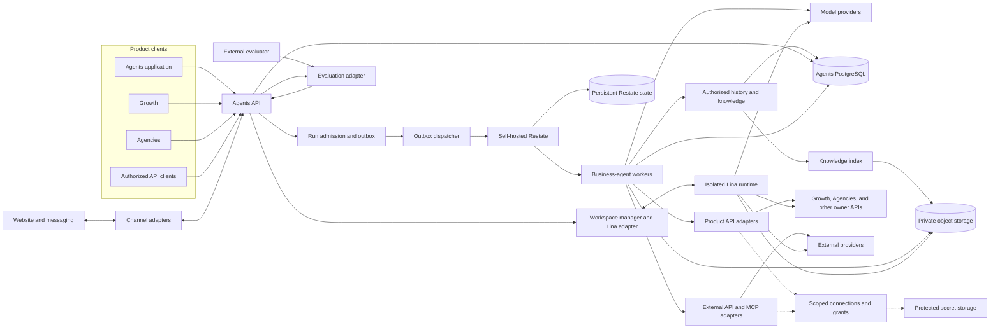

# Agents platform architecture

Updated: 2026-10-17.

This document describes the target system and the boundaries that guide implementation. It
separates those decisions from the current code, which still uses Temporal for business-agent
execution.

## Product boundary

The Agents backend serves the public Agents product, Growth, Agencies, and authorized API clients.
Each product owns its interface, permissions, records, and publication rules. Agents calls an
owning product's authenticated API. It does not read or write another product's database.

The public Agents product starts with customer support and enquiry assistance. Bookings can follow
through supported connectors. Personal assistance is another offering. It may use connected
services and an isolated Lina workspace. It is not a separate filesystem-agent product. Hosting an
agent in the shared backend does not require listing it in the public Agents catalogue.

## Target architecture

The diagram shows logical responsibilities. It does not require a separate service for every box.

The Agents API and worker roles can share one codebase and deploy as separate processes. The
workspace manager can start as a module in the API. Product and external adapters can remain
modules in the business worker until scaling or isolation requires a separate deployment. The
diagram does not select a model gateway, Redis, a general message broker, or a standalone tool
gateway. The outbox handles the Postgres-to-Restate handoff only.

## Adapter boundaries

An adapter translates a product operation or lifecycle contract into an API or protocol. A
connection identifies an authorized provider account and its protected credentials. An adapter
can serve many separately scoped connections.

| Adapter | Responsibility | Authority boundary |
| --- | --- | --- |
| Product API adapter | Calls a typed API owned by Growth, Agencies, or another Kasitek product. | The owning product validates its records, permissions, and business rules. |
| External API connector | Calls supported operations on an external provider and reconciles effect outcomes. | The Agents platform checks tenant, connection, resource scope, grants, approval, and budgets. |
| MCP client adapter | Discovers and invokes explicitly permitted tools on an authorized external MCP server. | Discovery and server authentication do not grant access to every resource reachable through that server. |
| Channel adapter | Verifies inbound provider events, preserves event identity, normalizes messages, and delivers authorized replies. | The adapter derives tenant scope from a trusted channel binding, not from model arguments. |
| Lina runtime adapter | Submits tasks to Lina and maps task identity, status, cancellation, history, and artifacts. | Lina owns its model and tool loop, runtime state, and recovery. |
| Evaluation adapter | Submits isolated, version-pinned test runs and collects evidence for a verifier. | Evaluator formats and grading stay outside ordinary agent execution. |

The business-tool path is:

1. Build the available tool list from the admitted agent version and verified execution scope.
2. Validate the tool name and arguments in trusted code.
3. Check current permissions, grants, approvals, and run budgets.
4. Resolve the scoped connection and credentials on the server.
5. Invoke the adapter with a stable operation identity and record its outcome.

Credential values never enter agent definitions, model arguments, ordinary transcripts, or client
streams. Revoked authority takes effect before a new external action. If an action has an unknown
outcome, the platform reconciles it with the provider before retrying.

Kasitek product operations have one implementation in the product that owns them. Agents calls
those product APIs. MCP may expose the same supported operations to clients that need tool discovery;
internal products do not need an MCP proxy by default. A general connector marketplace and
arbitrary uploaded server code are outside the initial scope.

## State ownership

| State | Owner | Other systems retain |
| --- | --- | --- |
| Tenant identity, membership, and permissions | Kasitek identity integration and platform access model | Verified principal and scope references |
| Agent drafts, immutable versions, connections, grants, conversations, and queryable run status | Agents PostgreSQL | Version IDs, digests, and correlation IDs |
| Business workflow position, timers, and recorded durable step results | Restate | A repairable status projection in PostgreSQL |
| Personal task execution, continuation, and native workspace state | Lina | Authorized task, status, history, and artifact references |
| Campaigns, bookings, orders, CRM facts, and external action outcomes | The product or provider that owns each record | Scoped references and operation receipts |
| Knowledge files and generated artifacts | Private object storage or the authoritative Lina workspace | Authorized references and required metadata |
| Provider credentials | Protected server-side secret storage | Opaque references only |

PostgreSQL run status is a repairable view of execution facts. It does not launch a second run.
Restate and PostgreSQL do not both own business workflow position. Keep any data that Restate needs
to replay a recorded result for at least as long as the corresponding execution can recover.

Business-agent memory belongs to a tenant, agent, and verified customer or conversation. Store
conversation history and selected facts in scoped platform records. Keep source documents in
private object storage and retrieve them through an authorized index. Current business facts remain
in the product or customer system that owns them. Memory keeps references rather than competing
copies. Anonymous visitors receive conversation-scoped context by default. Cross-conversation
private memory requires verified identity and permission.

## Business-agent execution

The target business-agent request path is:

1. The Agents API or a channel adapter establishes product, tenant, user or customer, agent,
   conversation, and grant scope from trusted identity and bindings.
2. One PostgreSQL transaction records the accepted request, stable run identity, selected immutable
   agent version, and an outbox command.
3. The dispatcher sends the command to Restate with a stable invocation identity. It can retry
   delivery without creating another logical run.
4. Restate invokes business handlers. Handlers put model calls, external effects, and other
   nondeterministic work inside the supported durable call boundaries.
5. The worker retrieves only authorized history, memory, knowledge, and current business data.
6. Trusted code validates each requested tool action, checks current authority and budgets, then
   calls its adapter.
7. The worker records meaningful outcomes and delivers replies through the authorized channel.

Published versions pin instructions, model settings, knowledge revisions, tool bindings, and policy
configuration. Runs keep the version admitted at start. Edits do not change in-flight permissions
or behavior. The platform still checks current authority when an action executes.

Human takeover changes conversation ownership before new automated work proceeds. The system stops
admitting actions under the old ownership generation and requests cancellation of active reasoning.
Already-started or uncertain external actions may still finish. The interface reports their actual
outcome rather than implying that takeover undid them.

Restate provides durable execution, timers, waits, and recorded results. It does not provide
business authorization, tenant isolation, sandboxing, human ownership, or task grading. Use Restate
services, keyed objects, and workflows where their documented behavior fits the request. Do not
hold conversation coordination while a model call or approval waits.

Agent delegation remains explicit. A child task gets only the capabilities granted to it. The
platform records parent, child, and root-task identities separately and applies time, spending,
concurrency, and delegation-depth limits across the root task. A first delegated use case needs
verified lifecycle, cancellation, replay, and failure behavior before the platform supports general
agent teams.

## Personal assistance through Lina

The Agents API creates a stable personal-task request. The workspace manager locates or provisions
the authorized isolated workspace and submits the task to Lina through a versioned headless
contract. The platform maps its run ID to Lina's task identity, follows status, requests
cancellation, and returns authorized history and artifacts. Reconnect follows the original task;
it does not submit a duplicate.

Lina owns its model and tool loop, history, continuation, permission decisions, and recovery. This
path does not depend on Restate or Temporal. The Agents platform owns workspace allocation and the
user-facing lifecycle. Any credentials Lina needs must remain scoped, revocable, and outside task
prompts.

## Tenant boundaries and capacity

Every request and background task carries verified tenant and resource scope. Resource IDs do not
grant access. The platform enforces scope at admission, database access, retrieval, connection
lookup, tool calls, artifacts, exports, and live subscriptions. Prompt instructions do not enforce
access control.

Use scoped database access and row-level security as complementary controls. Runtime roles cannot
bypass those policies. Bind tenant context to each transaction when the connection pool reuses a
database connection. Include tenant, resource, and permission scope in shared cache keys.

Shared API, worker, and database infrastructure is the default. A configured agent does not need a
permanent process. Capacity depends on active work, provider limits, tool latency, storage, and
database load. Add separate worker pools or dedicated resources only when measurements or a
customer isolation requirement justify them. No throughput or availability target has been
verified.

## Current implementation

The current Agents service has a TypeScript and Fastify API, PostgreSQL records, channel and tool
integrations, and a Temporal worker for durable business-agent runs. Some immediate runs can execute
inside the API. Current Temporal behavior is documented in [workflow execution](workflow-execution.md)
and [Temporal recovery](../runbooks/temporal-recovery.md).

Self-hosted Restate and the PostgreSQL outbox handoff are the target for business-agent execution.
Neither is implemented or accepted in this checkout. The Lina workspace integration is also not
implemented. Temporal evidence does not satisfy the Restate target. These runtime dependencies
remain separate from the current agent setup UI. Do not accept the target runtime until an isolated
Restate run proves replay, cancellation, outbox redelivery, and safe handling of uncertain external
effects.

## Related contracts

- [Implementation status](../source-boundary.md)
- [Security boundaries](../THREAT_MODEL.md)
- [Login and sessions](platform-login.md)
- [Tenant isolation](tenant-isolation-inventory.md)
- [Workflow execution](workflow-execution.md)
- [Memory lifecycle](memory-lifecycle.md)
- [MCP integration](../mcp-integration.md)
