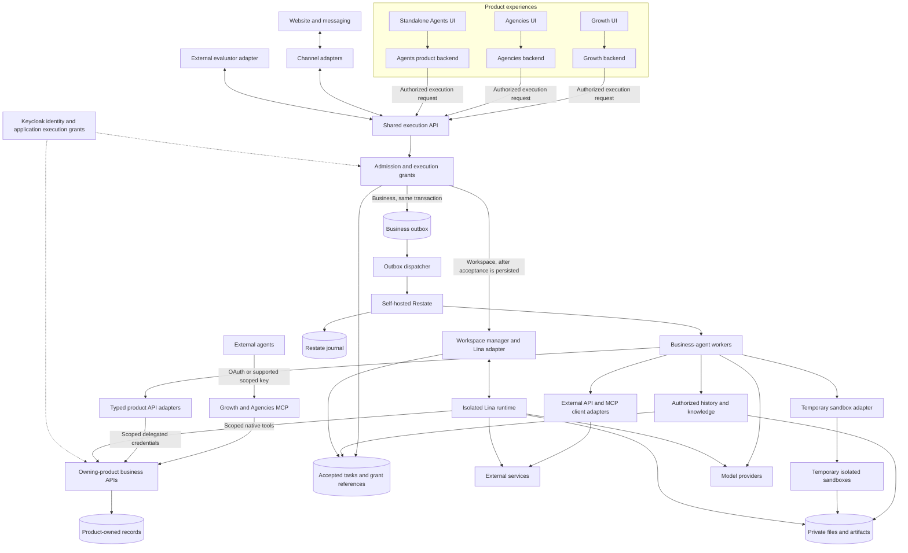
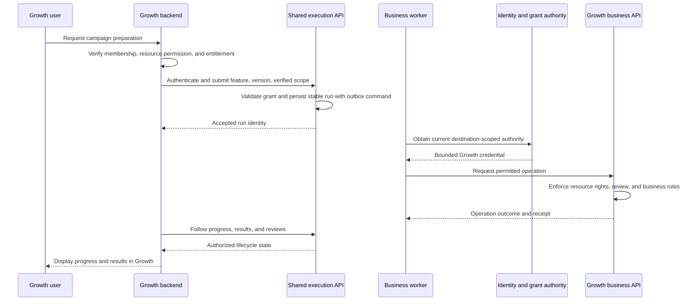

# Agents platform architecture

Updated: 2026-10-17.

This is the target architecture agreed with the owner. It defines the shared execution service
and the standalone Agents product separately. Design against these boundaries first. Existing
code is reusable only where it fits. This is a new product built with fresh schemas. Existing
data, histories, credentials, endpoints, and clients impose no migration, preservation, or backward-compatibility
requirements. Legacy data retention is not a prerequisite. The [implementation status](../source-boundary.md) describes
the legacy checkout; it does not constrain the replacement design.

## Product experience and ownership

| Surface | Customer experience | Authority |
| --- | --- | --- |
| Growth | Users initialize and use content, campaign, and guidance features inside Growth. | Growth membership, resource permissions, commercial entitlement, and business rules. |
| Agencies | Users initialize and use agency agent features inside Agencies. | Agencies membership, client and workspace boundaries, entitlement, and business rules. |
| Standalone Agents | Customers configure support, FAQ, and personal agents through the Agents product. | Agents-product membership, resources, entitlement, and publication rules. |
| Shared execution service | Backends submit authorized work and retrieve progress, results, and reviews. | Authenticated caller plus a validated, bounded execution grant. |

A Growth or Agencies customer does not need an Agents-product account, membership, subscription,
or dashboard visit to use embedded agent features. Execution records retain the verified initiating
user or organization automation identity without manufacturing an Agents-product membership.
Shared human login is compatible with separate product access. Products need not have identical
organization, workspace, client, or resource structures.

Each product owns its interface, business records, and customer authorization. The execution
service calls owning-product APIs and never reads or writes another product's database. Ordinary
product features operate without the execution service. Agent-powered features may depend on it
and must report its unavailability in their own interface.

## Three integration boundaries

| Direction | Contract | Responsibility |
| --- | --- | --- |
| External agents to Growth or Agencies | Product MCP protected by OAuth; deliberately supported, scoped API keys may also be offered. | The product authorizes external clients and exposes its permitted business operations. Connecting does not create an agent definition, version, or installation in the shared execution service. |
| Product backend to shared execution API | Authenticated internal submission, status, progress, results, approval, cancellation, and conversation contracts. | The product verifies access and entitlement. Execution admission validates bounded delegated authority for a permitted agent feature and version. |
| Executing agent to product business API | Typed API adapter using destination-specific scoped delegated credentials. | Trusted execution code proposes no authority of its own. The destination independently enforces resource access, review requirements, and business rules. |

Internal calls do not require MCP. Product APIs and external MCP expose the same owning-product
business operations and permission rules. External MCP does not replace embedded product execution.
The shared service may also use MCP client adapters to connect permitted third-party tools.

## Target architecture

The diagram shows logical modules. Product APIs, product MCP, and product backends can share a
product deployment. The standalone Agents backend and execution API can initially share a codebase
or process where their access boundaries remain explicit.



Admission selects one execution contract. Every accepted task has a persisted stable identity.
Only business tasks enter the Restate outbox; Lina submission follows its own accepted task.
Both paths use verified scope and common user-facing lifecycle conventions. Business
workflow recovery belongs to Restate. Lina owns its task execution and recovery. No default
Restate supervision layer is added around Lina. Adapters remain modules until scaling or isolation
requires separate deployments. No general message broker, Redis service, or standalone tool
gateway is selected by this diagram.

## Identity and authorization

The initial platform uses self-hosted Keycloak 26.6.0 with OIDC authorization code, PKCE, state and
nonce, plus separate browser and execution-service registrations. Fresh Agents records own product
membership and revocable bounded execution grants. Keycloak caller identity alone grants no tenant
authority. Growth and Agencies resource mapping and delegated product-token policy remain later work.

| Concept | Target responsibility |
| --- | --- |
| Human identity | Verified issuer and subject, independent of product access. |
| Organization or tenant ownership | Explicit ownership references and validated mappings across product boundaries. |
| Product membership | Access to a particular product; membership in one does not imply membership in another. |
| Product workspace and resource permissions | The owning product resolves permitted clients, workspaces, records, and operations. |
| Backend service identity | Growth, Agencies, and Agents backends authenticate as distinct applications. Caller identity alone grants no customer access. |
| Organization automation identity | Explicit owner and revocable grants for scheduled or background work. |
| Run identity and correlation | Stable accepted task, initiating principal, acting service, grant, feature version, and causal audit references. |

IDs and scope fields in a request are not self-authorizing. Admission validates the caller's right
to request the feature and the trusted product authorization behind its execution grant. The standalone Agents backend validates its browser session and product membership before
submitting authorized work. Embedded Growth requests instead carry Growth-validated scope from
its authenticated backend. Both enter shared execution through explicit service admission.
Execution tenant references must not assume that product workspace IDs are interchangeable.

### Execution grant

The initial application grant is a persisted record validated at admission and before model effects.
It identifies the initiating human or website visitor, authenticated caller, product, organization,
resource, immutable version, approved knowledge, operations, limits, expiry and revocation. Standalone
grants last at most 30 minutes; visitor grants last 10 minutes. Automation and embedded-product
issuance remain unavailable. This record is not a universal OAuth schema.

| Field group | Content |
| --- | --- |
| Origin and ownership | Origin product, organization, and product-specific workspace or resource scope. |
| Principal and caller | Verified initiating human or automation identity, acting backend, and issuer references. |
| Feature | Permitted agent feature, immutable version, and stable request identity. |
| Authority | Allowed operations, connection and resource restrictions, and required reviews. |
| Limits | Lifetime, usage allocation, and relevant task or delegation limits. |
| Lifecycle | Grant identity, owner, current validity, revocation, and run correlation. |

User-delegated work uses a bounded subset of current authorized rights. Background work uses an
explicit organization automation grant with its own scope and lifetime. It does not retain a
browser session as permanent authority. The execution service validates or adopts grants through
trusted product authorization before admitting work. The issuer, storage owner, validation mechanism,
and exact wire schema remain decisions.

OAuth Token Exchange is a candidate for obtaining destination-specific delegated credentials while
retaining subject and acting-service identity. Provider support and policy must be verified.
Credentials intended for execution admission cannot simply be forwarded to Growth or Agencies.
Destination services validate the applicable issuer, signature, expiry, audience, and actual
resource permissions. Token exchange alone defines neither tenant policy nor application reviews,
durable grants, or immediate revocation. See [RFC 8693](https://www.rfc-editor.org/rfc/rfc8693.html)
and [OAuth security best practice](https://www.rfc-editor.org/rfc/rfc9700.html).

### Embedded campaign request



The worker represents the Restate business path after durable dispatch. The authority participant
is a logical responsibility, not a selected new service. Rejected grants and missing entitlement
produce no accepted work. Repeated requests resolve to the same authorized logical run under the
agreed idempotency contract.

## Agent definitions and runtime contracts

The target model separates an agent or product feature, its immutable configuration version,
execution grant, connection, deployment binding, and run or task. The execution discriminator below
is settled. The remaining configuration and wire schemas still need definition.
An embedded feature can reference a product-managed version without creating a standalone Agents
subscription or customer-owned agent record.

Remove `system_hosted`, `kasitek_hosted`, and `external_connected` as target categories. Retire
protected KasiAi identity, bootstrap, dedicated controls, and implicit privileges. Future Growth
and Agencies guidance agents use ordinary feature/version and authorization contracts. Their role
comes from configuration and permitted operations.

Legacy `general`, `custom`, and audience fields do not define the replacement data model. Product
use cases, interaction policy, runtime binding, and deployment are separate decisions. A private
support-agent test is not a different personal-assistant offering. An external MCP client is an
integration principal and does not need a fabricated agent installation.

Published versions pin instructions, model settings, knowledge revisions, tool bindings, and
policy configuration. Each run records its admitted version. Current grants, resource permissions,
and required reviews are still checked before effects. A deployment can bind a version to a
website or channel without a hosting-mode enum.

### Two technical execution categories

Each immutable agent version declares exactly one `executionKind`:

```ts
type AgentExecutionKind = "business" | "workspace";
```

| Category | Execution owner | Supported behavior |
| --- | --- | --- |
| `business` | Our agent execution code runs on shared workers. Restate coordinates durable work. | Model-directed planning and tool use, agent delegation, defined workflow stages, approvals, schedules, and optional temporary execution sandboxes. |
| `workspace` | Lina executes inside an isolated workspace and owns its native runtime lifecycle. | Native model and tool loop, files, commands, browser work, workspace state, continuation, and recovery. |

Admission routes the version's `executionKind` to the business execution backend or the Lina
adapter. A caller cannot override the category in a message or bypass its grants by changing a
label. Technical execution category grants no permissions by itself.

Research agents, campaign managers, social-media agents, support agents, and FAQ agents can all
use `business`. Their purpose and enabled capabilities differ. They do not require separate
engines or services. `business` supports a model-directed agent loop, including planning and
subagents. Defined workflows enforce required stages and can invoke agent loops. Agents may
request permitted workflows. Conversation, asynchronous work, and workflow coordination are
execution patterns within this backend, not additional agent categories.

Lina is a separate execution owner. A business agent using an isolated browser or code tool keeps
`executionKind: "business"`; that capability does not change it into a workspace agent.
Subagents are configured agents invoked under bounded child-task authority. Websites and messaging
are channels. Sandboxes are execution resources. None adds a third category.

### Common platform lifecycle

Both categories implement the same platform operations while keeping their native runtime state
and recovery ownership separate. These are contract responsibilities, not selected HTTP paths.

| Contract | Required behavior |
| --- | --- |
| Submission | Validate scope, version, grants, and limits; record a stable accepted task and runtime reference. Repeated authorized requests do not create another task. |
| Status and progress | Return factual state and bounded progress. Reconnect reloads the accepted task instead of submitting it again. |
| Cancellation | Record the request and report the confirmed outcome or remaining uncertainty. A transport disconnect alone is not proof of termination. |
| Result | Report completion or failure with meaningful output, delivery state, and any uncertain operations. |
| History and artifacts | Return authorized records or references under current product, tenant, and resource policy. Do not force Lina's internal state into a Restate journal. |

Business admission commits the accepted task and outbox command atomically. The workspace path
persists its accepted identity and follows the original Lina task without a Restate dependency.
Exact Lina submission deduplication and lifecycle mapping must be verified against its contract.

### Business-agent capability configuration

An immutable business-agent version configures these capabilities explicitly. Current grants and
resource permissions still bound their use at execution time.

| Configuration | Contract |
| --- | --- |
| Instructions, model, and limits | Purpose, model settings, context selection, and bounded execution time and spending. |
| Knowledge | Approved source revisions and retrieval permissions. |
| Tools and connections | Selected operations and authorized accounts with resource restrictions. |
| Delegation | Enabled or disabled; allowed child agent versions, bounded grants, and root-task concurrency, depth, time, and spending limits. |
| Temporary sandboxes | Enabled or disabled; permitted operations, authorized inputs, resource and network limits, lifetime, and artifact rules. |
| Workflows and reviews | Permitted workflows and stages enforced by trusted code, including reviews required before effects. |
| Triggers | Authorized user requests, channel messages, schedules, or events. Background work requires its explicit automation grant. |

The initial platform delegation contract supports `business` parent tasks invoking `business`
child tasks. Cross-runtime delegation requires a separately defined contract before it is enabled.
Each child has stable parent, child, and root-task identities. Retries follow that child rather
than starting another one. A child receives a bounded task, explicitly granted tools and resources,
and an allocation within the root budget. Delegation does not multiply the available authority or
spending limit. Parent completion, failure, timeout, and cancellation behavior for children must be
specified and verified against the selected Restate mechanisms before enabling delegation.

### Temporary execution sandboxes

A business agent or permitted subagent can request temporary isolated compute for code, browser,
or file-processing tools. Trusted code authorizes and provisions the resource; generated code
runs outside shared trusted workers. Restate provides durable coordination, while the sandbox
provides isolated compute. A sandbox is not the persistent Lina workspace runtime.

The sandbox adapter binds each allocation to an authorized task or subtask and a stable operation
identity. It defines permitted reuse within that scope, expiry, and destruction. Parent sandbox
access, credentials, and files are not inherited by a child. Any sharing needs explicit grants.

Before enabling the capability, define CPU, memory, storage, concurrency, network access, filesystem,
credential injection, time, and spending limits. Define how validated inputs enter and authorized
results and artifacts leave. Required outputs must be captured before cleanup. Expiry, cancellation,
worker failure, and retries need verified outcomes. A lost response cannot trigger blind repetition
of a command with unknown external effects. The provider, isolation technology, exact limits,
allocation API, and recovery behavior remain unselected.

### Minimal website FAQ configuration

A website FAQ agent is a `business` agent using approved knowledge retrieval. Its configuration
contains instructions, approved knowledge sources, model and execution limits, and a website
binding to a selected immutable version. Safe defaults keep the creation form short.

For this minimal configuration, delegation and sandbox access are explicitly disabled. No external
business-action tools, extra workflows, or scheduled triggers are enabled. Knowledge retrieval
remains available within the approved public-source scope. Enabling more capabilities later
requires an explicit configuration and authorization change, not a new execution category.

A campaign manager may enable research and creative subagents, approved tools, temporary sandboxes,
and a required publication review. A research agent may enable search, analysis tools, and delegated
research tasks. Both use the same business execution backend as the FAQ agent, with different
capability configurations and grants.

## State ownership

| State | Owner | Other systems retain |
| --- | --- | --- |
| Human identity and authenticated applications | Selected identity infrastructure | Verified subject, issuer, and service references. |
| Product membership, entitlements, permissions, and domain records | Growth, Agencies, or standalone Agents product | Validated scope, authorization references, and operation receipts. |
| Accepted runs, versions, grant references, conversations, and queryable status | Shared execution records under verified product and tenant scope | Stable IDs and authorized projections. Exact product-configuration ownership is part of the schema design. |
| Business workflow position, timers, and recorded step results | Restate | Repairable status projection in PostgreSQL. |
| Workspace task execution, context, continuation, and workspace state | Lina | Authorized task, history, status, and artifact references. |
| Business facts and accepted external effects | Owning product or provider | Scoped references and confirmed or uncertain operation outcomes. |
| Knowledge files and generated artifacts | Private object storage or authoritative Lina workspace | Authorized references and required metadata. |
| Credentials | Protected secret storage and selected authorization infrastructure | Opaque references outside model context and ordinary transcripts. |
| Execution usage | Shared execution metering | Stable run, operation, and attempt attribution. |

Product permission truth remains with the product even when execution records retain a grant
reference. PostgreSQL status is a repairable projection of runtime facts and cannot launch a
second run. Reference data needed to recover a recorded runtime result must outlive that recovery
window.

## Business-agent durable execution

1. The product backend or verified channel binding establishes caller, product, tenant, principal,
   conversation, and permitted feature scope.
2. Admission validates the execution grant. One PostgreSQL transaction records the accepted task,
   immutable version, grant reference, and outbox command.
3. The dispatcher delivers a stable invocation to Restate. Delivery retries do not create another
   logical run.
4. Restate invokes business handlers. Model calls, external effects, and other nondeterministic
   operations use supported durable boundaries.
5. Trusted context retrieval and tool execution enforce current grants, resource scope, required
   reviews, and budgets. Destination credentials are obtained for the actual target API.
6. The worker records bounded outcomes and delivers through the authorized channel or requesting
   product. Reconnect follows the existing task.

Restate stores grant references, not permanent authority. Resume and new actions require valid
current credentials and policy checks. Revocation prevents future authorized effects according to
the selected enforcement contract. It cannot undo an already accepted external effect. Unknown
outcomes require reconciliation before retry.

Human takeover changes conversation ownership before admitting new automated actions. Active
reasoning receives a cancellation request. Already-started operations can still complete and must
report their actual outcome. Restate cancellation propagation for the selected server and SDK,
including child lifecycles, remains unverified.

Delegated agents use established runtime mechanisms and explicitly bounded child grants. A child
cannot exceed delegated authority. Parent, child, and root-task identities, spending, concurrency,
and depth limits remain distinct. General teams follow a verified bounded delegation use case.

## Workspace-agent execution through Lina

The execution API accepts an authorized `workspace` task, such as a personal-assistant request. The workspace manager locates or provisions
the isolated workspace and maps the stable platform request to Lina's task identity. It follows
status, requests cancellation, and returns authorized history and artifacts. Reconnect does not
resubmit the task.

Lina owns its native model and tool loop, context, continuation, history, permission mechanisms,
and recovery. This path requires neither Restate nor Temporal. The platform remains responsible
for granting bounded workspace and connection access, credential delivery, resource limits, and
the user-facing lifecycle. Platform-supplied credentials must preserve destination and resource
scope without appearing in task prompts. Provider and isolation technology remain unselected.

## Adapter boundaries

| Adapter | Responsibility | Authority boundary |
| --- | --- | --- |
| Product API | Calls typed Growth, Agencies, or other product operations. | Destination verifies delegated authority and current product rules. |
| External API or MCP client | Invokes explicitly selected provider operations. | Scoped connection, grants, resource limits, reviews, and effect reconciliation. |
| Channel | Verifies provider ingress, preserves event identity, and delivers replies. | Tenant and conversation authority come from trusted bindings. |
| Temporary sandbox | Provisions isolated, task-scoped compute and exports authorized results. | Explicit tool grants, resource and network limits, bounded lifetime, and verified cleanup. |
| Lina runtime | Maps submit, status, cancel, history, and artifacts. | Lina owns execution; platform grants bound accessible workspaces and services. |
| Evaluation | Submits isolated version-pinned trials and collects evidence. | Generic execution contracts; evaluator formats and grading stay outside ordinary execution. |

Trusted tool code validates arguments, derives scope, checks current policy, resolves credentials,
invokes the adapter with a stable operation identity, and records the outcome. Models propose
operations; they do not issue grants. Authenticated tool results and retrieved documents remain
untrusted content. A general marketplace and arbitrary uploaded server code are outside the
initial support slice.

## Entitlements, metering, and billing

Product-plan entitlement, individual permission, and run execution authority are separate checks.
A paid campaign feature does not let every employee publish. Products own commercial packaging.
The shared backend owns execution metering and runtime limits.

The initial standalone platform owns execution quota reservations and an operation-keyed usage
ledger in its dedicated PostgreSQL database. Admission reserves a conservative token allocation;
settlement accounts known usage once, or the reservation for uncertain model outcomes. Limits are
16 KiB model input, 1,024 output tokens, 120 seconds per model request, two concurrent tasks per
organization and 100,000 accounted tokens per UTC day. These are initial development ceilings.
Commercial billing ownership and future product entitlements remain separate decisions. Growth
credits are not a platform dependency.

## Tenant isolation, memory, and capacity

Enforce verified product, tenant, and resource scope at admission, database access, memory,
retrieval, connections, tools, files, exports, streams, and background work. Account and workspace
IDs across products require validated mappings. Combine database scoping and row-level security
where appropriate; runtime roles must not bypass the selected isolation policy.

Business history and selected memories retain explicit ownership and source access. Documents
remain in private storage behind authorized retrieval. Current business facts stay in their
owning product. Anonymous public questions receive conversation-scoped context. Private memory
across conversations requires verified identity and permission.

Shared workers and data infrastructure are the long-term default. A configured agent needs no
permanent process. Isolate code and computer execution, bound resource use and telemetry, and add
dedicated capacity only for measured load or explicit isolation requirements. Availability,
throughput, and multi-replica stream behavior remain unverified.

## Current implementation and remaining decisions

The initial implementation replaces the inherited Agents backend with fresh platform modules and
schema. It provides OIDC product sessions, organization membership, drafts, immutable versions,
approved text knowledge, explicit website bindings, bounded grants, atomic task/outbox/usage
admission, a Restate business worker and a small create/configure/test/publish interface. The
legacy Temporal, protected KasiAi, hosting-mode and synthetic-installation implementation is
removed. No existing database has been migrated or modified.

Restate server 1.7.13 and TypeScript SDK 1.17.3 are pinned and tested together. Keyed workflows use
the accepted task ID. Workflow and journal retention are seven days; outbox retry is limited to
24 hours and settled tasks are not dispatched again. Lost provider responses and interrupted
operations can remain uncertain. Cancellation requests do not imply that a model call stopped.
See the [runtime reference](../../../../infra/agents-runtime/README.md).

Exactly two execution categories exist in the configuration contract. Only the minimal business
FAQ is available in this milestone. Workspace execution fails before acceptance. Delegation,
sandboxes, business-action tools, schedules and additional workflows remain disabled. No Lina,
external MCP, Growth or Agencies integration is claimed by the initial delivery.

The remaining decisions cover embedded-product authorization and resource mapping, destination
credentials, automation/review policy, commercial billing, private file storage, other channels,
Lina hosting, sandbox isolation, and production runtime/observability operations. There is no
legacy migration or compatibility requirement. Requirements and checklists stay in Linear;
repository documents describe contracts and maintained behavior.

## Related records

- [Multi-product foundation specification](https://linear.app/kasitek/document/agents-multi-product-execution-foundation-and-architecture-reset-01fcce619f68)
- [Downstream support delivery](https://linear.app/kasitek/document/agents-recoverable-support-run-and-website-acceptance-e9c335ebe5bc)
- [Implementation status](../source-boundary.md)
- [Integration boundaries](../mcp-integration.md)
- [Security boundaries](../THREAT_MODEL.md)
- [Platform login](platform-login.md)
